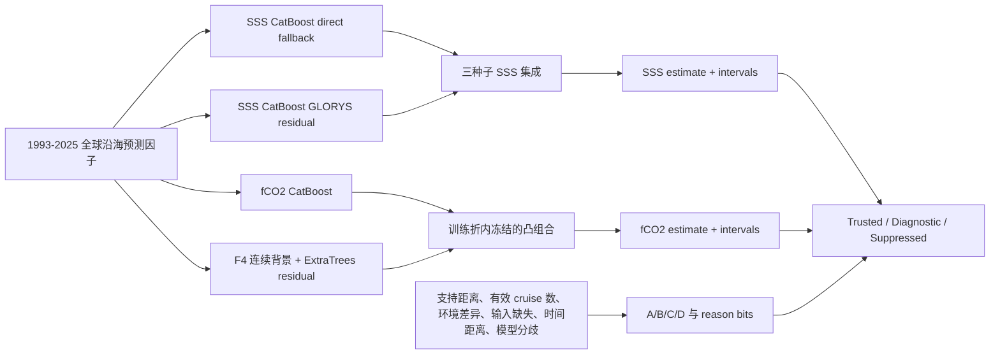

# ReCAD v2.4 当前方案与阶段结果

> 状态日期：2026-10-15  
> 当前版本：ReCAD v2.4.0  
> 产品时间范围：1993-01 至 2025-12  
> 当前结论：全球沿海 SSS/fCO2 条件发布完成；TA/DIC 不进入本版产品

## 1. 执行摘要

ReCAD v2.4 的核心目标是构建逐月全球沿海 SSS 和 fCO2 产品，并为每个网格月同时给出不确定性、适用性等级、发布状态、失败原因和数据来源。项目不再追求由一个统一的四输出网络同时生产 SSS、fCO2、TA 和 DIC。现阶段证据支持以下产品边界：

- **SSS**：全球沿海提供完整模型估计；A/B 为可信层，C 为诊断层，D 抑制。
- **fCO2**：全球沿海提供完整模型估计；Pacific 以外的 A/B 为可信层，Pacific A/B 和全部 C 为诊断层，D 抑制。
- **TA/DIC**：北美区域实验没有满足进入产品的条件，本版不发布。
- **2026**：不进入核心产品；正式时间轴截至 2025-12。

最终模型不是 STTransformer。经过统一数据、统一外层折、统一预算和统一指标的有限模型族比较后，当前产品采用：

- SSS：三随机种子的 **CatBoost 背景残差集成**；在 GLORYS SSS 可用时学习观测与背景之差，在背景缺失时使用同折 direct fallback。
- fCO2：**CatBoost 与 F4 连续背景残差模型的凸组合**；CatBoost 权重冻结为 0.30，组合权重只由训练折内的 inner-OOF 结果确定。

P3 最终验证不依赖另一个观测数据集。它从 SOCAT v2026 中依据元数据冻结 50 条完整 cruise，并把这些航次从模型拟合、背景拟合、上游 SSS、校准、风险模型、阈值和支持索引中全部排除，再一次性读取目标值。该实验回答的是同一数据体系内对**未见航次、稀疏位置和较新时间**的迁移能力，不支持跨传感器、跨 QC 系统或跨数据产品的泛化声明。

在 50 条完整留出航次上：

| 目标 | 全部样本 RMSE | MAE | Bias | R² | 90% 覆盖率 | A/B RMSE | A/B 90% 覆盖率 |
|---|---:|---:|---:|---:|---:|---:|---:|
| SSS | 1.185 PSU | 0.570 PSU | 0.067 PSU | 0.773 | 0.910 | 0.598 PSU | 0.927 |
| fCO2 | 30.780 µatm | 19.442 µatm | -3.371 µatm | 0.592 | 0.883 | 26.619 µatm | 0.904 |

严格重训的 ReCAD v1.x Random Forest 在相同留出航次和共同样本上的 fCO2 RMSE 为 41.100 µatm，ReCAD v2.4 为 30.325 µatm，改善 26.2%。在保持 cruise 身份的共同 0.25° 比较中，RMSE 从 42.424 降至 31.014 µatm，改善 26.9%。两项均超过冻结的 5% 改进门槛。

## 2. 科学问题和产品定义

项目研究的是全球沿海月尺度海洋碳系统重建。沿岸区域具有强烈的河流输入、近岸混合、水团边界、生物过程和采样不均衡，仅依靠经纬度或一个全球统一回归关系不足以保证未采样区域的可靠性。因此产品被定义为“估计值 + 可信边界”，而不是只有一个无条件连续场。

当前产品的科学问题分为三层：

1. **能否估计已有观测支持附近的 SSS 和 fCO2？**
2. **模型能否迁移到未参与训练的完整航次、稀疏位置和较新时间？**
3. **产品能否明确标出不能可靠回答的网格月？**

第三层与预测精度同等重要。ReCAD v2.4 保留完整模型估计以便审计，但正式分析应使用单独的 `trusted_prediction` 或 `diagnostic_prediction` 变量，不能把 suppressed 网格静默填入分析。

## 3. 空间和时间范围

- 时间范围：1993-01 至 2025-12，共 396 个月。
- 空间表示：全球沿海压缩节点，共 838,661 个 coastal nodes。
- 产品外边界：距显著陆地不超过 400 km。
- 大陆架核心：以水深不超过约 200 m 的 shelf-core 概念单独标识；它是地貌分层，不替代 400 km 产品边界。
- 全球模型覆盖与全球可信覆盖分开报告。

每个目标产品维度均为 `396 × 838,661`，但平均可信面积远小于完整计算区域：

| 目标 | Trusted 平均面积比例 | Diagnostic 平均面积比例 | Suppressed 平均面积比例 |
|---|---:|---:|---:|
| SSS | 20.61% | 8.91% | 70.47% |
| fCO2 | 12.28% | 18.61% | 69.11% |

这些比例说明产品已经能够生成完整估计，但当前观测证据只支持其中一部分作为可信分析层。

## 4. 数据和输入方案

### 4.1 监督目标

- SSS：SOCAT v2026 中的原位盐度。
- fCO2：SOCAT v2026 中的推荐 fCO2。
- TA/DIC：CODAP-NA/GLODAP 表层观测只用于区域开发和诊断，没有进入 v2.4 全球产品。

### 4.2 全球动态场和静态场

核心候选输入包括：

- 时间：中心化年份、月份正弦和余弦。
- 位置：经纬度的周期编码。
- 沿岸地貌：距显著陆地距离、水深、陆架核心标识、陆坡/深水标识。
- 环境：SST、风速和大气 xCO2。
- SSS 专用背景：GLORYS 月平均 SSS 及其可用性标记。

ADT、叶绿素、MLD、河流流量和附加过程代理没有被设为产品必需输入。ADT 在物理上与 dynamic height 有关，但当前月尺度、当前分辨率和当前验证设计下没有为 SSS 或 fCO2 提供稳定的外层折增益，因此没有进入正式产品模型。叶绿素和其他过程变量的共同覆盖、时间范围或迁移增益也不足以成为必需场。

### 4.3 fCO2 的 SSS 使用原则

fCO2 不使用同一条观测记录中的真实 SSS 作为输入。在需要上游 SSS 的实验中：

- 外层训练内部采用完整 cruise 分组的 cross-fit SSS；
- 校准和留出 cruise 的 SSS 只能由未包含该 cruise 的模型产生；
- 最终选择的 fCO2 产品组合不依赖 SOCAT 观测 SSS 的泄漏路径。

这避免了发布时不可获得的真实盐度造成虚假的验证技能。

## 5. 当前模型结构

### 5.1 SSS

SSS 使用 GLORYS 作为连续背景，但不把 GLORYS 当作真值。模型学习：

\[
SSS_{obs} = SSS_{GLORYS} + \Delta SSS_{ML}
\]

背景可用时由 CatBoost 预测残差；背景不可用时使用相同外层训练数据拟合的 direct fallback。三个冻结随机种子的结果用于降低随机训练波动。

### 5.2 fCO2

fCO2 最终候选是两个误差结构不同的模型组合：

- CatBoost：学习环境、空间和季节关系。
- F4：连续球面—季节—趋势背景加 ExtraTrees 残差模型。

组合形式为：

\[
\widehat{fCO2}=0.30\,\widehat{fCO2}_{CatBoost}+0.70\,\widehat{fCO2}_{F4}
\]

0.30 权重在最终完整航次验证前冻结。它来自训练折内 OOF 误差，而不是留出 cruise 的结果。

### 5.3 为什么不是 STTransformer

模型族比较覆盖 Ridge、Random Forest/ExtraTrees、CatBoost、XGBoost、残差 MLP、数值 FT-Transformer，以及早期时空网络和图结构候选。结果表明：

- 当前主要限制是观测覆盖和分布迁移，而不是模型容量不足。
- MLP 和 FT-Transformer 在相同输入、相同折和相近预算下没有超过树模型。
- 旧 GRU/ST96/四邻接实现整体退化，不能通过扩大相同实现解决。
- 相邻网格残差相关只证明存在空间结构，不证明图模型一定更好。
- 复杂模型在普通插值折上可能有局部优势，但在 geographic、whole-region 或 forward transfer 中经常退化或区间欠覆盖。

因此 v2.4 采用数据条件下更稳定、可审计且在完整 cruise 验证中通过条件门槛的树模型组合。未来如果新增过程信息或显著扩大观测覆盖，可以重新比较 Transformer、图网络或神经算子，但不能因模型更新颖而直接替换当前方案。

## 6. 验证设计

### 6.1 开发阶段外层折

所有模型选择基于修复后的分组验证合同：

- complete-cruise holdout；
- geographic block 加 100 km buffer；
- whole-region holdout；
- past-only rolling-forward；
- 预处理、上游预测、组合权重、风险模型和区间校准全部嵌套在外层训练数据内。

2004–2005 只作为历史比较，不再作为独立测试。

### 6.2 P3 完整航次留出

最终验证从 SOCAT v2026 中按元数据冻结 50 条完整 cruise：

- SSS 8,469 行；fCO2 8,470 行。
- 23 条为 2022–2025 recent cruises。
- 27 条来自 cruise 密度最低的 5° 稀疏块。
- 覆盖 Arctic、Atlantic、Pacific、Indian 和 Mediterranean 五个 basin，每个 basin 至少 6 条。
- 选择过程不读取 SSS 或 fCO2 目标值；相同条件用 salted SHA256 确定选择顺序。

每条留出 cruise 均从以下路径排除：

- 点模型拟合；
- 连续背景拟合；
- fCO2 上游 SSS cross-fit；
- 校准样本；
- 风险模型和阈值；
- 支持距离和有效 cruise 数索引。

目标标签只打开一次，访问次数固定为 1。该设计比随机抽行更接近真实产品面对新航次的条件，同时不把“换一个数据集”错误地当作问题本身。

## 7. 最终验证结果

### 7.1 汇总指标

| 目标 | 行数 | Cruise 数 | RMSE | Cruise-equal RMSE | MAE | Bias | R² | Coverage 50 | Coverage 90 |
|---|---:|---:|---:|---:|---:|---:|---:|---:|---:|
| SSS | 8,469 | 50 | 1.185 PSU | 2.445 PSU | 0.570 PSU | 0.067 PSU | 0.773 | 见归档表 | 0.910 |
| fCO2 | 8,470 | 50 | 30.780 µatm | 45.942 µatm | 19.442 µatm | -3.371 µatm | 0.592 | 见归档表 | 0.883 |

Cruise-equal RMSE 明显高于逐行 pooled RMSE，说明少数困难航次会被大量普通观测行掩盖。因此产品判断不能只引用 pooled RMSE。

### 7.2 可信层结果

| 目标与范围 | RMSE | Coverage 90 | 相对背景技能 | 决定 |
|---|---:|---:|---:|---|
| SSS A/B，全部有代表 basin | 0.598 PSU | 0.927 | 0.799 | Trusted |
| fCO2 A/B，合并范围 | 26.619 µatm | 0.904 | 0.666 | 需区域限制 |
| Pacific fCO2 A/B | 见区域表 | 0.845 | 正技能 | Diagnostic；未达到 0.85 门槛 |
| C | 目标相关 | 低于可信合同 | 不稳定 | Diagnostic |
| D | 高风险尾部 | 不满足 | 不稳定 | Suppressed |

### 7.3 时间和空间迁移

| 目标 | Recent cruises RMSE | Sparse-block cruises RMSE |
|---|---:|---:|
| SSS | 0.738 PSU | 1.487 PSU |
| fCO2 | 25.498 µatm | 35.005 µatm |

较新时间并不是当前最严重的问题；缺少邻近 cruise 支持的空间迁移更困难。这支持把空间支持和环境差异写入每个网格月的可信标记。

### 7.4 保留的失败案例

最差完整航次为 `187F20250215`：

- SSS RMSE：15.947 PSU；
- fCO2 RMSE：266.792 µatm；
- 产品等级：D。

这是强淡水影响系统。等级系统识别了该场景，但区间仍不能覆盖其巨大误差。因此 grade D 必须抑制，不能仅依靠扩大不确定性区间将其包装为可信预测。

## 8. 与 ReCAD v1.x 的严格比较

v1.x 对照重新训练 Random Forest，并使用与 v2 完全相同的 50 条 cruise exclusion。比较只发生在两者都能预测的共同观测行，避免因数据覆盖不同产生虚假优势。

| 比较尺度 | 共同样本 | Strict v1.x RMSE | ReCAD v2.4 RMSE | 相对改善 |
|---|---:|---:|---:|---:|
| 原生 1/8° | 7,907 行 | 41.100 µatm | 30.325 µatm | 26.2% |
| Cruise-preserving 0.25° | 4,328 行 | 42.424 µatm | 31.014 µatm | 26.9% |

冻结门槛要求至少改善 5%，两种尺度均通过。该比较是严格的方法族对照，不是对 v1.1 论文全期局地校准产品的逐字复现。论文分数、其他文献分数和本结果具有不同目标定义、校准、区域和验证方法，只能作为背景，不能直接排行。

## 9. 适用性等级和发布状态

等级和状态由部署时可获得的信息决定，包括：

- 距剩余训练 cruise 的空间距离；
- 有效 cruise 数；
- 环境变量与训练分布的差异；
- 输入可用性与回退路径；
- 时间距离；
- 背景场与模型之间的分歧；
- fCO2 组合成员之间的分歧。

正式状态定义如下：

| Grade/Status | 含义 | 使用方式 |
|---|---|---|
| A/B — Trusted | 在冻结完整航次验证和区域门槛下获得支持 | 可用于正式统计和科学分析，同时传播区间 |
| C — Diagnostic | 有模型估计，但证据不足以作为可信产品值 | 用于假设生成、覆盖诊断和未来采样设计 |
| D — Suppressed | 远离支持域、严重缺失或失败风险过高 | 不进入科学产品值；保留状态与原因用于审计 |

fCO2 额外执行区域规则：Pacific A/B 使用 reason bit `2048` 降为 diagnostic。

## 10. TA 和 DIC 的结论

TA 和 DIC 没有被简单删除，而是经过了有预算上限的北美区域实验。

- TA 与 SSS 在部分美国沿岸具有近似线性关系，但系数随水团和区域变化。
- MAB TA 仍为 diagnostic-only；SAB 在纬度扩展和不同水团混入后明显失败。
- Carter/ESPER TA 可以作为先验或诊断参考，不能视为近岸真值。
- DIC 依赖 TA 和 fCO2/SSS 的上游资格。TA 误差经 CO2SYS 传播后会显著放大 DIC 风险。
- Issue #45 的 North-American rescue 条件没有触发，因此没有继续消耗训练预算，也没有把不合格上游结果强行写成产品。

当前决定是：**v2.4 不发布 TA/DIC**。未来只有在北美区域获得足够的完整航次观测、独立上游资格和合格的不确定性覆盖后，才重新开启该扩展。

## 11. 产品内容和位置

### 11.1 NetCDF 产品

| 目标 | 文件 | 大小 | SHA256 |
|---|---|---:|---|
| SSS | `C:\backup\phd\data\processed\recad_v2_4\recad_v2_release_v2.4\products\ReCAD_v2.4_SSS_1993_2025.nc` | 7.07 GB | `5c1276b0adf07d160b3d927ed3d326b08b78fe844702619aeb5f8acd2285cb5d` |
| fCO2 | `C:\backup\phd\data\processed\recad_v2_4\recad_v2_release_v2.4\products\ReCAD_v2.4_fCO2_1993_2025.nc` | 5.07 GB | `be0b4ef9cb0de60ab9053323adae9abda7be74b97fce6f907f8782c2bbd0360b` |

主要变量包括：

- `prediction`：完整模型估计；
- `width50`、`width90`：预测区间半宽；
- `grade`、`status`、`reason_bits`；
- 支持距离、有效支持和 basin provenance；
- `trusted_prediction`；
- `diagnostic_prediction`。

重放检查中 release-layer mismatch 和 qualified-layer 非有限值计数均为 0。

### 11.2 证据归档

- P3 完整航次验证：[`experiment_archive/p3_cruise_holdout_v2.4/`](experiment_archive/p3_cruise_holdout_v2.4/)
- v2.4 发布与 v1.x 对比：[`experiment_archive/recad_v2_release_v2.4/`](experiment_archive/recad_v2_release_v2.4/)
- 模型族比较：[`experiment_archive/p2_model_zoo_v2.4/`](experiment_archive/p2_model_zoo_v2.4/)
- 条件组合与不确定性：[`experiment_archive/p2_conditional_combination_v2.4/`](experiment_archive/p2_conditional_combination_v2.4/)
- 输入消融：[`experiment_archive/p2_predictor_ablation_v2.3/`](experiment_archive/p2_predictor_ablation_v2.3/)
- 全局可信度合同：[`experiment_archive/p2_global_reliability_contract_v2.4/`](experiment_archive/p2_global_reliability_contract_v2.4/)

每个正式实验归档包含完整报告、图片、紧随图片的 caption、源表、外部大文件哈希和复现入口。大数据和模型 checkpoint 保存在 Git 之外。

## 12. 结论可以怎么表述

当前证据支持以下表述：

1. ReCAD v2.4 可以生成 1993–2025 全球沿海月尺度 SSS 和 fCO2 条件产品。
2. 在 SOCAT v2026 内完整留出 cruise 的同源验证中，SSS A/B 和 Pacific 外 fCO2 A/B 获得可信发布资格。
3. fCO2 在相同留出航次和共同支持样本上显著优于严格重训的 v1.x Random Forest。
4. 稀疏海域仍明显弱于有观测支持的海域，全球计算覆盖不能解释为全球统一可靠。
5. 当前数据量下，树模型组合优于已测试的 Transformer、MLP 和旧时空/图实现；该结论只针对当前输入、预算和验证设计。
6. TA/DIC 的北美区域证据不足，本版不发布。

当前证据不支持以下表述：

- 所有全球沿岸网格都具有相同精度；
- 结果已经验证可迁移到另一个观测系统或数据集；
- Pacific fCO2 A/B 已达到可信层门槛；
- TA/DIC 已形成可发布的北美产品；
- 更大 Transformer 一定会在当前数据条件下改善产品。

## 13. 后续工作建议

当前模型与产品路线已经闭环。下一阶段应优先处理论文和产品发布，而不是继续无约束扩大模型：

1. 形成论文主表：完整 cruise 指标、cruise-equal 指标、可信层指标、recent/sparse 对比和 v1.x common-support 对比。
2. 形成论文主图：全球状态图、可信面积时间序列、观测—预测图、逐 cruise RMSE、支持距离风险和 v1.x/v2 对比。
3. 完善发布元数据：变量字典、CF 属性、DOI/版本说明、使用示例和 status/reason-bit 解码。
4. 对 trusted 层开展科学分析；diagnostic 层只用于发现问题和规划未来采样。
5. 后续 SOCAT 版本出现新增航次时，可作为前瞻性更新验证；它不是当前方案成立所必需的额外数据集。
6. 只有当新观测显著增加稀疏海域支持，或新增过程变量在严格迁移折中通过门槛时，才重新开启图模型、Transformer 或 TA/DIC 产品路线。

## 14. 权威记录

具体数据版本、决策和实验结果以以下文件为准：

- [`DATA_REGISTRY.md`](DATA_REGISTRY.md)
- [`EXPERIMENT_REGISTRY.md`](EXPERIMENT_REGISTRY.md)
- [`DECISION_LOG.md`](DECISION_LOG.md)
- [`../HANDOFF.md`](../HANDOFF.md)

若早期设计文件与本报告冲突，以 v2.4 冻结配置、D029–D031 决策和 P3/发布归档为准。
