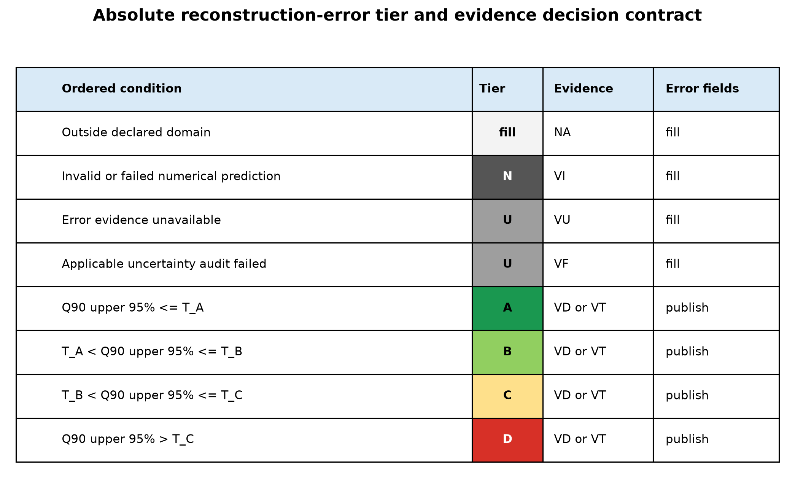

# Absolute reconstruction-error flag contract preregistration

## Scientific question and permitted claim

Can ReCAD replace model-relative risk percentiles with fixed physical reconstruction-error tiers while preserving an explicit unknown state where error is not identifiable? This archive freezes the method and schema only. It does not assign A-D, because the scientific tolerances remain deliberately unset.

## Data, splits, and leakage controls

The future residual experiment will keep whole cruises intact and separately evaluate buffered spatial blocks, whole-region transfer, forward time, and early-era reconstruction. Every target-derived transformation, point model, upstream SSS estimate, error model, and calibration object must remain inside the appropriate training partition. The already opened Issue 5 labels cannot tune thresholds.

## Candidate models and training

No point model is selected or trained in this preregistration. The contract is model-agnostic. A future conditional-error model may estimate the 90th-percentile absolute grid-month error in physical units, but its score cannot directly define a tier. Measurement, representation, input, fitting, structural, and transfer errors remain a versioned error ledger; covariance and double-counting must be audited.

## Main development results

The methodology is frozen as `methodology_frozen_thresholds_pending_scientific_derivation`. The primary statistic is `absolute_error_q90_upper95`: the one-sided 95% confidence upper bound for the conditional 90% absolute grid-month reconstruction-error quantile. Production tier assignment fails closed until all thresholds are frozen.

| Target | Unit | T_A | T_B | T_C |
|---|---|---:|---:|---:|
| SSS | 1 | UNSET | UNSET | UNSET |
| fCO2 | uatm | UNSET | UNSET | UNSET |

Figure 1. Ordered Issue 81 decision contract. A-D require a calibrated physical-error estimate and eligible direct or transfer evidence. U retains a numerical reconstruction while explicitly withholding an unsupported error claim; D means supported evidence of large error rather than unknown error.

## Decision and limitations

Decision: `freeze_methodology_and_schema; block_production_grading_until_threshold_derivation`. A-D are supported physical-error tiers. U means that a numerical reconstruction exists but its error is not estimable or its applicable calibration failed. N means no valid prediction. VD and VT are eligible evidence states; VU and VF cannot receive A-D. Basin identity cannot directly change a tier. Current v2.4 percentile flags remain legacy relative applicability ranks and cannot be mechanically translated.

The target grid-month mean and observation representativeness treatment still require a dedicated experiment. Physical thresholds must be derived from preregistered scientific uses before final audit. No class occupancy is required, and all cells may legitimately receive the same tier or U.

## Figure and table index

- Figure 1: ordered decision contract; source `tables/table01_error_tier_decision_contract.csv`.
- Table 1: machine-readable decision conditions, output tiers, evidence states, and error-field policy.
- Frozen input: `configs/frozen/absolute_error_flag_contract_v2.5.in`.
