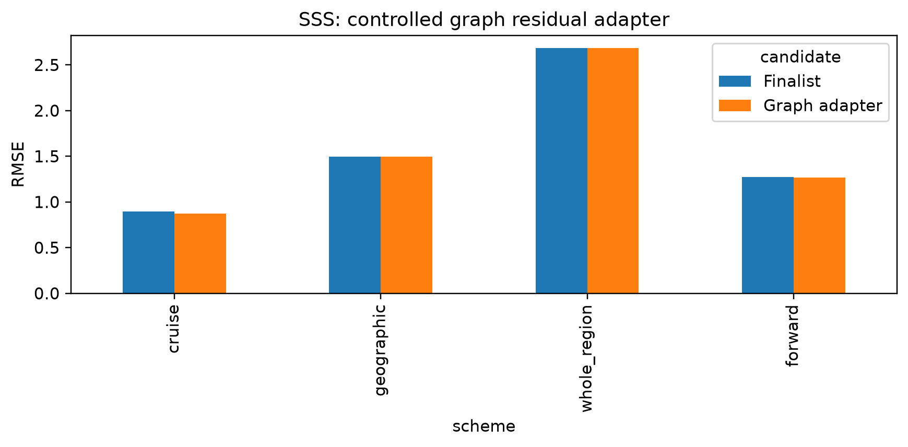
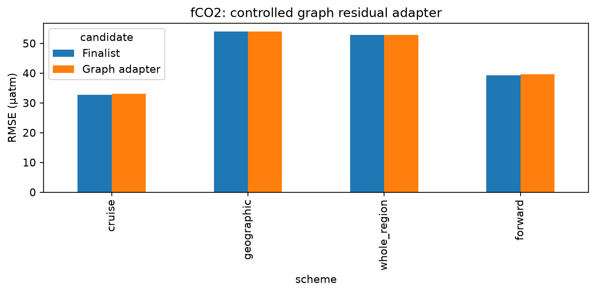
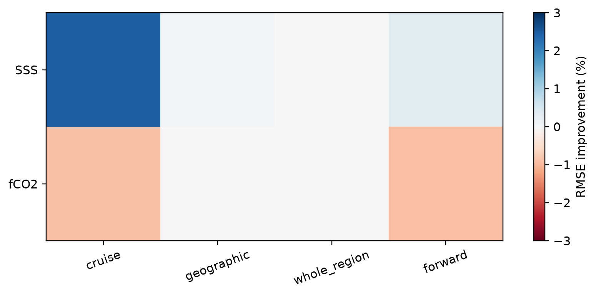
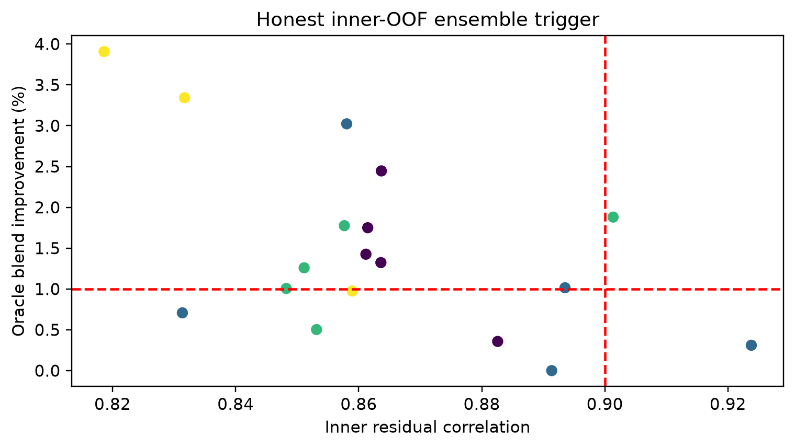
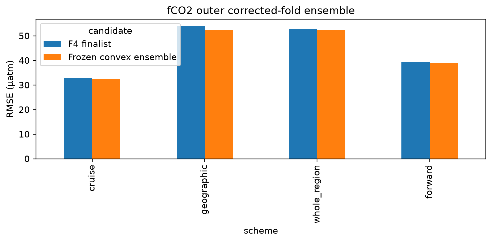
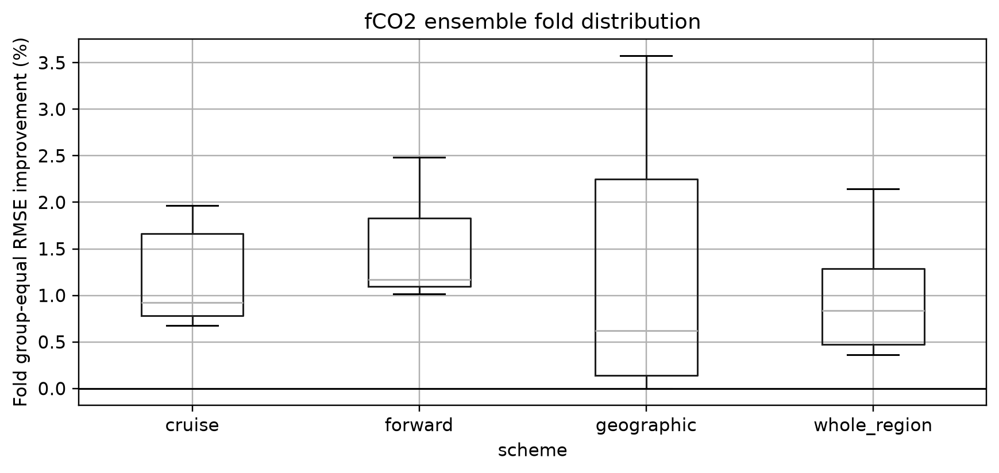
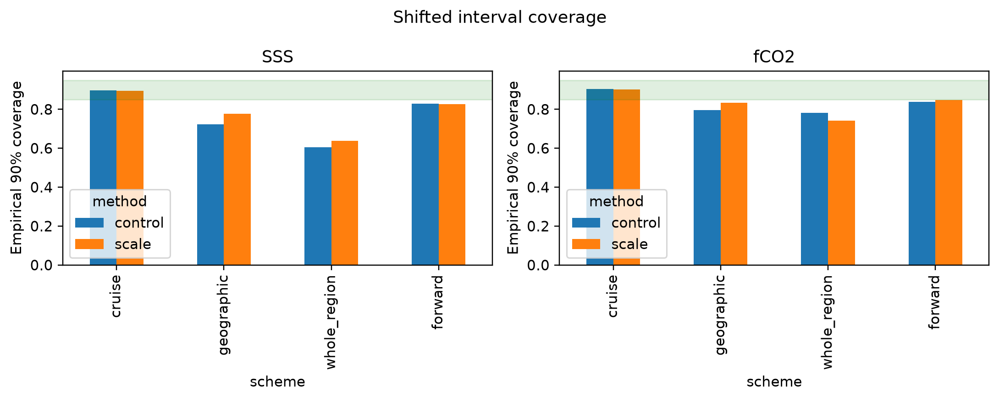
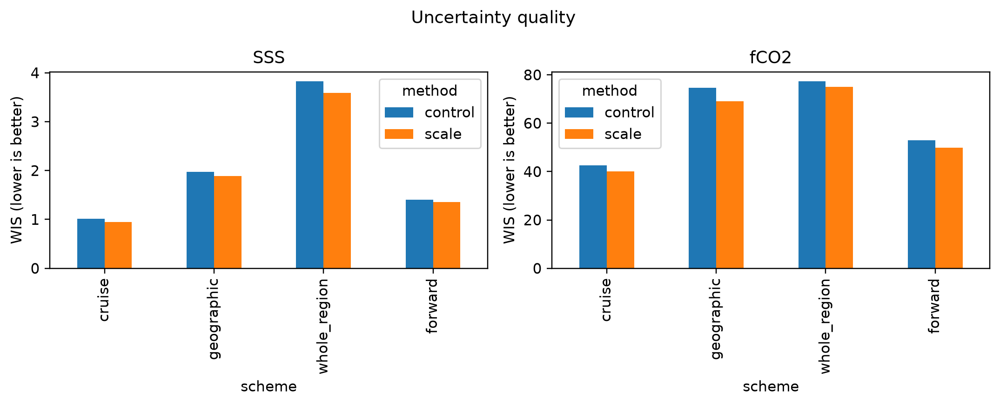

# P2 conditional models and uncertainty v2.4

## Scientific question and permitted claim

Issue #64 tests only hypotheses activated by Issues 62-63 under the exact corrected Issue 61 folds. The graph branch propagates honest inner-validation residuals across a water-only seasonal graph and is architecturally distinct from the failed Issue 42 ST96 model. The uncertainty branch learns only residual magnitude inside outer model-fit data. The fCO2 ensemble weight is selected exclusively from honest inner-OOF residuals. No locked, external-independent, or 2026 labels were opened.

## Data, splits, and leakage controls

The experiment reuses the frozen 1993-2025 matchup, predictor cube, and all 36 target-specific Issue 61 outer splits. Graph sources, graph hyperparameter selection, residual-scale fitting, and ensemble weights remain inside each outer fit partition. Held labels are used only for scoring.

## Candidate models and training

The controlled candidates are a four-season nearest-source water-graph residual adapter, an ExtraTrees log-absolute-error scale head with standardized conformal calibration, and—only after its inner trigger fired—a convex CatBoost/F4 fCO2 ensemble. Process-factor combinations and pretraining remain untriggered. The failed Issue 42 four-neighbour ST96 implementation was not rerun.

## Main development results

The graph residual adapter is rejected for both targets. SSS improves pooled cruise RMSE but does not pass two transfer schemes with paired group evidence; fCO2 graph corrections are neutral or harmful except one forward fold. Adjacent residual correlation was therefore diagnostic, not proof that graph propagation transfers.

The scale-head uncertainty branch is rejected. It raises fCO2 geographic 90% coverage from 0.795 to 0.833 and forward from 0.837 to 0.847, but remains below 0.85 and worsens whole-region coverage from 0.783 to 0.742. SSS geographic and whole-region coverage also remain far below the gate. Heteroscedastic scaling cannot replace reliability flags in unsupported domains.

The honest inner-OOF audit activates the fCO2 CatBoost/F4 convex ensemble (median residual correlation 0.860). Frozen fold-specific CatBoost weights improve pooled fCO2 RMSE from **32.776 to 32.471 µatm** on cruise, **54.061 to 52.495 µatm** on geographic transfer, **52.834 to 52.504 µatm** on whole-region transfer, and **39.317 to 38.853 µatm** forward. It passes the point gate through geographic and forward improvements, with no scheme regression, and is retained for development only. It is not product-qualified until the one-time independent gate.

Process-factor combinations and pretraining remain untriggered negative branches. The machine decision is `retain_fco2_convex_ensemble_for_development_only`.

## Decision and limitations

Only the fCO2 convex ensemble is retained for development. The graph and scale-head branches are preserved as negative results. None is production-qualified: all scores use development labels already covered by the exposure ledger, and the one-time independent gate remains sealed.

## Figure and table index

### Figure 1

Figure 1. SSS pooled corrected-fold RMSE for the Issue 63 finalist and seasonal water-graph residual adapter. The apparent cruise gain is insufficient across transfer schemes.

### Figure 2

Figure 2. fCO2 pooled corrected-fold RMSE for the continuous-background finalist and graph adapter. The graph hypothesis does not transfer consistently.

### Figure 3

Figure 3. Relative graph-adapter RMSE improvement by target and split; blue denotes improvement and red regression. The required two-scheme evidence is absent.

### Figure 4

Figure 4. Honest inner-OOF fCO2 residual correlation and oracle convex-blend gain. These labels only trigger the outer branch and never tune on held folds.

### Figure 5

Figure 5. Pooled outer corrected-fold fCO2 RMSE for F4 and the fold-specific inner-frozen CatBoost/F4 convex ensemble.

### Figure 6

Figure 6. Fold-level group-equal RMSE improvement for the fCO2 ensemble, preserving heterogeneity hidden by pooled scores.

### Figure 7

Figure 7. Empirical 90% interval coverage for prediction-stratified conformal control and residual scale head; the green band marks the frozen 0.85-0.95 acceptance range.

### Figure 8

Figure 8. Weighted interval score for control and scale-head intervals. Coverage failures prevent retaining the scale head even where average interval score changes favorably.

Exact source tables are under `tables/`. Row-level predictions and selections remain outside Git under `C:\backup\phd\data\processed\recad_v2_4\p2_conditional_combination_v2.4` and are hashed in `external_artifact_manifest.csv`.
