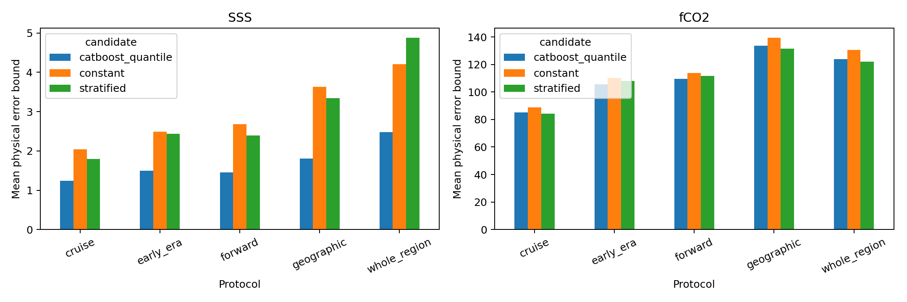
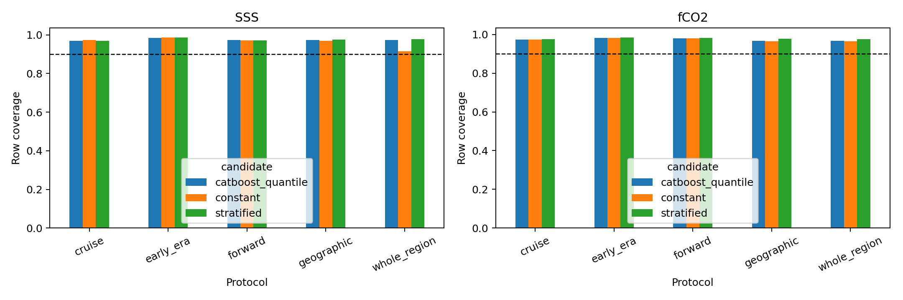
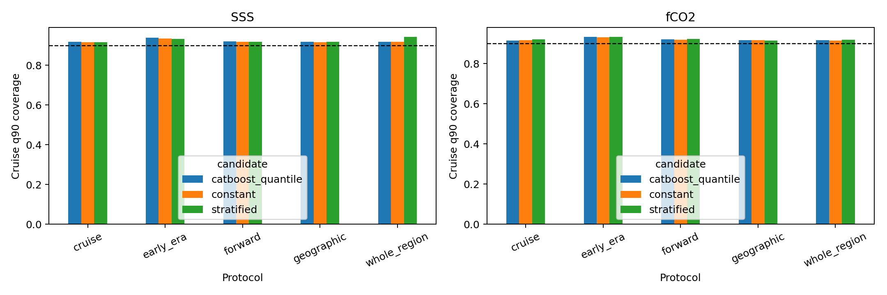
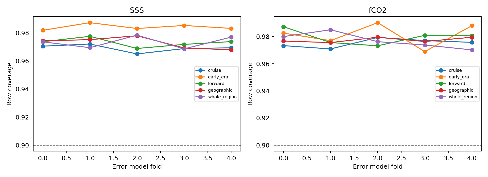
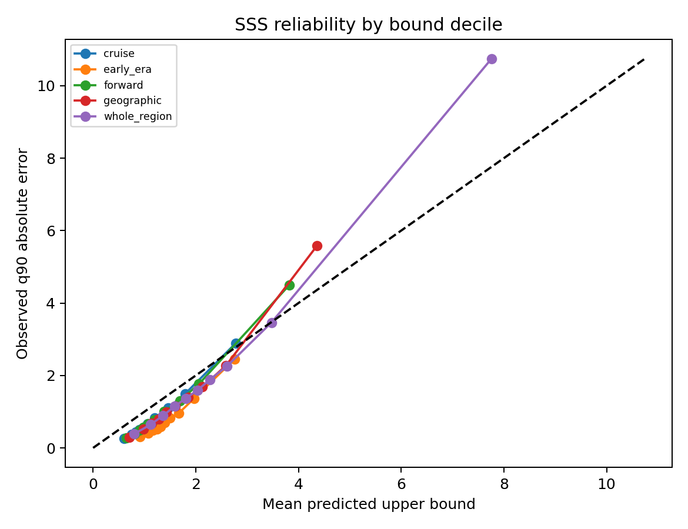
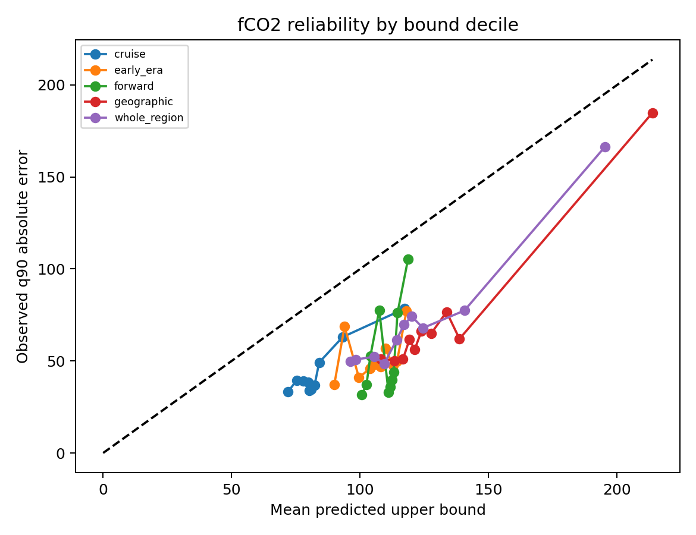
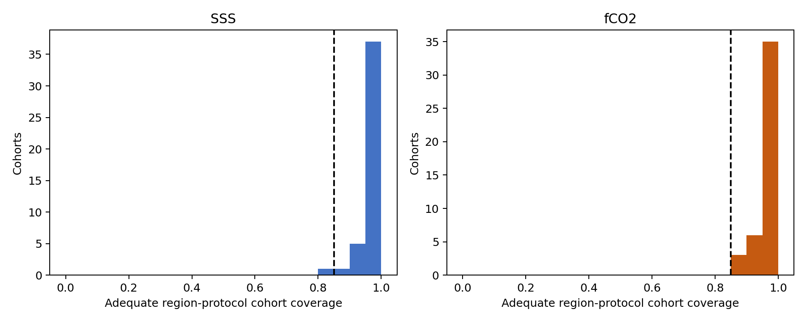
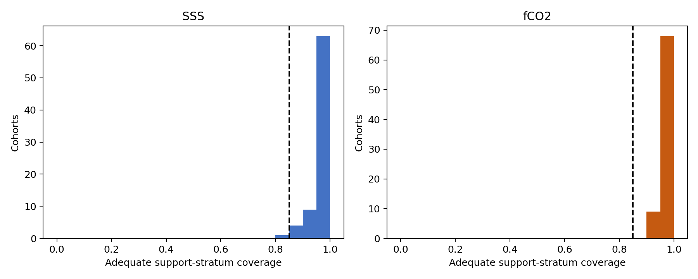

# Conditional physical-error estimation

## Scientific question and permitted claim

This experiment asks whether deployment-available diagnostics can estimate a conservative conditional 90th-percentile absolute reconstruction error in PSU or microatmospheres. It supports development calibration on observed held cruises. It does not define intended-use thresholds, publish A-D grades, or validate unsupported cells.

## Data, splits, and leakage controls

The five residual protocols remain separate. Inside each target-protocol bank, complete cruises are hashed into five error-model folds. Each evaluation uses three folds for fitting, one disjoint fold for calibration, and one disjoint fold for testing. The calibration offset is the distribution-free one-sided 95% upper order statistic across cruise-level q90 residual scores. Basin is excluded from model features. No independent or 2026 label is opened.

## Candidate models and training

The frozen candidates are a constant physical q90, an interpretable fixed-bin support model, and a CatBoost conditional quantile model. All consume the same deployment-available prediction, disagreement, support, location, and season fields. Candidate selection requires pooled row coverage at least 0.90, every fold at least 0.88, cruise-q90 coverage at least 0.90, then minimizes mean physical bound. Protocols are never pooled; future deployment must use their upper envelope.

## Main development results

- SSS / cruise: catboost_quantile; mean bound 1.236, row coverage 0.969, cruise-q90 coverage 0.919.
- SSS / geographic: catboost_quantile; mean bound 1.806, row coverage 0.973, cruise-q90 coverage 0.918.
- SSS / whole_region: catboost_quantile; mean bound 2.481, row coverage 0.973, cruise-q90 coverage 0.919.
- SSS / forward: catboost_quantile; mean bound 1.456, row coverage 0.973, cruise-q90 coverage 0.920.
- SSS / early_era: catboost_quantile; mean bound 1.496, row coverage 0.984, cruise-q90 coverage 0.939.
- fCO2 / cruise: stratified; mean bound 84.304, row coverage 0.975, cruise-q90 coverage 0.922.
- fCO2 / geographic: stratified; mean bound 131.603, row coverage 0.978, cruise-q90 coverage 0.914.
- fCO2 / whole_region: stratified; mean bound 122.100, row coverage 0.977, cruise-q90 coverage 0.918.
- fCO2 / forward: catboost_quantile; mean bound 109.607, row coverage 0.980, cruise-q90 coverage 0.921.
- fCO2 / early_era: catboost_quantile; mean bound 105.597, row coverage 0.982, cruise-q90 coverage 0.933.

All ten target-protocol cells select an eligible estimator. SSS selects CatBoost in all protocols. fCO2 selects the simpler fixed-bin estimator for cruise, geographic, and whole-region transfer, and CatBoost only for forward and early-era transfer. Model complexity is therefore not treated as evidence quality.

Figure 1. Mean calibrated physical error bound for every candidate and transfer protocol. Targets are shown in separate panels because their units differ.

Figure 2. Observation-level coverage of each candidate's physical q90 upper bound. The dashed 0.90 line is the frozen marginal target.

Figure 3. Fraction of complete cruises whose within-cruise 90th-percentile absolute error is covered. Cruises, rather than dense rows, are the evidence units.

Figure 4. Fold-specific row coverage for the selected estimator in each protocol. No fold is removed when it performs worse than the pooled result.

Figure 5. SSS observed 90th-percentile absolute error versus the mean calibrated upper bound in each predicted-bound decile. Points below the diagonal are conservative.

Figure 6. fCO2 observed 90th-percentile absolute error versus the mean calibrated upper bound in each predicted-bound decile. Points below the diagonal are conservative.

Figure 7. Distribution of row coverage across adequately sampled ocean-region by protocol cohorts. Cohorts below 0.85 are retained as failed evidence rather than hidden by pooling.

Figure 8. Distribution of coverage across adequately sampled fixed geographic, environmental, cruise-diversity, and temporal-support strata. Failed strata require VF or U in later product mapping.

## Decision and limitations

Decision: retain the ten protocol-specific estimators as development calibration objects. 79 of 88 adequately sampled region-protocol cohorts and 141 of 154 adequately sampled fixed-support cohorts pass the 0.85 cohort audit. Failed cohorts must later receive VF or U; aggregate calibration cannot override them. T_A, T_B, and T_C remain UNSET for both targets, so no A-D grade is emitted.

These bounds describe end-to-end errors represented by observed held cruises. They do not identify Antarctica or another unsupported cell solely from model spread. Measurement and grid-month representativeness components remain separate and must be bounded without double-counting the held-out residual.

## Figure and table index

- Tables 1-3: candidate metrics, fold metrics, and selected protocol-specific estimators.
- Tables 4-6: region calibration, support calibration, and reliability bins.
- Tables 7-9: selected partition hashes, model artifact hashes, and the frozen decision.
- Figures 1-8: candidate sharpness and coverage, fold stability, reliability, and cohort qualification.
