# P2.6 temporal context and coastal connectivity

Issue: #42

Decision: **stop scaling the current GRU/STTransformer/graph family; promote no context candidate and retain the honest v1.x random forest as the point baseline**

## Scientific question and permitted claim

This experiment tests whether six months of local environmental history or four-neighbour water-connected context adds reliable information beyond the strongest Issue #41 point model. It supports a development-stage architecture and data-sufficiency decision. It does not authorize a global product, independent-validation claim, or use 2004-2005 as selection evidence.

## Data, splits, and leakage controls

All candidates use the same 887,811 SOCAT fCO2 rows, 5,143 cruises, 117,324 observed coastal nodes, 788,556 node-months, 54 LMEs, strict outer-fold cross-fitted SSS, and frozen cruise, spatial-block, whole-LME, and forward splits. Six-month histories contain only SST, wind speed, atmospheric xCO2, and background SSS from the observation-independent predictor cube. No lagged fCO2 or observed SSS is used. Locked, external-independent, and provisional 2026 labels remain sealed.

The nominal row count substantially exceeds the independent information: the median cruise contributes 123 rows and the 90th percentile contributes 389. Model selection therefore uses grouped outer validation and cruise-equal metrics.

## Candidate models and training

The matrix compares the exact Issue #41 random-forest predictions, residual lag-feature CatBoost, a two-layer 64-unit GRU, a two-layer d_model=96 local temporal transformer, and the same transformer with water-connected neighbour histories. The graph branch was legitimately triggered: adjacent RF residual correlation is 0.869, while the within-time permutation control is approximately zero.

## Main development results

| model | cruise | spatial | whole-LME | forward |
| --- | ---: | ---: | ---: | ---: |
| v11_random_forest | 33.96 | 37.45 | 54.38 | 47.55 |
| lag_catboost | 36.71 | 38.74 | 56.54 | 47.16 |
| gru_context | 43.82 | 44.33 | 57.65 | 53.26 |
| st96_local | 43.40 | 44.25 | 56.39 | 54.98 |
| st96_graph | 42.66 | 44.59 | 57.52 | 52.43 |

Lag CatBoost is the only candidate with any forward gain: pooled forward RMSE changes from 47.55 to 47.16 microatmospheres, while bias changes from -15.06 to -5.14. This 0.8 percent gain is far below the frozen five-percent threshold and is accompanied by cruise, spatial, and whole-LME cruise-equal degradations of 7.5, 7.2, and 4.7 percent. Paired cruise bootstraps place every cruise and spatial candidate above the random-forest MSE.

The graph ST96 improves on local ST96 in cruise and forward tests, but remains much worse than the point baseline. It also leaves adjacent residual correlation at 0.919 rather than reducing the RF value of 0.869. Observed adjacent fCO2 gradients average about 7.31 microatmospheres; the direct RF predicts about 2.13, while all candidates preserve fronts poorly. Residual models additionally develop roughly 20-microatmosphere cross-LME jumps because their LME-month background is discontinuous. That background must not be used unchanged in a continuous product.

## Data-volume and model-capacity diagnostic

The nested cruise-label experiment holds outer fold 0 fixed, keeps SSS support fixed, and increases fCO2 training cruises within every LME:

| cruise budget | cruises | RF | lag CatBoost | ST96 |
| --- | ---: | ---: | ---: | ---: |
| 10% | 429 | 41.57 | 39.31 | 45.55 |
| 20% | 839 | 37.56 | 37.35 | 46.36 |
| 40% | 1,714 | 36.09 | 36.31 | 41.58 |
| 60% | 2,535 | 33.62 | 35.89 | 41.69 |
| 80% | 3,356 | 33.17 | 35.87 | 41.06 |
| 100% | 4,161 | 32.49 | 35.87 | 43.02 |

At ten percent of cruises, lag CatBoost is better than RF in pooled RMSE; as independent cruise coverage grows, RF continues improving and overtakes it. Lag CatBoost plateaus near 35.9 microatmospheres after 40 percent. ST96 is unstable and remains above 41 microatmospheres even at high coverage. More rows alone do not unlock the transformer: current histories lack enough independent process information, and their monthly/local representation does not identify the missing coastal dynamics.

## Decision and limitations

Ordinary cruise and spatial intervals are calibrated by construction, but forward coverage remains inadequate. Lag CatBoost reaches 0.409/0.815 at nominal 50/90 percent, compared with RF 0.323/0.776; neither passes the frozen ranges. Neural models use about 174 thousand parameters and up to roughly 426 MB of allocated GPU memory, yet provide no outer-generalization return.

No candidate passes the complete promotion contract. The current STTransformer, GRU, and graph aggregation families should stop scaling. The allowed conclusion is conditional: under the available SOCAT cruise coverage, frozen monthly predictors, and strict validation protocol, RF is the most suitable interpolation baseline. Future gains require new independent coverage or more process-resolving predictors and a continuous background formulation, rather than a larger network on the same information.

## Figure and table index

### Figure 1

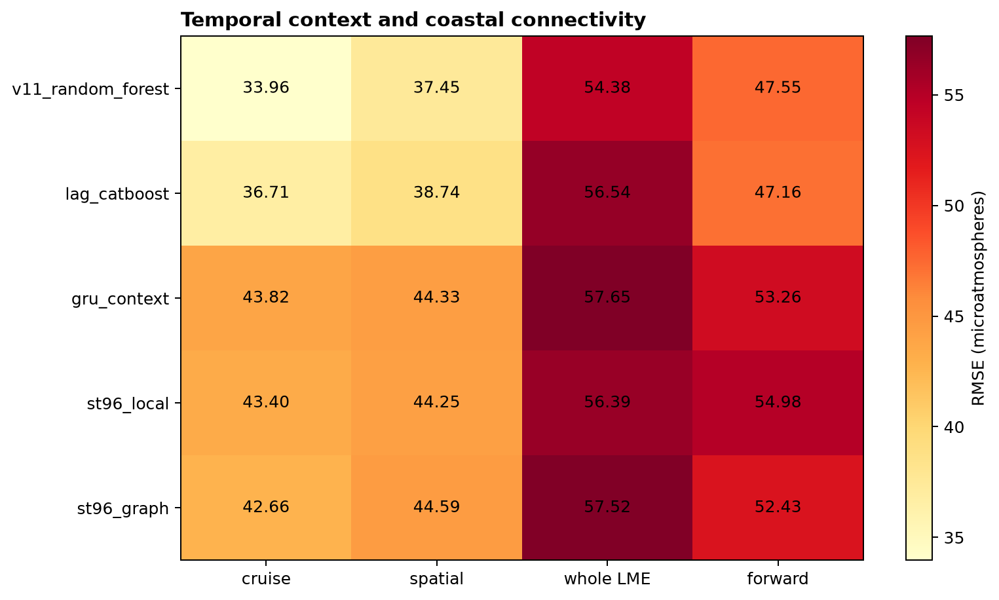

Figure 1. Native held-out fCO2 RMSE across point, lag, recurrent, local-transformer, and water-connected transformer candidates; the random forest leads three transfer schemes and lag CatBoost gives only a small forward gain.

### Figure 2

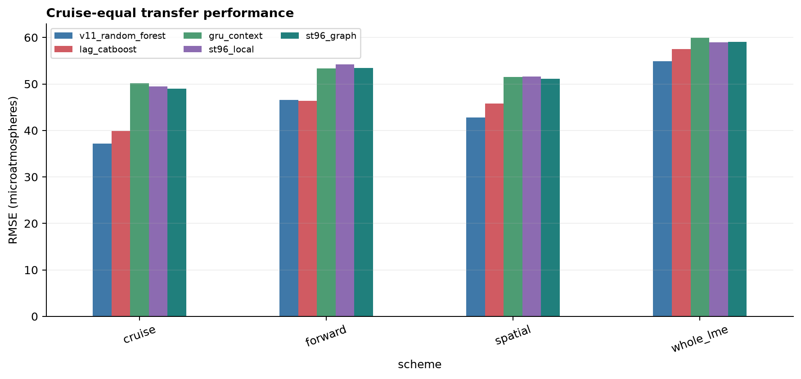

Figure 2. Cruise-equal RMSE gives every independent cruise equal influence and confirms that no context candidate reaches the frozen five-percent improvement threshold.

### Figure 3

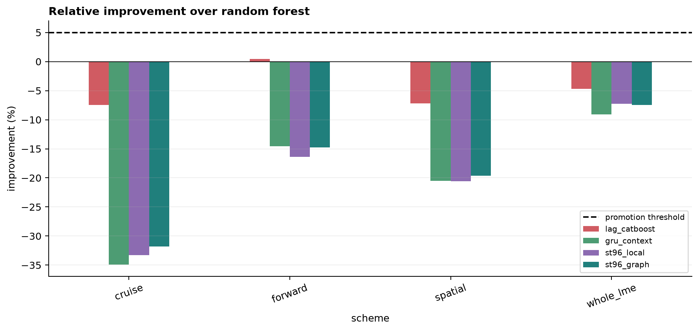

Figure 3. Relative cruise-equal improvement against the honest random forest; positive values indicate improvement, and only lag CatBoost is slightly positive in forward validation.

### Figure 4

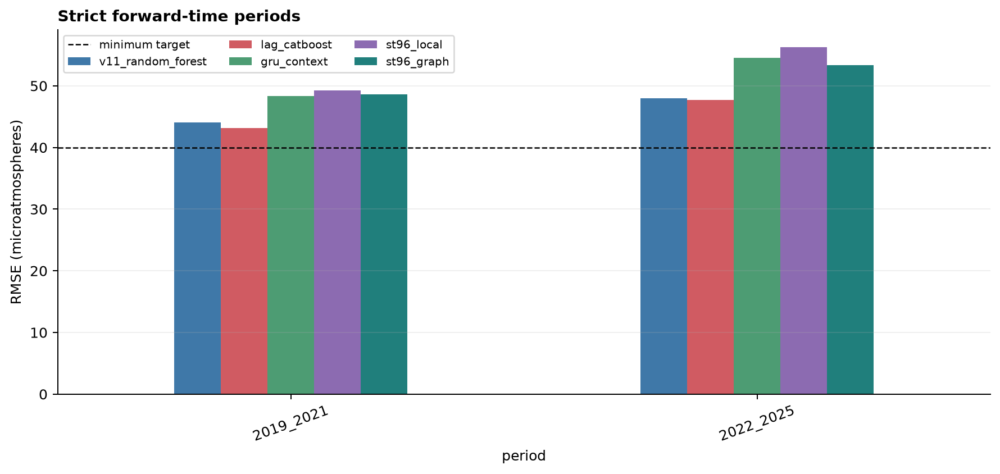

Figure 4. Strict forward RMSE in 2019-2021 and 2022-2025; lag CatBoost reduces temporal bias but remains above the 40 microatmosphere ceiling in both periods.

### Figure 5

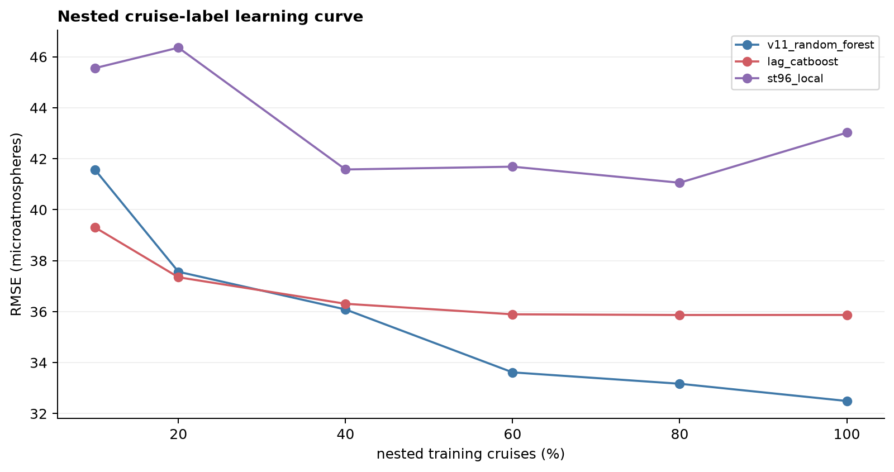

Figure 5. Cruise-fold-0 pooled learning curves under nested LME-stratified fCO2 cruise-label budgets; random-forest error continues to fall as coverage increases, lag CatBoost plateaus, and ST96 is unstable.

### Figure 6

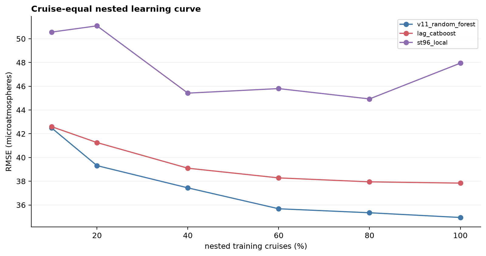

Figure 6. Cruise-equal learning curves show that the apparent row count overstates independent information and that ST96 does not unlock additional capacity with the available cruise coverage.

### Figure 7

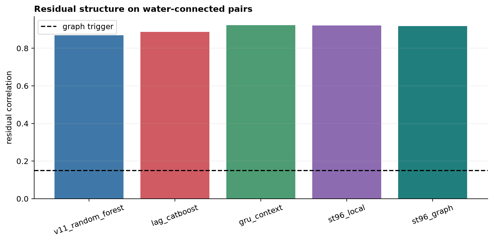

Figure 7. Water-adjacent residual correlation remains high for every model and is larger after the context networks, so the graph input does not remove the spatially connected error structure that triggered it.

### Figure 8

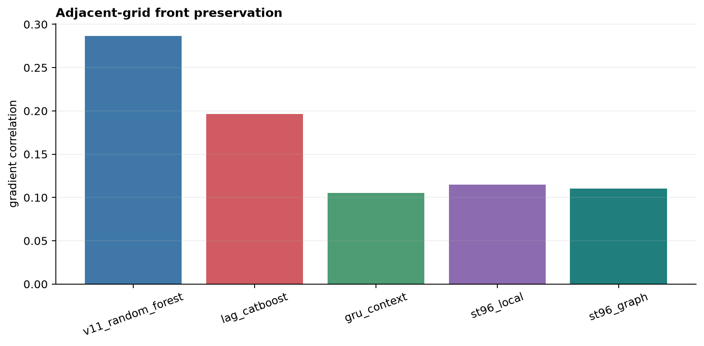

Figure 8. Correlation between observed and predicted adjacent-grid fCO2 gradients; all candidates smooth fronts strongly and context networks preserve less gradient structure than the point random forest.

### Figure 9

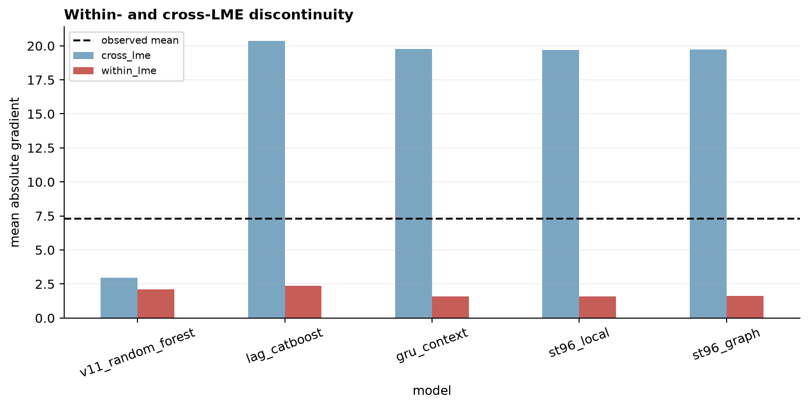

Figure 9. Mean predicted gradient within and across LME boundaries; residual models inherit artificial cross-LME jumps from the fold-fitted LME-month background while the direct random forest remains smoother.

### Figure 10

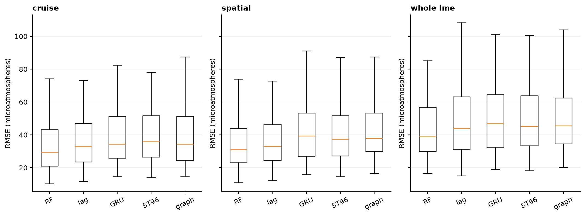

Figure 10. Per-LME RMSE distributions for cruise, spatial, and whole-LME validation expose a long geographic error tail that additional context does not reduce.

### Figure 11

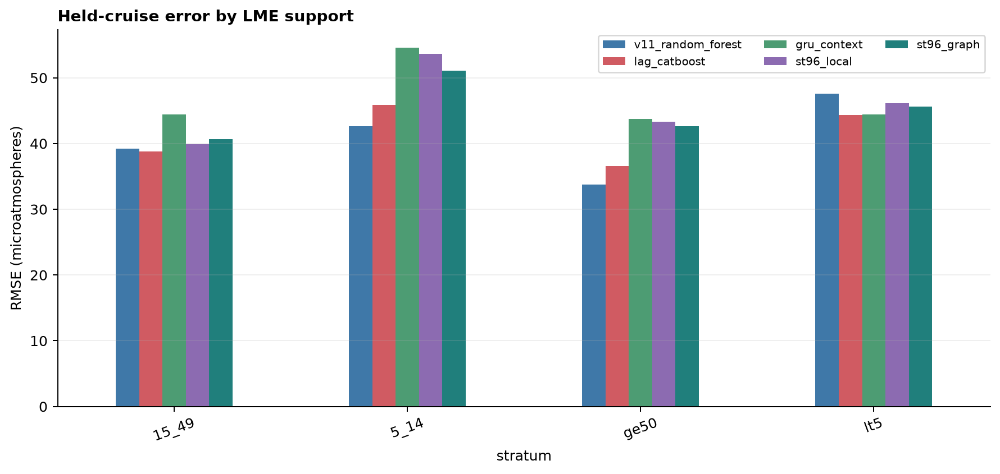

Figure 11. Cruise-held-out RMSE by the number of training cruises in the target LME; sparse support remains difficult and no complex model supplies a reliable low-support advantage.

### Figure 12

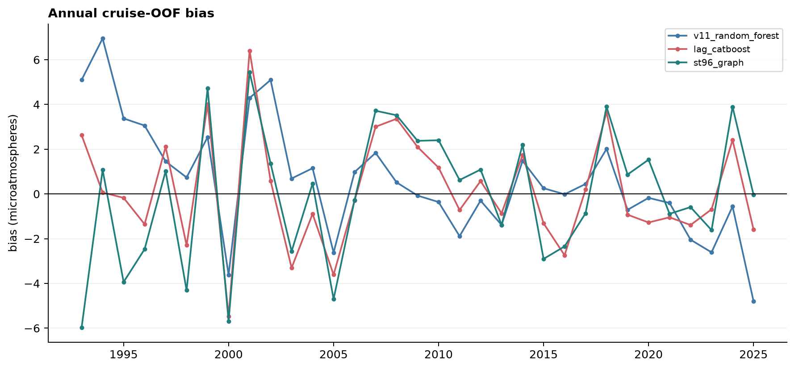

Figure 12. Annual cruise-OOF bias; lag CatBoost follows the long-term signal better than the random forest in some years but pays for it with higher ordinary held-cruise error.

### Figure 13

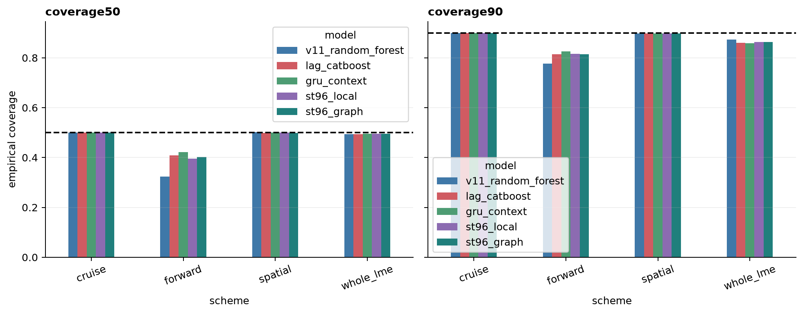

Figure 13. Leakage-safe 50 and 90 percent interval coverage; forward coverage remains below the frozen ranges for every candidate despite wider context-model intervals.

### Figure 14

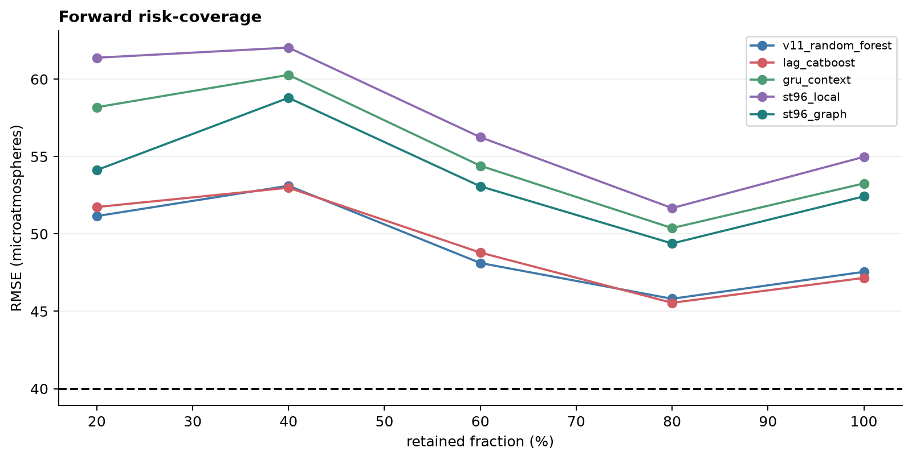

Figure 14. Forward RMSE after retaining cases with the narrowest empirical intervals; uncertainty ranking cannot reduce any candidate to the release ceiling at full coverage.

### Figure 15

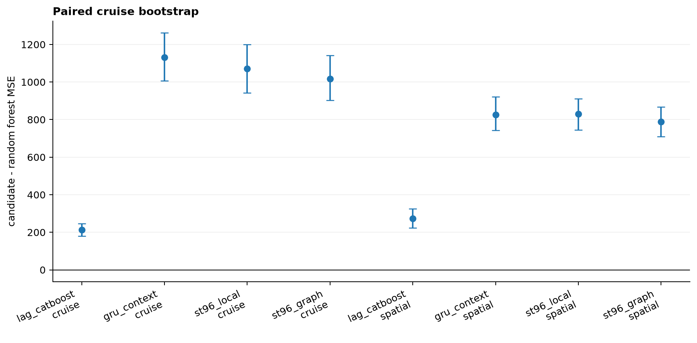

Figure 15. Cruise-level paired MSE bootstrap contrasts against the random forest; every context candidate has confidence intervals above zero in cruise and spatial validation.

### Figure 16

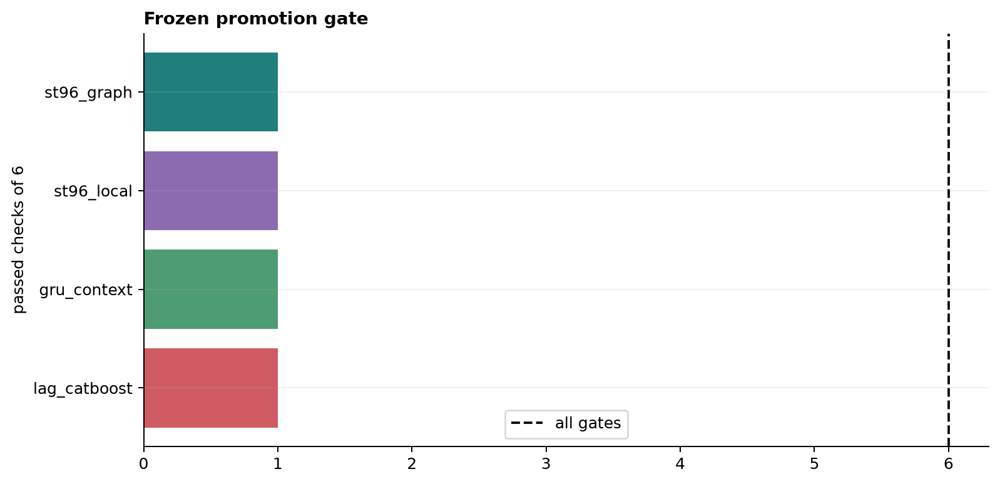

Figure 16. Frozen promotion-gate totals; no context candidate passes the complete contract, so the current STTransformer, GRU, and graph families stop scaling.

### Figure 17

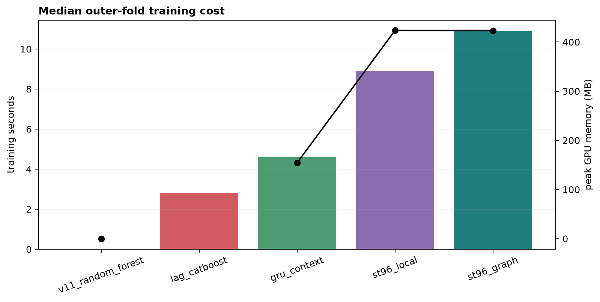

Figure 17. Median outer-fold training time and peak GPU memory; added neural complexity has measurable cost without a generalization return.

### Tables

- `table01_native_metrics.csv`: machine-readable source data used by this report.
- `table02_cruise_equal_metrics.csv`: machine-readable source data used by this report.
- `table03_common_grid_metrics.csv`: machine-readable source data used by this report.
- `table04_lme_metrics.csv`: machine-readable source data used by this report.
- `table05_lme_macro_worst.csv`: machine-readable source data used by this report.
- `table06_stratified_metrics.csv`: machine-readable source data used by this report.
- `table07_time_block_metrics.csv`: machine-readable source data used by this report.
- `table08_annual_diagnostics.csv`: machine-readable source data used by this report.
- `table09_extreme_metrics.csv`: machine-readable source data used by this report.
- `table10_interval_metrics.csv`: machine-readable source data used by this report.
- `table11_risk_coverage.csv`: machine-readable source data used by this report.
- `table12_paired_bootstrap.csv`: machine-readable source data used by this report.
- `table13_historical_2004_2005.csv`: machine-readable source data used by this report.
- `table14_graph_residual_structure.csv`: machine-readable source data used by this report.
- `table15_front_boundary_metrics.csv`: machine-readable source data used by this report.
- `table16_training_resources.csv`: machine-readable source data used by this report.
- `table17_learning_curve.csv`: machine-readable source data used by this report.
- `table18_model_definitions.csv`: machine-readable source data used by this report.
- `table19_effective_sample_size.csv`: machine-readable source data used by this report.
- `table20_selection_gate.csv`: machine-readable source data used by this report.
- `table21_trend_slopes.csv`: machine-readable source data used by this report.
- `table22_forward_period_metrics.csv`: machine-readable source data used by this report.
