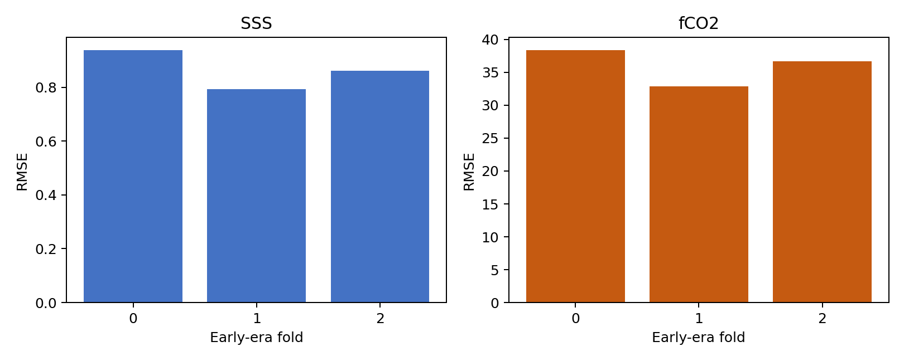
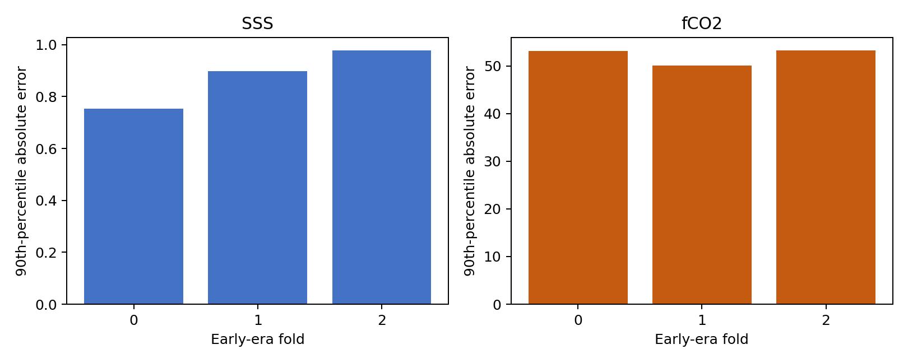
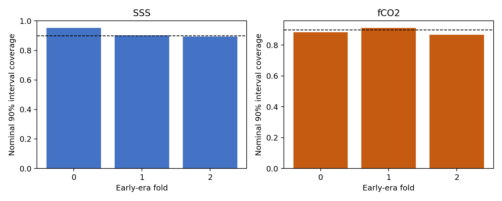
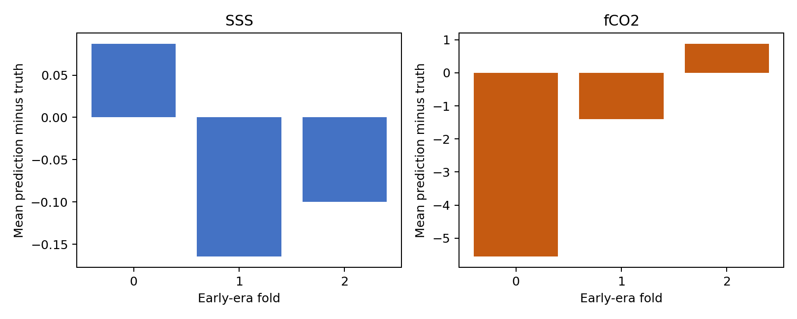
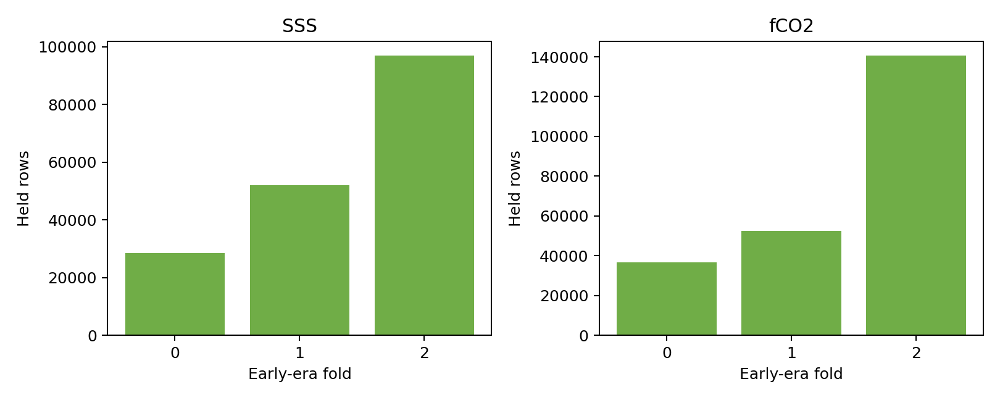
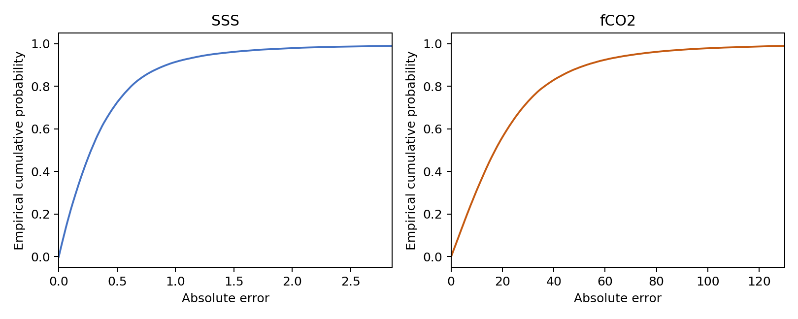
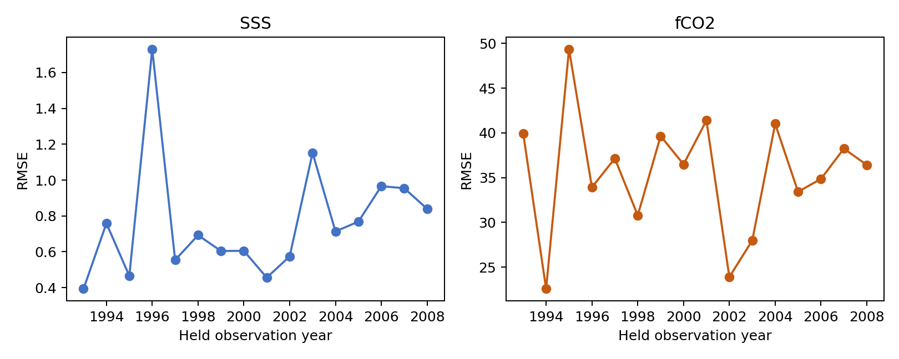
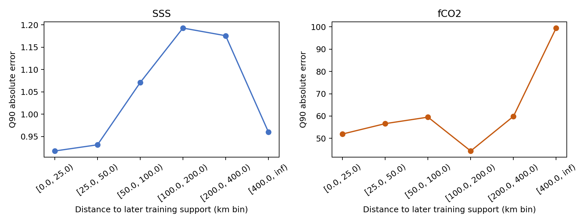

# Strict reverse-time early-era validation

## Scientific question and permitted claim

This experiment tests whether the frozen SSS and fCO2 candidates can reconstruct complete early cruises when every fitting and calibration observation comes from a later era. It supports a development claim about observed early cruises only; it cannot identify error in observation-free waters or define A-D thresholds.

## Data, splits, and leakage controls

Three windows were frozen from label metadata before inspecting errors: 1993-1998 held with training from 2004, 1999-2003 held with training from 2009, and 2004-2008 held with training from 2014. Complete normalized cruises are indivisible. Cruises crossing a boundary or lying in the temporal gap are excluded. All audits report zero train-held cruise overlap. No independent or 2026 label was opened.

## Candidate models and training

SSS uses the frozen three-seed CatBoost background-residual finalist. fCO2 uses the frozen F4 continuous-background ExtraTrees plus CatBoost convex ensemble with CatBoost weight 0.3. Its SSS input is regenerated inside each later-only training hierarchy: model-fit cruises receive two-fold out-of-fold SSS, while calibration and early held cruises receive predictions from SSS models fitted only on fCO2 model-fit cruise groups.

## Main development results

- SSS fold 0: RMSE 0.938, q90 0.752, bias 0.087, coverage90 0.953.
- SSS fold 1: RMSE 0.794, q90 0.897, bias -0.165, coverage90 0.903.
- SSS fold 2: RMSE 0.862, q90 0.978, bias -0.100, coverage90 0.893.
- fCO2 fold 0: RMSE 38.389, q90 53.145, bias -5.561, coverage90 0.883.
- fCO2 fold 1: RMSE 32.898, q90 50.046, bias -1.396, coverage90 0.912.
- fCO2 fold 2: RMSE 36.662, q90 53.255, bias 0.880, coverage90 0.867.

Figure 1. Fold-specific reverse-time RMSE in each target's physical units; the two targets use separate panels and are not compared by magnitude.

Figure 2. Fold-specific observation-equal 90th-percentile absolute error for complete early cruises held before all model-fitting observations.

Figure 3. Empirical coverage of prediction-stratified 90% intervals on early held cruises; the 0.90 reference line is diagnostic rather than a pass manufactured by filtering.

Figure 4. Fold-specific signed bias. The earliest fCO2 window retains its negative bias as evidence of unresolved reverse-time transfer error.

Figure 5. Number of held observations in each complete-cruise early-era fold; all windows have substantial evidence and window definitions were frozen from metadata before error inspection.

Figure 6. Empirical cumulative distributions of absolute reverse-time error, truncated visually at each target's 99th percentile while all rows remain in reported metrics.

Figure 7. Annual reverse-time RMSE inside the held windows, showing temporal heterogeneity that is hidden by a single pooled early-era score.

Figure 8. Reverse-time 90th-percentile absolute error across fixed geographic-support bins; sparse or distant support remains a diagnostic and does not itself assign an A-D grade.

## Decision and limitations

Both early-era banks are accepted into the separated residual-bank evidence. Pooled RMSE is 0.856 for SSS and 36.122 microatmospheres for fCO2; pooled q90 absolute error is 0.922 and 52.616 respectively. The earliest fCO2 fold has a -5.561 microatmosphere bias, and interval coverage falls to 0.867 in the latest early-era fold. These negative results remain explicit. The next step is cross-fitted conditional physical-error estimation across all five protocols. T_A, T_B, and T_C remain unset.

## Figure and table index

- Tables 1-8 contain fold metrics, source hashes, leakage audits, annual metrics, support strata, nested SSS lineage, frozen windows, and the decision.
- Figures 1-8 show fold errors and coverage, evidence size, the error distribution, temporal heterogeneity, and geographic-support behavior.
