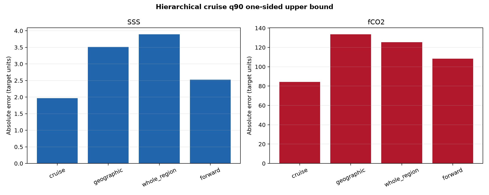
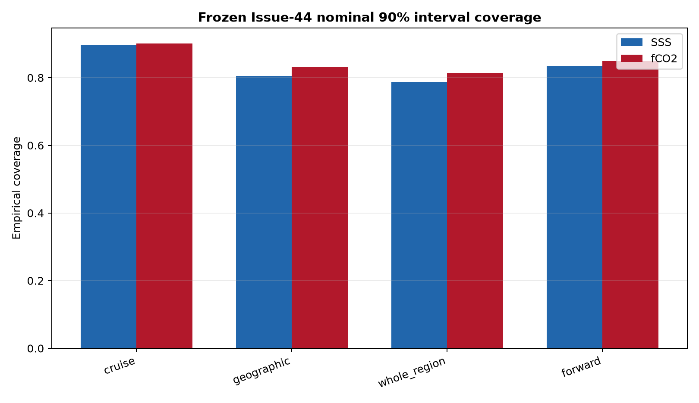
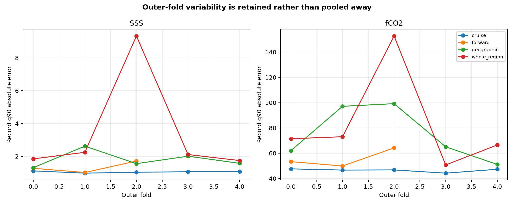
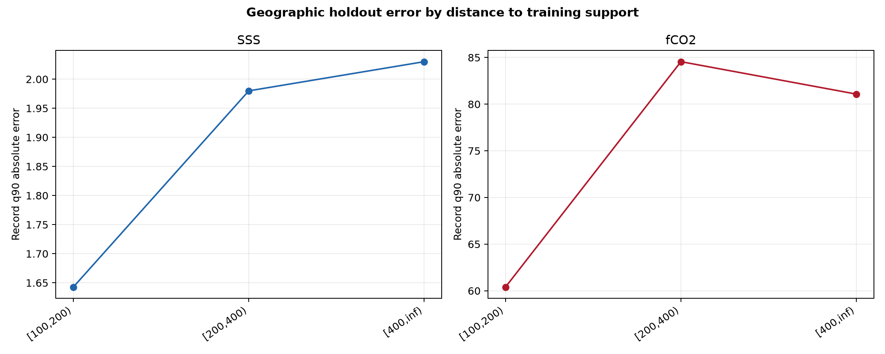
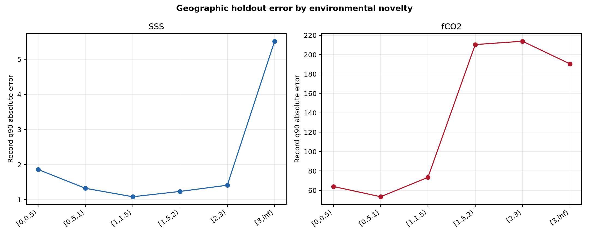
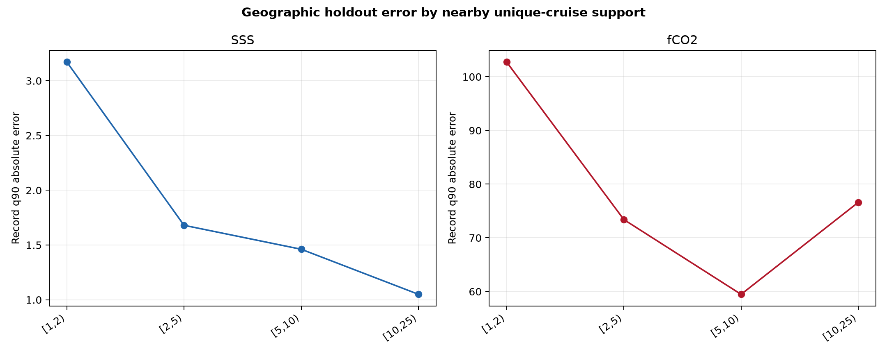
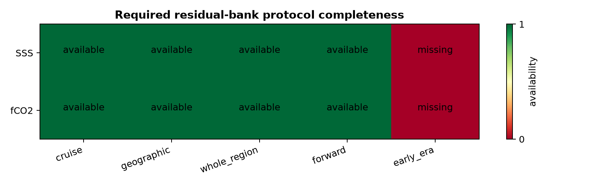

# Deployment-matched end-to-end residual banks

## Scientific question and permitted claim

This experiment asks what deployment-matched end-to-end residual evidence is available for physical SSS and fCO2 error estimation under the frozen final candidates. The permitted claim is limited to residual-bank construction and an evidence-gap audit. It cannot define intended-use thresholds, publish A-D grades, or validate observation-free waters.

## Data, splits, and leakage controls

This Issue 81 phase reuses the exact corrected Issue-61 outer predictions archived by Issue 44. Raw residual banks remain separate for complete-cruise, buffered-geographic plus 100-km exclusion, whole-region, and past-to-future protocols. It opens no new labels. Complete cruises remain the independent evidence units. Every source partition is hashed, record and evaluation identities are audited, and no duplicate identity was found. Basin identity is attached from GOaS v1 for reporting only and cannot alter a grade.

## Candidate models and training

The point predictions are frozen: the Issue-44 three-seed SSS CatBoost background-residual candidate and the fCO2 inner-OOF-weighted CatBoost/F4 convex ensemble. This experiment does not fit or select a point model, refit a calibration model, or tune a threshold. The saved outer predictions therefore isolate error analysis from model selection.

The primary feasibility statistic is hierarchical: compute the 90th-percentile absolute error inside each complete cruise, then take the 90th percentile across cruises and a distribution-free one-sided 95% order-statistic upper bound. This prevents dense rows within one cruise from manufacturing precision. Observation-equal q90, fold variability, region strata, support strata, RMSE, MAE, bias, R2, width and coverage remain diagnostics. These development residuals cannot define the intended-use `T_A`, `T_B`, or `T_C` thresholds.

## Main development results

- SSS / cruise: RMSE 0.896, record q90 1.049, hierarchical upper 1.964, coverage90 0.898.
- SSS / geographic: RMSE 1.501, record q90 1.874, hierarchical upper 3.515, coverage90 0.804.
- SSS / whole_region: RMSE 2.616, record q90 3.522, hierarchical upper 3.896, coverage90 0.788.
- SSS / forward: RMSE 1.255, record q90 1.338, hierarchical upper 2.528, coverage90 0.835.
- fCO2 / cruise: RMSE 32.420, record q90 46.461, hierarchical upper 84.378, coverage90 0.901.
- fCO2 / geographic: RMSE 52.471, record q90 74.461, hierarchical upper 133.626, coverage90 0.832.
- fCO2 / whole_region: RMSE 52.167, record q90 77.732, hierarchical upper 125.472, coverage90 0.815.
- fCO2 / forward: RMSE 38.847, record q90 56.527, hierarchical upper 108.376, coverage90 0.849.

The four available residual banks are reusable, but the frozen contract also requires an early-era test in which later observations fit the model and earlier cruises are held out. That bank does not exist in Issues 61-44. Final grading therefore fails closed. No protocol is pooled into a global error estimate, and no error is asserted for observation-free cells from ensemble spread alone.

Figure 1. Observation-equal 90th-percentile absolute held-out error for the frozen SSS and fCO2 candidates, kept separate across complete-cruise, buffered-geographic, whole-region, and forward-time protocols. Different physical units are shown in separate colored series and must not be compared across targets.

Figure 2. Distribution-free one-sided 95% upper bound for the 90th percentile across within-cruise 90th-percentile absolute errors. Complete cruises are evidence units, so dense rows from one cruise cannot create artificial confidence.

Figure 3. Empirical coverage of the nominal 90% Issue-44 intervals on the identical frozen predictions. Shifted protocols remain visibly below nominal coverage; this residual-bank phase does not repair or conceal that negative result.

Figure 4. Fold-specific record-level 90th-percentile absolute error. Variation across held geographic blocks, regions, and time windows remains explicit instead of being erased by a single pooled score.

Figure 5. Buffered-geographic held-out error stratified by distance to training support using fixed kilometer bins from the external .in contract. Empty or weak cohorts are not used to redefine bin boundaries.

Figure 6. Buffered-geographic held-out error stratified by standardized environmental k-nearest-neighbour distance. The diagnostic is in physical error units; the novelty score itself is not a quality grade.

Figure 7. Buffered-geographic held-out error stratified by the count of nearby unique cruises. Cruise support is a deployment diagnostic and cannot by itself assign an A-D tier.

Figure 8. Completeness of the five protocol banks required by the frozen absolute-error contract. Early-era evidence is missing for both targets, so final A-D grading remains blocked even though the other four banks are reusable.

## Decision and limitations

Decision: retain the four separated banks as development evidence and run the missing early-era prediction experiment before conditional error calibration. After all five banks exist, fit and cross-fit candidate conditional physical-error estimators, test their calibration by protocol and cohort, and only then evaluate intended-use threshold profiles. The current v2.4 product remains unchanged.

The hierarchical bound is deliberately stricter than observation-equal error and describes transfer across observed cruises; it is not yet an area-time-weighted global product error. Observed locations cannot by themselves identify error in a coast with no target observations or validated analogue. Measurement and representativeness components are not separately estimated in this phase and must be added without double-counting the end-to-end residual.

## Figure and table index

- Table 1: protocol metrics.
- Table 2: outer-fold metrics.
- Table 3: GOaS v1 region reporting strata.
- Table 4: fixed support-diagnostic strata.
- Table 5: required-protocol completeness.
- Table 6: every source partition with SHA256.
- Table 7: duplicate identity audit.
- Table 8: frozen decision.
- Table 9: field dictionary.
