# P2.5 global coastal fCO2 baseline and regional-sharing bake-off

Issue: #41

Decision: **promote no global fCO2 model; retain the honest v1.x random forest as the strict interpolation baseline and carry residual-sharing models only into the temporal/connectivity experiment**

## Scientific question and permitted claim

This experiment asks whether target residualization, strict cross-fitted SSS, fixed-LME adapters, or probabilistic environmental experts improve on an honestly retrained v1.x random forest and the frozen Issue #54 CatBoost. It supports a development-stage architecture decision. It does not authorize global product release, claim independent validation, or use the historical 2004-2005 comparison as model-selection evidence.

## Data, splits, and leakage controls

All candidates used the same 887,811 SOCAT fCO2 records from 5,143 cruises, 54 LMEs, and 1993-2025. Five-fold cruise, spatial-block, strict whole-LME, and forward-time validation were preserved from Issue #54. Cruises touching a held spatial block or LME were removed from training.

Observed SOCAT salinity was forbidden as an fCO2 input. Within every outer fold, SSS for fCO2 training rows was generated by two-fold cruise cross-fitting using only that outer fold's training subset; held-row SSS used a model fitted to all outer-training SSS labels. This produced 16 fold-specific SSS feature partitions. The old locked labels, external-independent data, and 2026 provisional records remained sealed.

## Candidate models and training

The matrix contained a fold-fitted seasonal/trend background, an honest 96-tree v1.x random forest, the exact Issue #54 direct CatBoost, CatBoost residualized around the seasonal/trend background, the same residual model plus cross-fitted SSS, shrunk fixed-LME/month adapters, and eight soft GMM/environmental residual experts. The 112 final prediction partitions cover every model and outer fold. Large predictions and 176 model checkpoints remain outside Git.

## Main development results

| model | cruise | spatial | whole-LME | forward |
| --- | ---: | ---: | ---: | ---: |
| seasonal_trend | 46.78 | 49.87 | 64.62 | 58.32 |
| v11_random_forest | 33.96 | 37.45 | 54.38 | 47.55 |
| catboost_direct | 36.48 | 39.00 | 54.26 | 49.18 |
| catboost_residual | 36.93 | 39.20 | 57.43 | 47.46 |
| catboost_residual_sss | 36.45 | 38.58 | 57.28 | 46.57 |
| lme_adapters | 35.95 | 38.15 | 57.28 | 46.21 |
| gmm_experts | 35.12 | 37.68 | 56.52 | 46.45 |

The honest random forest is strongest in ordinary transfer: native cruise/spatial RMSE is 33.96/37.45 microatmospheres, with cruise-equal RMSE 37.14/42.76. Every modern candidate has a positive cruise- and spatial-level paired MSE difference relative to it; all 95 percent bootstrap intervals exclude zero in the wrong direction. No candidate supplies the required five-percent improvement.

The advantage reverses partly in time. LME adapters and GMM experts reduce pooled forward RMSE from 47.55 to 46.21 and 46.45 microatmospheres. In 2022-2025, GMM reaches 46.58, compared with 47.96 for the random forest. The random forest's cruise annual bias slope is -0.170 microatmospheres per year, while GMM is -0.013; explicit residual/trend structure better follows the temporal rise. Nevertheless, all late-forward RMSE values exceed the frozen 40-microatmosphere minimum.

Cross-fitted SSS consistently but modestly improves residual CatBoost: cruise/spatial/whole-LME/forward RMSE changes from 36.93/39.20/57.43/47.46 to 36.45/38.58/57.28/46.57. This confirms useful SSS information without supporting observed-SSS leakage or making SSS a sufficient solution.

No model preserves the prior Caribbean candidate's 9.54/10.03/13.57 cruise/spatial/forward RMSE simultaneously. Simple development thresholds qualify 22 LMEs for GMM versus 18 for the random forest, including four new IDs, but forward interval coverage for GMM is only 0.806 at nominal 90 percent and 0.396 at nominal 50 percent. Those counts therefore cannot be interpreted as trustworthy product coverage.

## Decision and limitations

No modern candidate passes the frozen promotion contract. The honest v1.x random forest remains the strict interpolation baseline, not a release candidate: it still misses the 30-microatmosphere cruise and 40-microatmosphere forward ceilings and develops a large late negative bias. Residual/GMM sharing is retained only as the temporal-transfer branch for Issue #42 because it improves trend and forward behavior while losing ordinary and whole-LME skill.

The next experiment must test temporal context and coastal connectivity against these complementary baselines. A valid successor must preserve random-forest cruise/spatial skill while recovering the residual models' trend and late-forward behavior. Locked and external-independent labels must remain sealed until one architecture passes the complete development and calibration gate.

## Figure and table index

### Figure 1

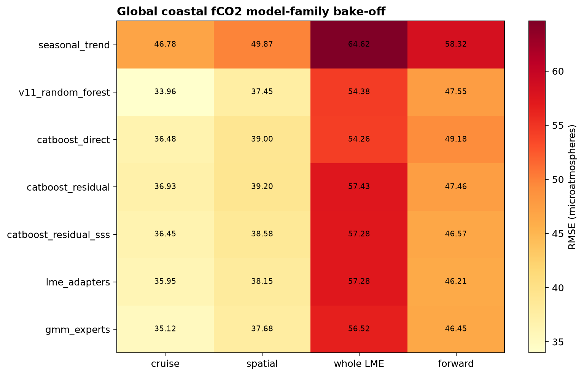

Figure 1. Native held-out fCO2 RMSE for seven model families and four validation designs; the honest v1.x random forest leads cruise and spatial tests, while no model leads every transfer regime.

### Figure 2

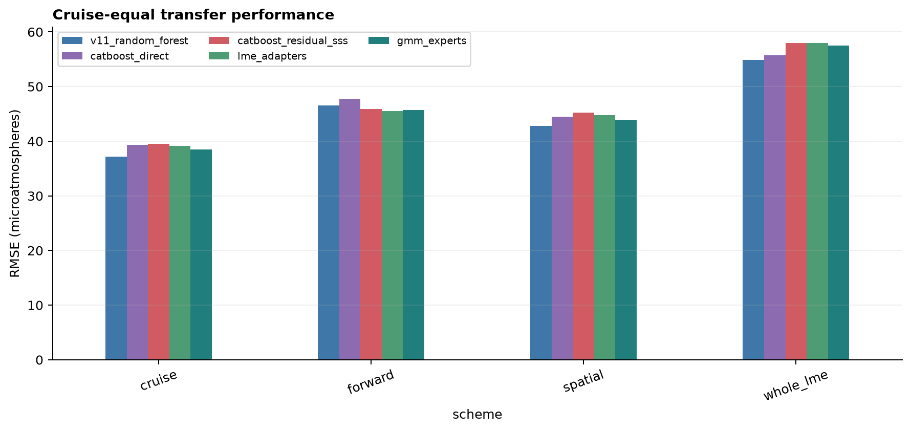

Figure 2. Cruise-equal RMSE gives each cruise equal influence and confirms that none of the modern candidates beats the honest random-forest baseline by the frozen five-percent margin.

### Figure 3

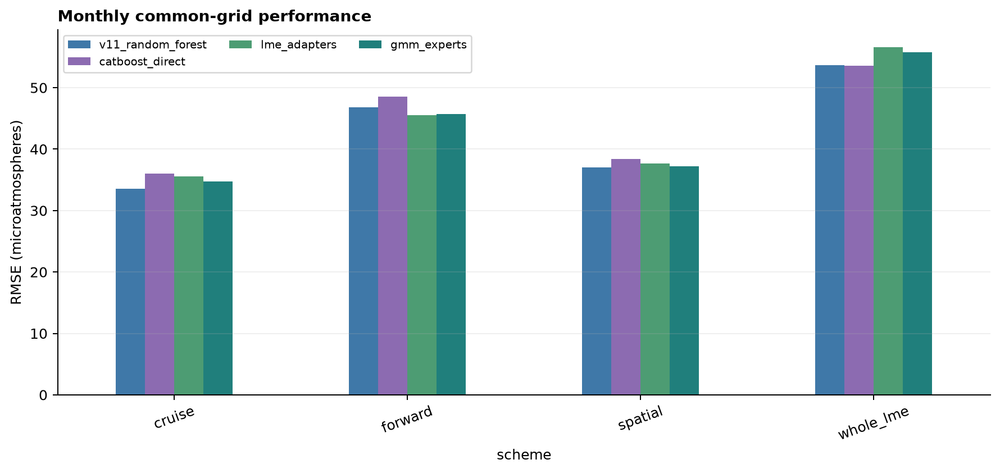

Figure 3. Monthly common-grid RMSE preserves the same ranking as native records, showing that repeated sampling within grid months does not explain the random forest advantage.

### Figure 4

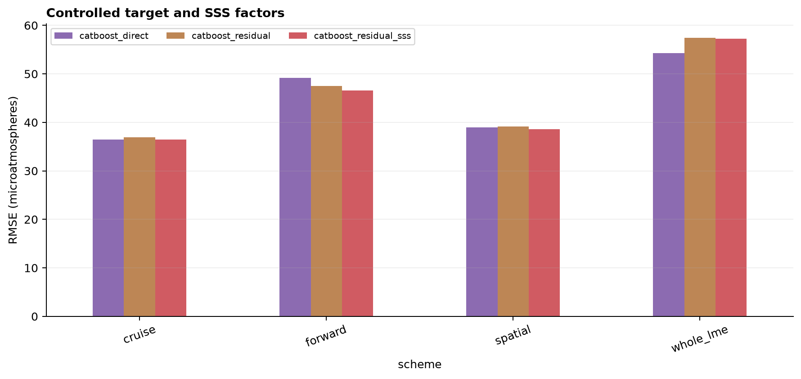

Figure 4. Controlled CatBoost effects isolate target residualization from adding cross-fitted SSS; SSS gives small consistent gains, while residualization alone does not improve ordinary held-cruise skill.

### Figure 5

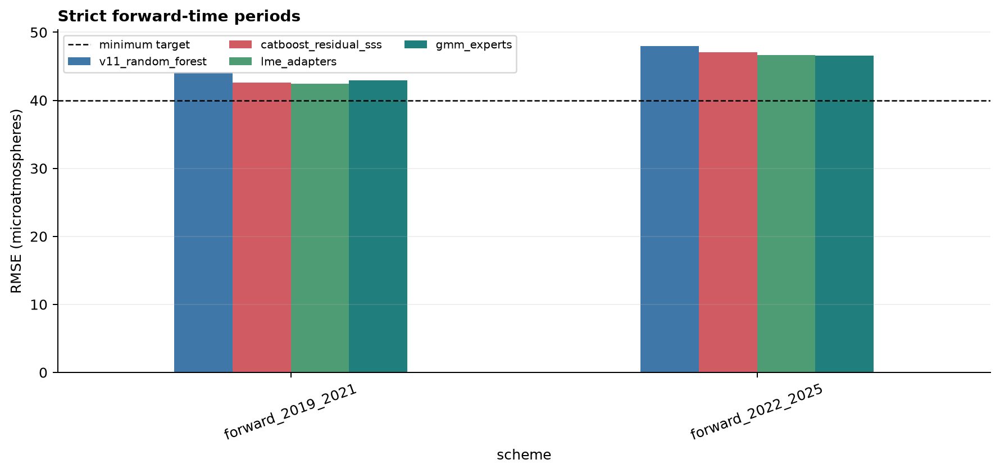

Figure 5. Strict forward-time RMSE in 2019-2021 and 2022-2025; residual sharing reduces the late-period error and bias but every candidate remains above the 40 microatmosphere minimum target.

### Figure 6

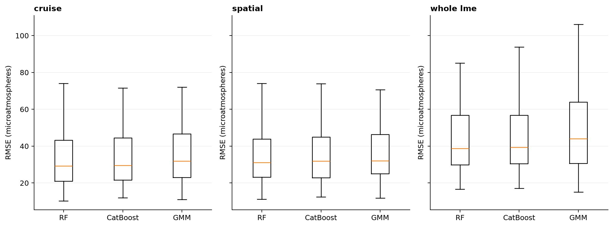

Figure 6. Per-LME RMSE distributions reveal a long geographic error tail and the tradeoff between random-forest interpolation and residual-model temporal transfer.

### Figure 7

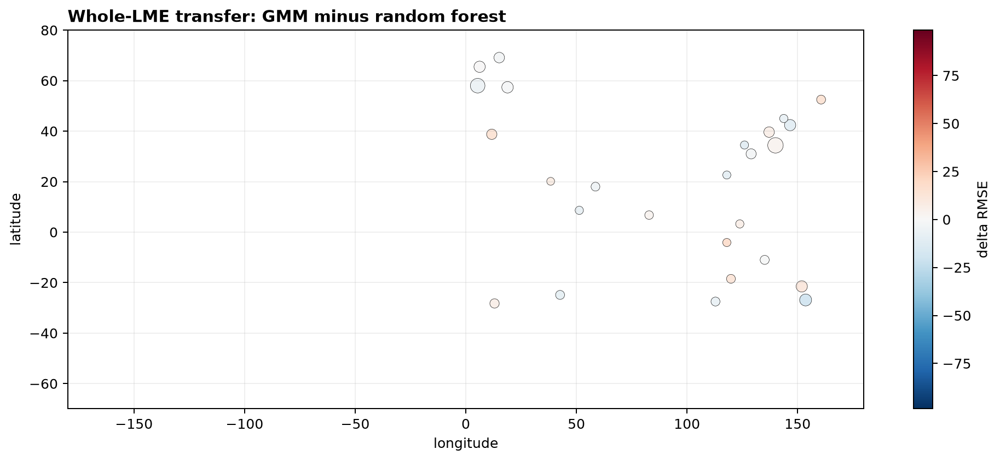

Figure 7. Whole-LME GMM-minus-random-forest RMSE difference at observation-weighted LME centers; positive red points mark regions where soft experts transfer less reliably.

### Figure 8

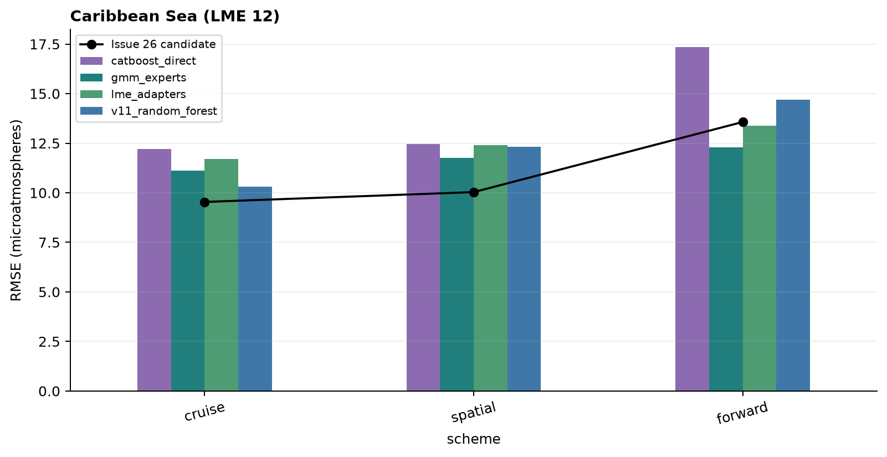

Figure 8. Caribbean Sea LME 12 RMSE against the prior Issue 26 regional candidate; no global candidate preserves its cruise, spatial, and forward skill simultaneously.

### Figure 9

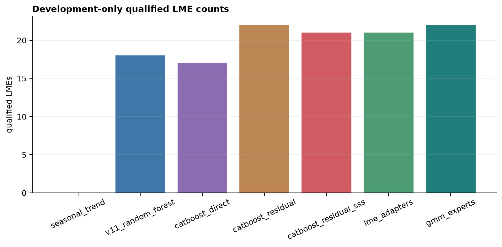

Figure 9. Development-only LME qualification counts; GMM meets simple absolute/positive-skill thresholds in more LMEs, but this does not override failed global, calibration, and paired-improvement gates.

### Figure 10

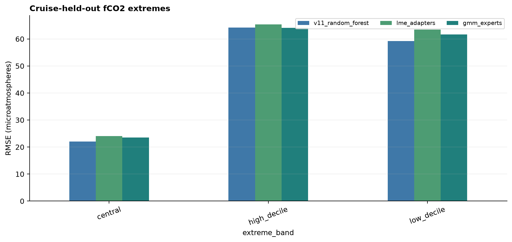

Figure 10. Cruise-held-out RMSE in low, central, and high observed-fCO2 bands; extreme values remain substantially harder than the central distribution.

### Figure 11

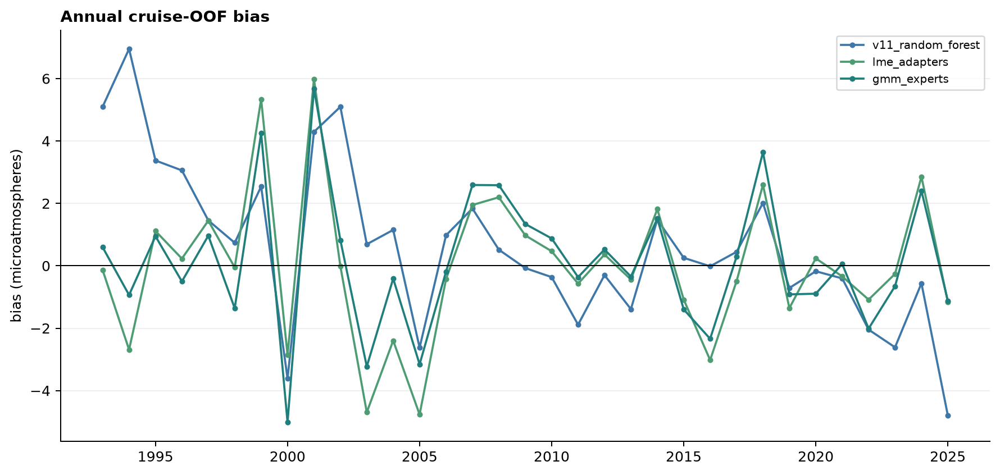

Figure 11. Annual cruise-OOF bias for the principal models; the random forest underestimates the observed temporal rise more strongly than residual-sharing candidates.

### Figure 12

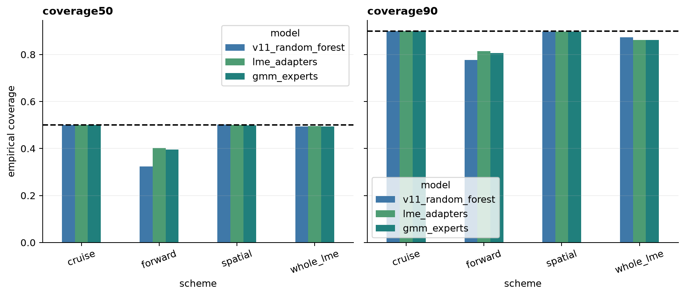

Figure 12. Leakage-safe 50 and 90 percent interval coverage; forward-time coverage collapses below the frozen calibration ranges for every leading model.

### Figure 13

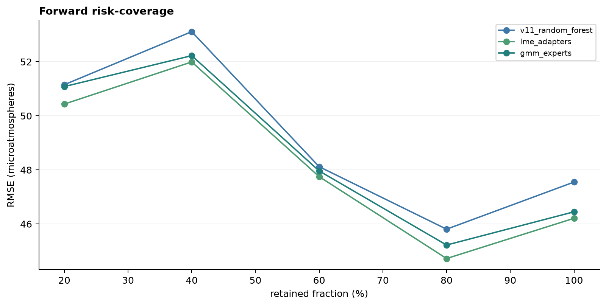

Figure 13. Forward RMSE after retaining cases with the narrowest empirical 90 percent intervals; ranking risk helps triage cases but does not establish unsampled-grid reliability.

### Figure 14

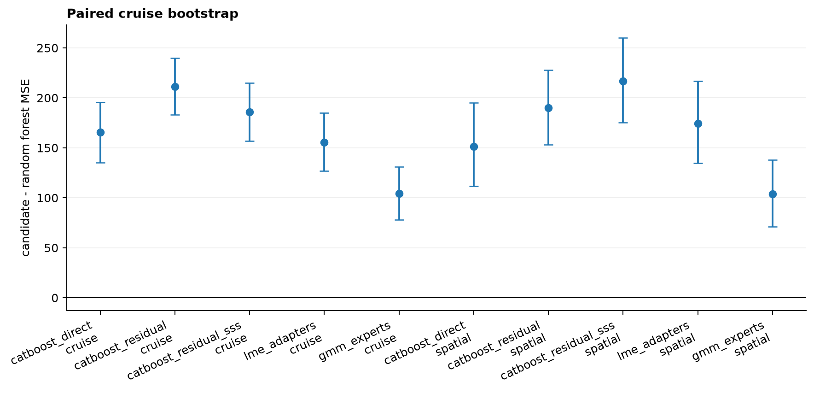

Figure 14. Cruise-level paired MSE bootstrap contrasts against the honest v1.x random forest; every modern candidate has a positive confidence interval in cruise and spatial validation.

### Figure 15

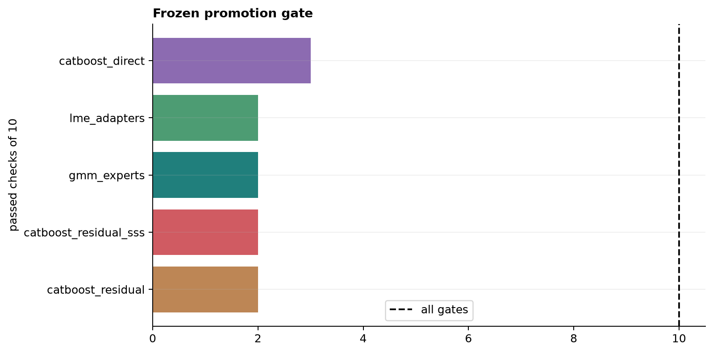

Figure 15. Frozen selection-gate totals for each modern candidate; none passes more than three of ten checks, so no architecture is promoted.

### Tables

- `table01_native_metrics.csv`: machine-readable source data used by this report.
- `table02_cruise_equal_metrics.csv`: machine-readable source data used by this report.
- `table03_common_grid_metrics.csv`: machine-readable source data used by this report.
- `table04_lme_metrics.csv`: machine-readable source data used by this report.
- `table05_lme_macro_worst.csv`: machine-readable source data used by this report.
- `table06_stratified_metrics.csv`: machine-readable source data used by this report.
- `table07_time_block_metrics.csv`: machine-readable source data used by this report.
- `table08_annual_diagnostics.csv`: machine-readable source data used by this report.
- `table09_extreme_metrics.csv`: machine-readable source data used by this report.
- `table10_interval_metrics.csv`: machine-readable source data used by this report.
- `table11_risk_coverage.csv`: machine-readable source data used by this report.
- `table12_paired_bootstrap.csv`: machine-readable source data used by this report.
- `table13_historical_2004_2005.csv`: machine-readable source data used by this report.
- `table14_lme_qualification.csv`: machine-readable source data used by this report.
- `table15_model_definitions.csv`: machine-readable source data used by this report.
- `table16_training_log.csv`: machine-readable source data used by this report.
- `table17_selection_gate.csv`: machine-readable source data used by this report.
- `table18_source_inventory.csv`: machine-readable source data used by this report.
- `table19_lme_centers.csv`: machine-readable source data used by this report.
- `table20_candidate_summary.csv`: machine-readable source data used by this report.
- `table21_trend_slopes.csv`: machine-readable source data used by this report.
- `table22_forward_period_metrics.csv`: machine-readable source data used by this report.
