# P2.3c frozen global-coastal predictor cube

Issue: #53

Output: `C:\backup\phd\data\processed\recad_v2_3\global_coastal_predictor_cube_v2.3.nc`

Decision: **pass cube freeze; proceed to Issue #54 predictor ablations**

## Scientific question and permitted claim

This engineering experiment asks whether the predictors qualified by Issue #52 can be represented as one traceable, replayable 1993-2025 monthly cube on the observation-independent Issue #50 geometry. It may claim reproducible input construction and coverage behavior. It does not claim SSS or fCO2 prediction skill and does not open locked or external-independent labels.

## Data, splits, and leakage controls

The cube contains 396 months and 838,661 coastal nodes, or 332,109,756 grid-months. It copies accepted source values from the five standardized full-grid caches into row-major coastal-node order. Missing or broad-range-rejected values remain NaN and receive explicit status and availability codes. The Issue #50 mask, Issue #38 SOCAT cache, and Issue #38 group/split manifest are SHA256 verified and unchanged.

No observation target is stored. No climatology, normalization, imputation, learned repair, or target-dependent transformation is fitted in this cube. Those operations must be fitted inside each training fold during Issue #54 and later model comparisons.

## Candidate models and training

No model was trained. SST, wind speed, and atmospheric xCO2 define `predictor_ready_mask`. GLORYS SSS is a masked background field. ADT is optional and cannot block release. `strict_common_support_mask` requires all five fields and exists only for controlled common-support comparisons. The compressed NetCDF uses one-month by 65,536-node chunks, zlib compression, and an atomic completion marker.

## Main development results

| predictor | role | mean_area_fraction | minimum_area_fraction | missing_gridmonths | range_rejected_gridmonths | imputed_gridmonths |
|---|---|---|---|---|---|---|
| sst | mandatory_dense | 100.000% | 100.000% | 0 | 0 | 0 |
| sss_bg | masked_background | 98.126% | 98.126% | 9645768 | 0 | 0 |
| adt | optional | 92.666% | 87.711% | 57102093 | 0 | 0 |
| wspd | mandatory_dense | 100.000% | 100.000% | 0 | 0 | 0 |
| xco2air | mandatory_dense | 100.000% | 100.000% | 0 | 0 | 0 |
| predictor_ready | release_mask | 100.000% | 100.000% | 0 | 0 | 0 |
| strict_common | diagnostic_mask | 92.138% | 87.301% | 59219633 | 0 | 0 |

The mandatory predictor-ready mask is complete because all three required fields are complete over the frozen geometry and core period. Strict common support reproduces Issue #52: it averages about 92.14% of product area and falls to about 87.30% in the worst month. Shelf strict support remains lower and seasonally variable because ADT coverage is weakest in shallow and high-latitude waters.

The final external file is 1.571 GB, built in 2.04 minutes from 30.481 GB of standardized source caches. Every deterministic replay check has zero mismatches, and monthly area coverage agrees with the independently archived Issue #52 audit to machine precision.

## Decision and limitations

Issue #53 passes. Issue #54 must use this frozen cube and identical target rows/splits for all ablations. ADT and background SSS require missingness-aware branches; a sample may remain publishable when either is absent. Chl-a, MLD, river discharge, and unfrozen circulation proxies remain excluded.

The cube records standardized cache paths and hashes, but the upstream producers may issue future revisions; any source update requires a new cube version. Broad physical ranges detect gross corruption rather than scientific bias. The cube is an input product, so complete predictor-ready coverage does not establish prediction reliability in observation-sparse regions.

## Figure and table index

### Figure 1

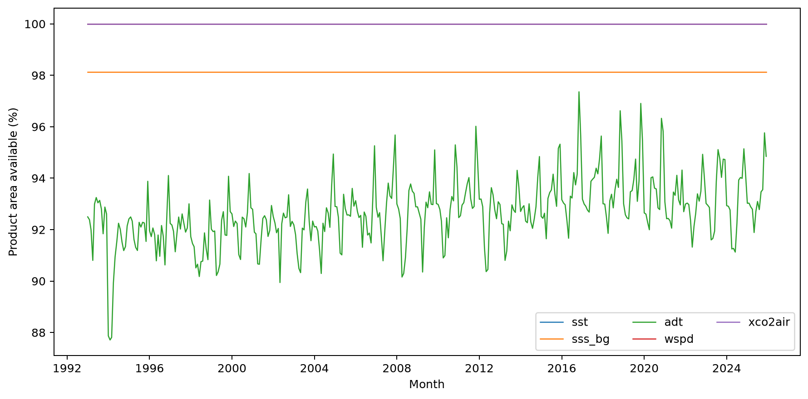

Figure 1. Replayed monthly area-weighted availability for every dynamic field written to the frozen coastal-node cube from 1993 through 2025.

### Figure 2

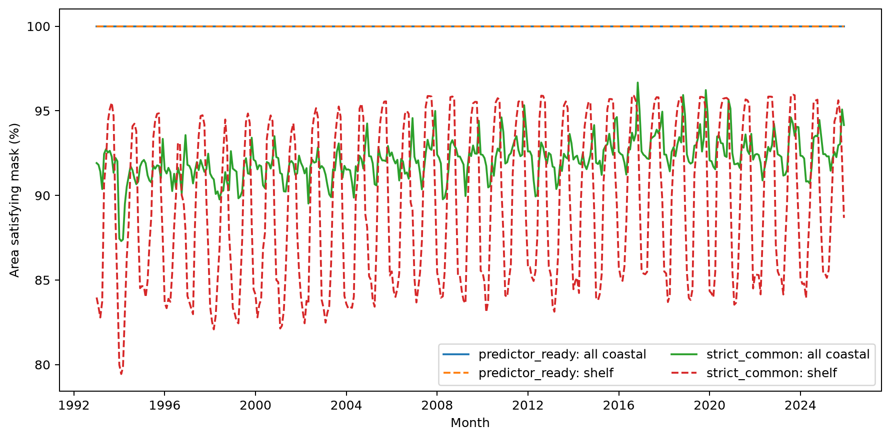

Figure 2. Mandatory predictor-ready coverage remains separate from five-field strict common support; dashed curves show the shallower and more seasonally incomplete shelf core.

### Figure 3

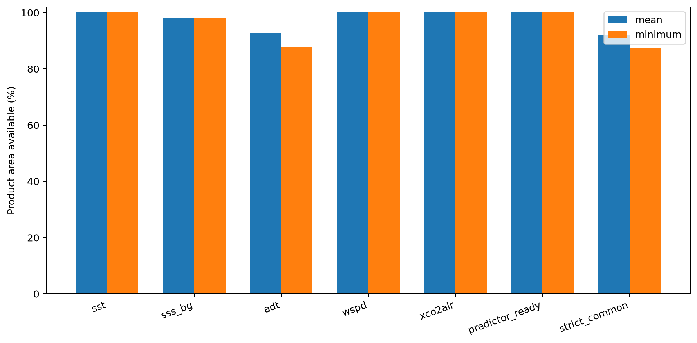

Figure 3. Mean and worst-month product-area coverage for each stored field and the two distinct readiness masks, confirming that optional ADT does not gate release.

### Figure 4

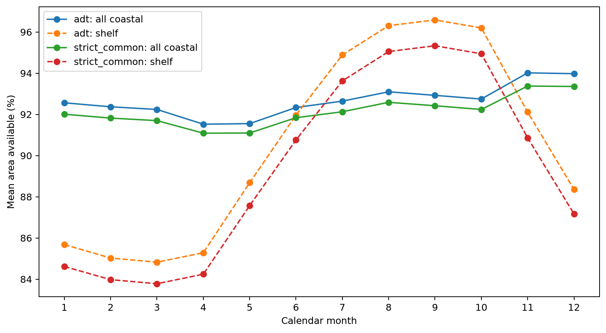

Figure 4. Calendar-month climatology of ADT and strict support, showing why an ADT requirement would impose a strong seasonal selection on shelf waters.

### Figure 5

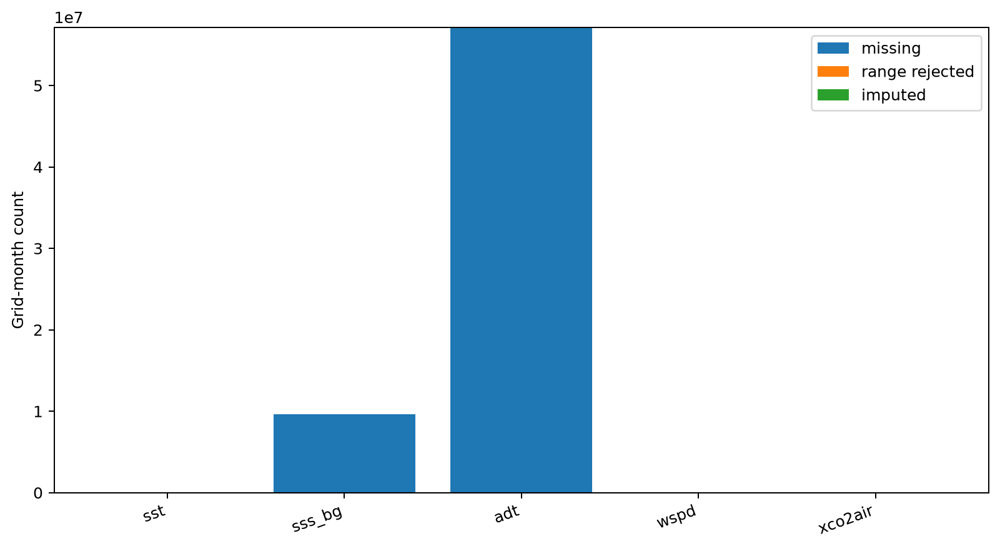

Figure 5. Missing, physical-range-rejected, and imputed grid-month accounting; the frozen cube performs no imputation and preserves unavailable values as NaN plus status codes.

### Figure 6

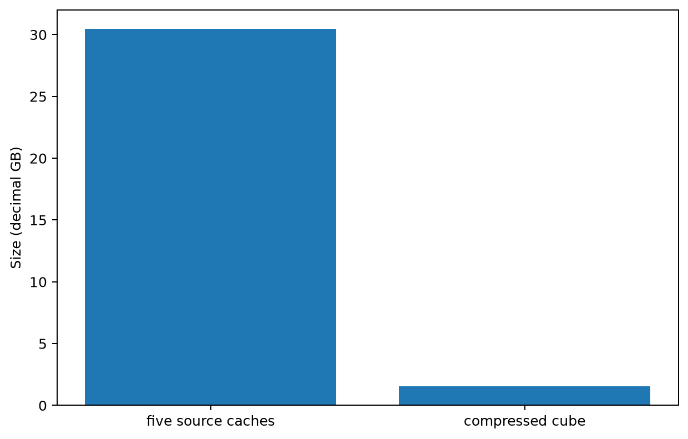

Figure 6. Storage accounting for the five full-grid standardized caches and the coastal-node cube, which removes land and non-product ocean nodes while retaining explicit status masks.

### Figure 7

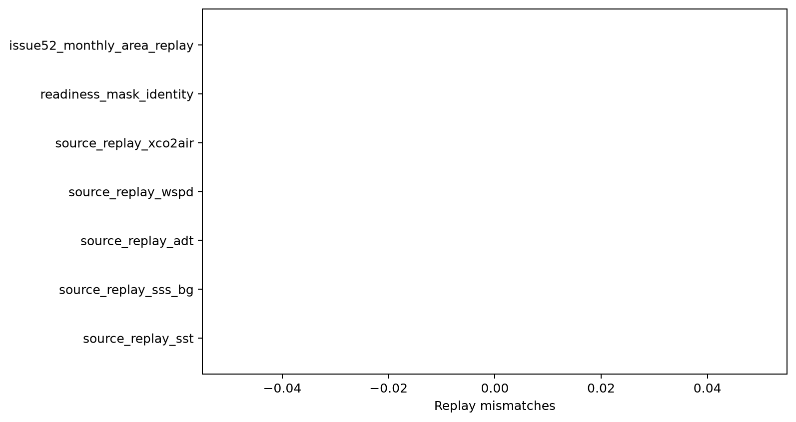

Figure 7. Deterministic source-value, status, readiness-mask, and Issue 52 coverage replay mismatches; all required checks must remain exactly zero.

### Figure 8

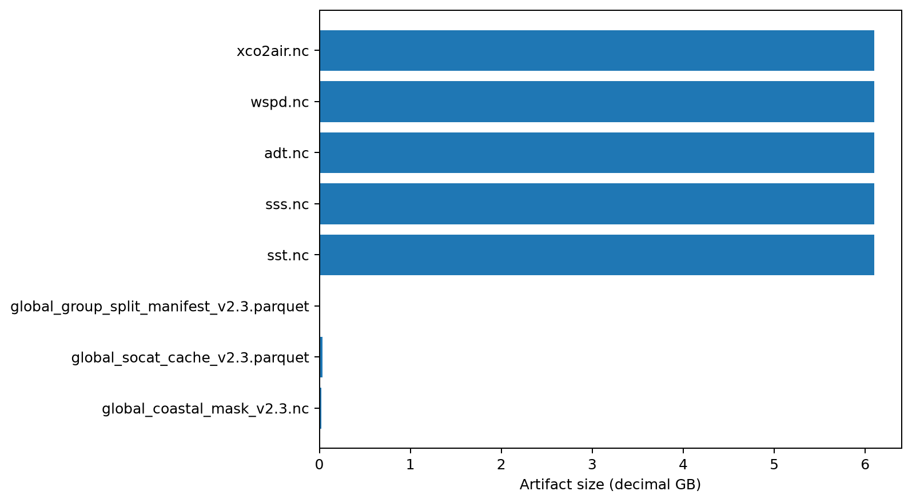

Figure 8. Frozen input-artifact sizes for the geometry, target cache, split manifest, and five standardized predictor sources; every SHA256 was verified before publication.

### Figure 9

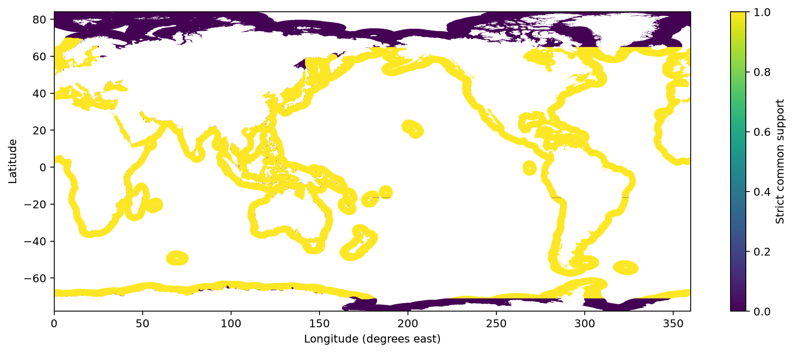

Figure 9. Exact five-field strict common-support mask for 1994-02; this diagnostic mask is deliberately separate from the mandatory predictor-ready release mask.

### Figure 10

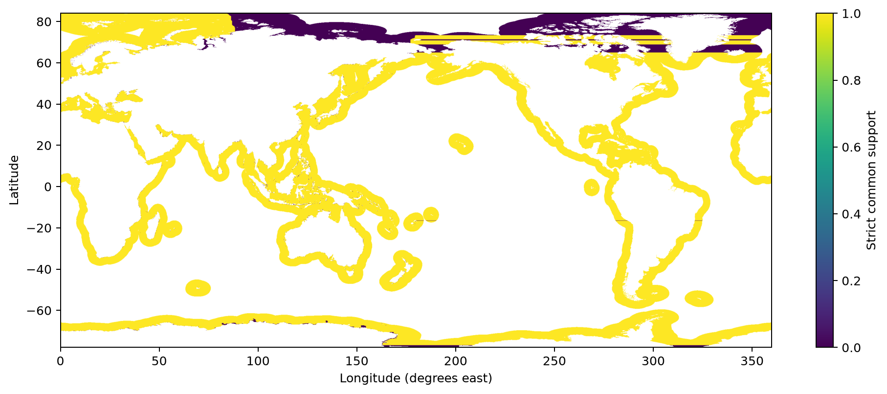

Figure 10. Exact five-field strict common-support mask for 2025-12; this diagnostic mask is deliberately separate from the mandatory predictor-ready release mask.

### Figure 11

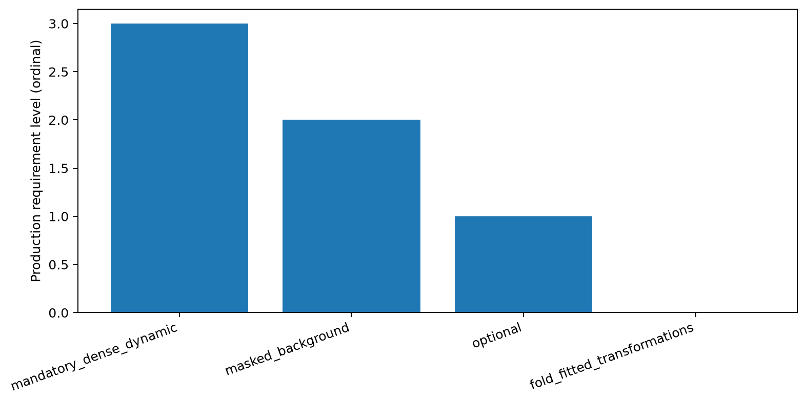

Figure 11. Frozen production roles distinguish mandatory dynamic inputs, explicitly masked background SSS, optional ADT, and transformations that must be fitted only inside training folds.

### Source tables

- `table01_data_dictionary.csv`: variables, units, dimensions, roles, and status semantics.
- `table02_source_inventory.csv`: immutable source paths, sizes, and verified SHA256.
- `table03_monthly_coverage.csv`: per-field and mask monthly coverage.
- `table04_predictor_summary.csv`: whole-period field and mask summary.
- `table05_time_block_coverage.csv`: frozen temporal-block diagnostics.
- `table06_seasonal_coverage.csv`: calendar-month coverage climatology.
- `table07_resource_accounting.csv`: runtime and storage accounting.
- `table08_replay_checks.csv`: deterministic replay results.
- `table09_mask_definitions.csv`: geometry, release, strict, and per-variable masks.
- `table10_excluded_candidates.csv`: fields deliberately absent from the cube.
- `table11_frozen_decision.csv`: production role contract for Issue #54.
- `table12_cube_file.csv`: final path, hash, chunking, and compression.
