# Issue #44 — Global coastal calibration and applicability contract

## Scientific question and permitted claim

This experiment asks whether the frozen Issue 62 SSS candidate and Issue 64 fCO2 ensemble can receive leakage-safe uncertainty intervals and deployable A/B/C/D grid-month applicability flags over the complete 1993-2025 coastal domain. The result is a development-stage reliability contract and complete auditable projection. It is not independent qualification of unsampled coasts.

## Data, splits, and leakage controls

All point and calibration evidence uses the corrected Issue 61 cruise, geographic-plus-buffer, whole-region, and past-only forward folds. Interval method selection stayed inside outer training. Risk heads use only deployment-available support, environmental novelty, input availability, time distance, and model/background disagreement. Locked, external-independent, and 2026 labels remained sealed. The final products preserve all 332,109,756 grid-months per target.

## Candidate models and training

SSS is the three-seed CatBoost background-residual finalist. fCO2 is the continuous-background ExtraTrees/CatBoost convex ensemble with a frozen final CatBoost weight of 0.30 and final fCO2 training uses the Issue 61 leakage-safe cross-fitted SSS covariate. SSS intervals use support-risk-scaled conformal widths; fCO2 uses the prediction-stratified conformal control. Grades use cruise-derived 50/75/90% risk thresholds plus hard geographic, environmental, missing-input, temporal, group-diversity, and disagreement reason bits.

## Main development results

Cruise-fold RMSE is 0.896 PSU for SSS and 32.42 µatm for fCO2. Cruise 90% coverage is 0.898 and 0.901. The minimum shifted-scheme coverage is 0.788, below the frozen 0.85 gate. Complete-domain mean trusted area is 20.6% for SSS and 21.0% for fCO2; suppressed area is 70.5% and 69.1%, respectively. The suppressed-area limit passes, but global interval qualification fails.

## Decision and limitations

The A/B/C/D machinery and complete products are frozen for audit and the later one-time independent decision. Global predictive qualification does not pass because intervals under-cover geographic and whole-region shifts. A/B means supported by the development contract, not proven accurate in observation-free waters. C is diagnostic; D is suppressed. The product must retain these flags and may not publish unflagged global values. No difficult region was removed to improve a score.

## Figures

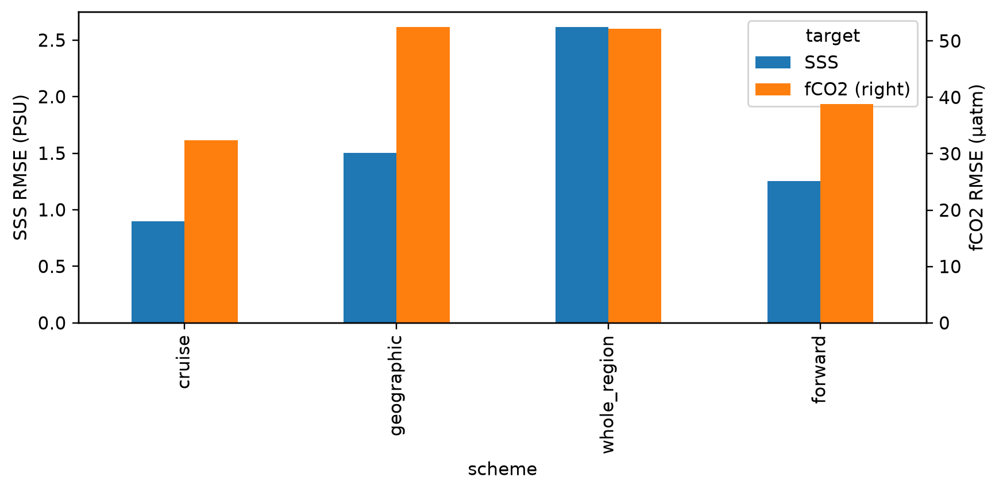

Figure 1. Pooled corrected-fold point RMSE for the frozen SSS and fCO2 candidates. Geographic, whole-region, and forward partitions quantify transfer error rather than random-row interpolation.

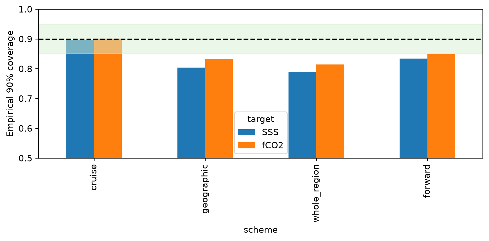

Figure 2. Empirical 90% interval coverage on corrected outer folds. Cruise coverage is near nominal, while multiple shifted partitions fall below the frozen 0.85 lower bound.

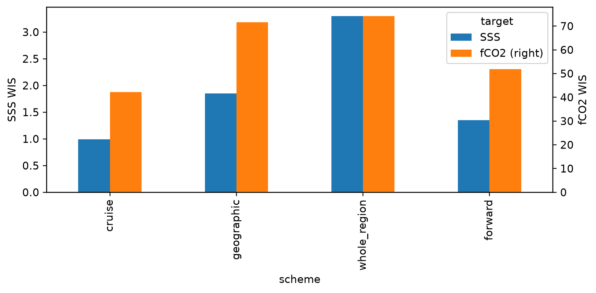

Figure 3. Weighted interval score for the selected target-specific interval rules across all corrected validation schemes; lower values indicate sharper calibrated distributions.

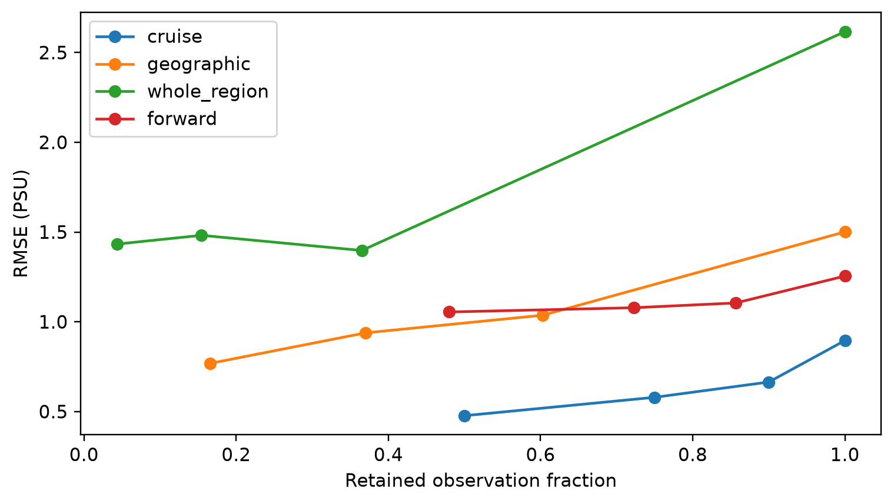

Figure 4. SSS RMSE as observations are retained through fixed cruise-derived risk thresholds. Shifted regions retain fewer rows and remain harder even at matched risk cutoffs.

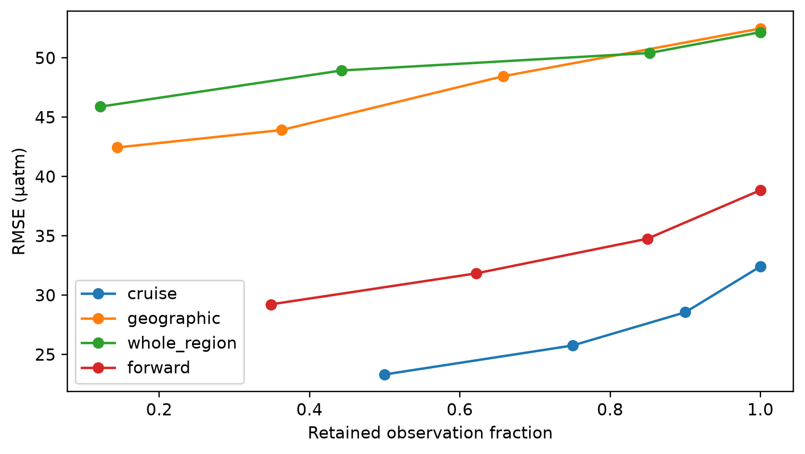

Figure 5. fCO2 RMSE at fixed 50%, 75%, 90%, and complete cruise-derived risk envelopes. Risk ranking is useful in-distribution but weak under whole-region transfer.

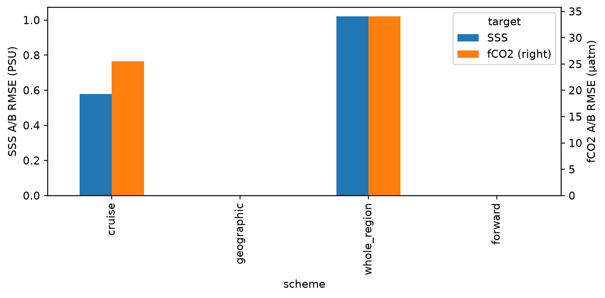

Figure 6. RMSE among observations receiving frozen A/B status in each outer scheme. Geographic folds yield no A/B rows because the support envelope correctly abstains everywhere.

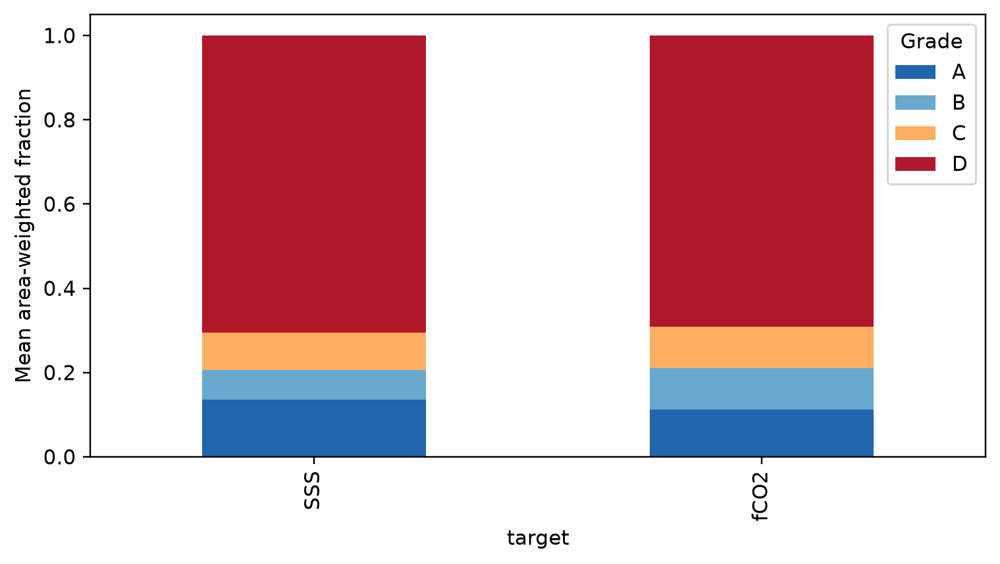

Figure 7. Mean area-weighted A/B/C/D coverage across the complete 396-month by 838,661-node product geometry. Difficult areas remain present as C/D rather than being discarded.

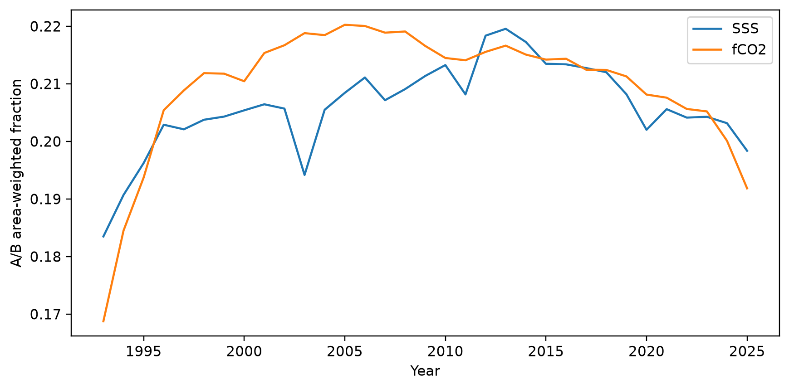

Figure 8. Area-weighted A/B fraction from 1993 through 2025. Changes reflect predictor availability and distance from the temporal and environmental training envelope.

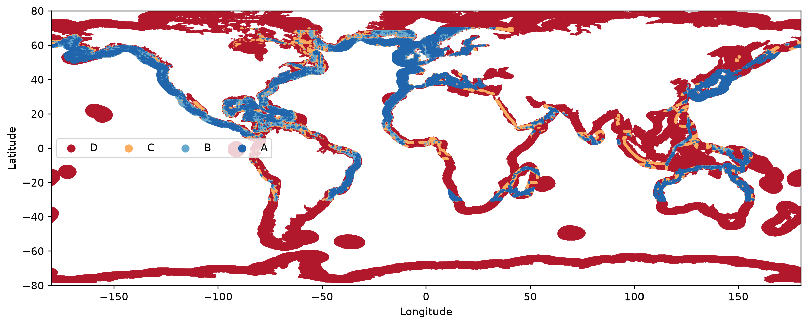

Figure 9. Global coastal SSS applicability grades in July 2025. A/B is concentrated near demonstrated observational support; C is diagnostic and D is suppressed.

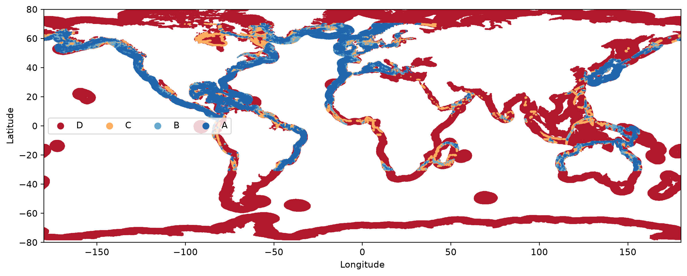

Figure 10. Global coastal fCO2 applicability grades in July 2025. The full geometry is retained, including unsupported coasts marked D rather than silently omitted.

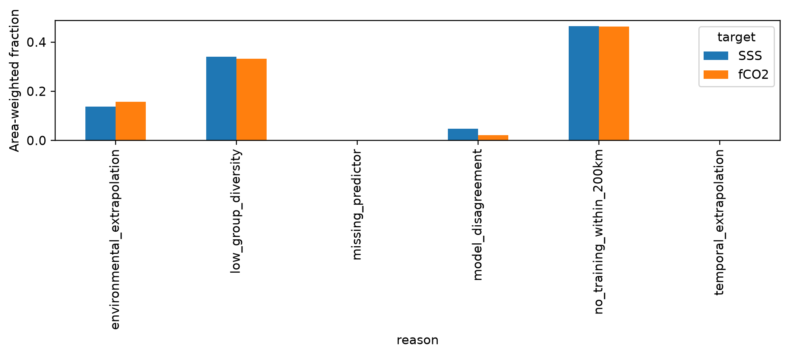

Figure 11. Area-weighted prevalence of each deployable reason bit in July 2025. Multiple bits may coexist, so fractions are diagnostic and do not sum to one.

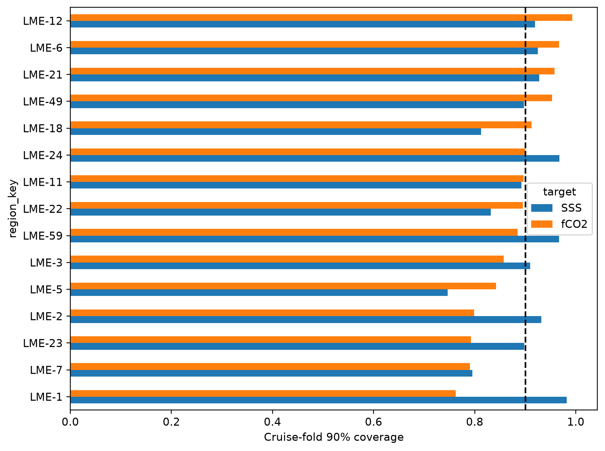

Figure 12. Cruise-fold 90% coverage in the fifteen observation regions with the largest row counts. Regional heterogeneity remains visible despite near-nominal pooled cruise coverage.

## Figure and table index

Figures 1-12 cover point error, calibration, risk coverage, observed grades, complete-domain area, temporal drift, global maps, reason bits, and regional calibration. Tables contain outer metrics, fixed-coverage risk, observed-grade metrics, annual and regional calibration, interval-method audit, complete-product grades and masks, reason-bit prevalence, partition summaries, and external artifact hashes.
