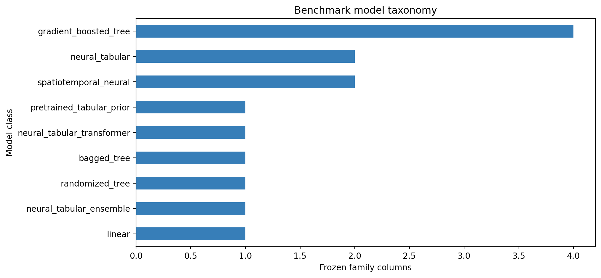
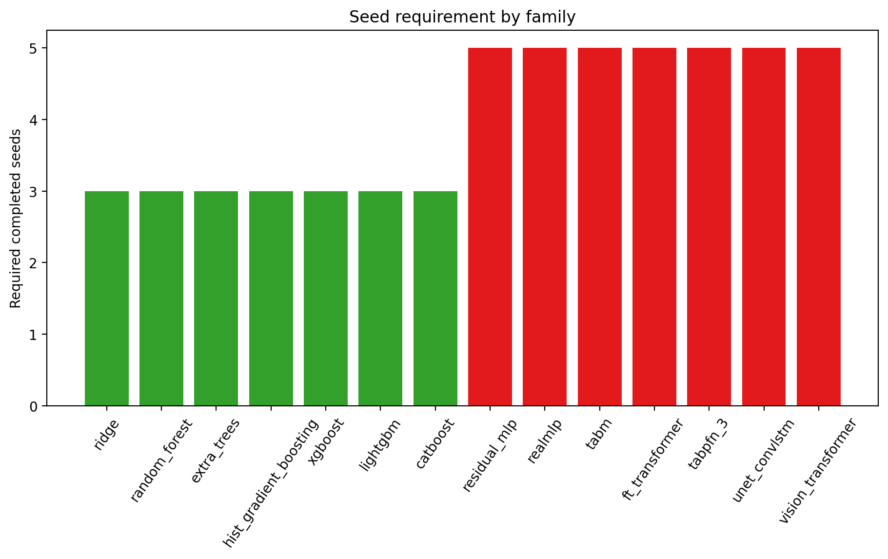
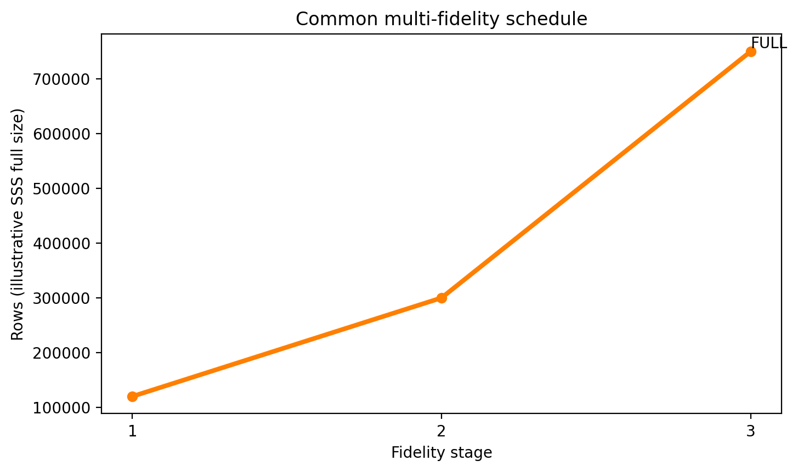

# Fair model-family and optimization benchmark preregistration

## Scientific question and permitted claim

Which globally applied model family best reconstructs coastal SSS and fCO2 when every family receives the same eligible observations, predictors, corrected outer identities, nested upstream lineage, and an empirically converged family-specific optimization? This Issue 88 archive freezes the comparison before new benchmark results are inspected. It contains no model-performance result and promotes no model.

## Data, splits, and leakage controls

The benchmark reuses the Issue-61 development identities for complete cruises, buffered geographic blocks, whole regions, forward time, and early era. Within a target, all families receive identical eligible rows. fCO2 receives only outer-nested deployment-valid SSS predictions. External pCO2/fCO2 products, external target pretraining, one-time independent labels, and 2026 labels are prohibited from the main ranking. TabPFN receives the full eligible pool; internal estimator sampling is part of its frozen model configuration rather than a special external subset.

## Candidate models and training

| Family | Class | Representation | Trial range | Seeds |
|---|---|---|---:|---:|
| ridge | linear | tabular | 16-32 | 3 |
| random_forest | bagged_tree | tabular | 48-96 | 3 |
| extra_trees | randomized_tree | tabular | 48-96 | 3 |
| hist_gradient_boosting | gradient_boosted_tree | tabular | 48-96 | 3 |
| xgboost | gradient_boosted_tree | tabular | 48-96 | 3 |
| lightgbm | gradient_boosted_tree | tabular | 48-96 | 3 |
| catboost | gradient_boosted_tree | tabular | 48-96 | 3 |
| residual_mlp | neural_tabular | tabular | 36-72 | 5 |
| realmlp | neural_tabular | tabular | 36-72 | 5 |
| tabm | neural_tabular_ensemble | tabular | 36-72 | 5 |
| ft_transformer | neural_tabular_transformer | feature_tokens | 36-72 | 5 |
| tabpfn_3 | pretrained_tabular_prior | tabular | 24-48 | 5 |
| unet_convlstm | spatiotemporal_neural | coastal_grid_patch_sequence | 36-72 | 5 |
| vision_transformer | spatiotemporal_neural | coastal_grid_patch_sequence | 36-72 | 5 |

Every family follows 120,000-row, 300,000-row, and full-data fidelity stages. It must complete at least 3 seeds, or five for neural families. Empirical convergence requires a complete full-data stage and less than 0.25% improvement in both the final 20% of the search and the final capacity tail. A family that exhausts its maximum budget without satisfying these gates remains `optimization_incomplete` and cannot advance.

## Main development results

The machine decision is `benchmark_contract_frozen_no_models_ranked`. Fourteen model-family columns and five outer protocols are fixed. The top five eligible, empirically converged families per target will advance by the same deterministic score: the weighted geometric mean of matched-control-normalized cruise-equal RMSE across all five protocols. Whole-region ratio, worst-region ratio, wall time, and stable family name are frozen tie breakers. Missing protocols, missing secondary metrics, or incomplete optimization make a family ineligible rather than assigning an artificial poor rank.

The complete roadmap is bounded at 68 primary scientific cells. Hyperparameter trials, seeds, and folds are repetitions inside a cell. SOM and GRaCER remain spatial-organization rows for later issues and are not additional predictor-family columns.

Figure 1. The frozen benchmark contains 14 model-family columns spanning linear, bagged-tree, boosted-tree, tabular-neural, and spatiotemporal-neural approaches. SOM and GRaCER are excluded from the columns because they are spatial-organization rows.

Figure 2. Every family receives a preregistered minimum and maximum optimization budget. A family may stop after the minimum only when the search and capacity tails meet the same empirical-convergence threshold; reaching the maximum without convergence is preserved as optimization_incomplete.

Figure 3. Tree and linear families require at least three completed seeds, while neural families require five. Seed counts are convergence requirements and cannot be reduced after outer-fold results are inspected.

Figure 4. The frozen primary score gives the largest weight to whole-region transfer, then buffered geography, with complete-cruise, forward-time, and early-era evidence retained. Every protocol uses cruise-equal RMSE normalized by its matched strict control.

Figure 5. Every family follows the same 120,000-row, 300,000-row, and full-data fidelity sequence. The lower fidelities allocate search effort; only a completed full-data stage can be declared empirically converged.

Figure 6. Advancement requires all convergence gates simultaneously: minimum trials, the full eligible data, the family-specific seed count, a flat final search tail, and a flat capacity tail. A failed gate remains visible rather than being converted into a poor score.

Figure 7. The roadmap bounds the scientific comparison at 68 primary target-architecture cells: 28 global cells, at most 30 additional spatial cells for five advancing families per target, and at most 10 target-representation cells. Folds, seeds, and trials are repetitions.

Figure 8. Main-ranking information is deliberately restricted. All families receive the same eligible rows within a target and deployment-valid nested SSS for fCO2; external target products, external pretraining, one-time independent labels, and 2026 labels are excluded.

## Decision and limitations

Decision: `freeze_fair_model_family_benchmark_before_training`. The contract resolves the earlier unfairness in which Random Forest lacked the same optimization opportunity and TabPFN was proposed for a unique 50,000-row subset. It does not claim that the mathematical global optimum can be proven; it defines auditable empirical convergence under finite resource ceilings. Optional packages and large neural implementations must pass their preregistered smoke paths before P2.9b starts. A dependency or resource failure must remain an explicit infeasible or incomplete result and cannot be replaced after seeing another family's score.

The ranking selects five columns for controlled regionalization; it does not authorize different model families in different regions. The later shared-partition issues retain one family per target architecture and one target-independent partition for SSS and fCO2.

## Figure and table index

- Figures 1-8 correspond one-to-one to Tables 1-8 in `tables/`.
- Tables 1-8 contain the model taxonomy, protocol weights, fidelity schedule, convergence gates, selection order, bounded cell budget, information invariants, and literature coverage.
- Frozen input: `configs/frozen/model_family_benchmark_v2.5.in`.
- Machine validator: `scripts/validate_model_family_benchmark.py`.
