# P2 fair finite model zoo v2.4

## Scientific question and permitted claim

Issue #62 asks which point-model inductive biases deserve further work for global-coastal SSS and fCO2 after the Issue 61 validation repair. The permitted claim is a development-stage family comparison on corrected outer holdouts. No new locked, external-independent, or 2026 labels were opened, and this experiment does not itself publish a global gridded product.

## Data, splits, and leakage controls

Every family uses the frozen 1993-2025 SOCAT matchup and the exact five cruise, five 5-degree geographic plus 100 km buffer, five whole-region, and three past-only forward splits from Issue 61. Complete groups define outer fitting, inner 80/20 configuration selection, and the separate outer 80/20 conformal calibration partition. fCO2 receives only SSS predictions generated within the permitted lineage: inner-selection SSS never uses an inner-validation salinity label, and outer held/calibration SSS is predicted from outer model-fit labels. Figure 13 records zero group, record, calibration-group, and forbidden-future overlap.

## Candidate models and training

The screen compares Ridge, ExtraTrees, CatBoost, XGBoost, a residual MLP, and a compact numerical FT-Transformer. Each family receives six frozen configurations, the same capped inner training and validation budgets, group-equal RMSE selection, and a final refit on all outer model-fit rows. SSS uses a same-family GLORYS background-residual path with a direct fallback; fCO2 is direct and uses outer-nested predicted SSS. The screen seed is 62024. At most two Pareto or fallback stability finalists per target are repeated with seeds 62025 and 62026. Checkpoints, transforms, configuration scores, runtime, updates, parameter count, inference time, peak GPU memory, and SHA256 hashes are retained outside Git and indexed by archived tables.

## Main development results

- **SSS / CatBoost** (promotion_finalist): cruise RMSE 0.899, geographic RMSE 1.436, whole region RMSE 2.168, forward RMSE 1.186.
- **fCO2 / ExtraTrees** (stability_finalist_only): cruise RMSE 33.301, geographic RMSE 51.242, whole region RMSE 52.408, forward RMSE 39.228.
- **fCO2 / CatBoost** (stability_finalist_only): cruise RMSE 34.907, geographic RMSE 48.950, whole region RMSE 53.092, forward RMSE 40.079.

The finalist state is explicitly distinguished from promotion: `promotion_finalist` means the frozen relative-improvement rule passed, whereas `stability_finalist_only` preserves the best non-dominated families for a three-seed stability estimate without claiming practical superiority. Late-period bias, worst supported-region RMSE, group-equal error, interval coverage, risk-coverage, and compute cost remain part of the interpretation rather than post-hoc selection metrics.

Conditional context diagnostics were evaluated only after the point screen. Their recorded outcomes are: SSS: temporal=False, graph=True; fCO2: temporal=False, graph=True. A triggered diagnostic identifies residual structure worth a separately controlled context experiment; it is not evidence that a particular graph or temporal network will improve predictions.

## Decision and limitations

The machine-readable decision is `development_model_zoo_complete`. The selected families are development candidates under observed-location transfer, not independently validated product models. Geographic and whole-region holdouts are the best current proxies for unsampled coastal space but do not reproduce every no-observation coastline. Prediction intervals calibrated on outer training can under-cover after spatial or temporal shift. The graph statistic uses observed same-month adjacent cells and a permutation control; it establishes residual dependence, not causality or guaranteed graph-model skill.

Issue 62 closes the finite fair family screen. Any context branch triggered here must be treated as a separately named follow-up with the same corrected folds and an explicit point-model comparison. Product promotion still requires later tuning, grid-month applicability flags, and independent evidence defined by the roadmap.

## Figure and table index

### Figure 1

Figure 1. Held-out SSS RMSE for all six preregistered point-model families across cruise, true geographic-block plus 100 km buffer, whole-region, and rolling-forward validation; every bar pools the complete corrected outer predictions rather than an inner tuning subset.
### Figure 2

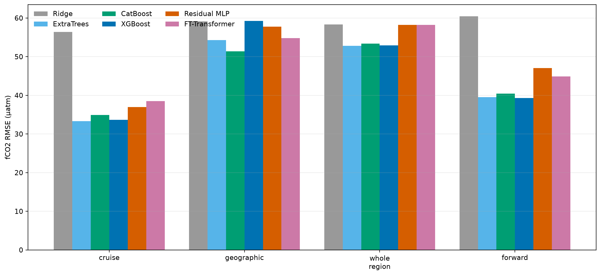

Figure 2. Held-out fCO2 RMSE for the same six families and repaired validation designs, using outer-nested predicted SSS rather than observed salinity as an input; the strict transfer columns determine whether ordinary cruise skill generalizes.
### Figure 3

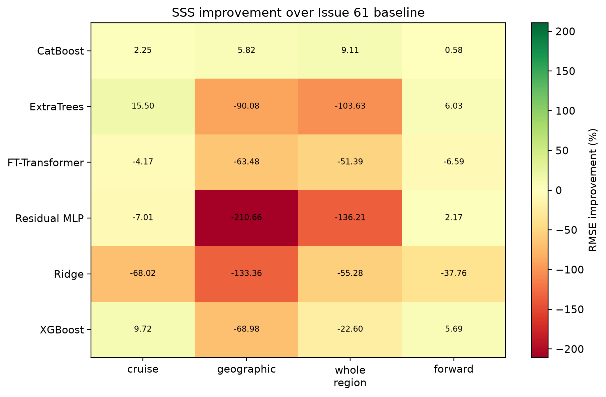

Figure 3. Percent SSS RMSE improvement relative to the Issue 61 CatBoost background-residual baseline; positive values indicate improvement, while the four columns expose any gain obtained by sacrificing geographic, regional, or future transfer.
### Figure 4

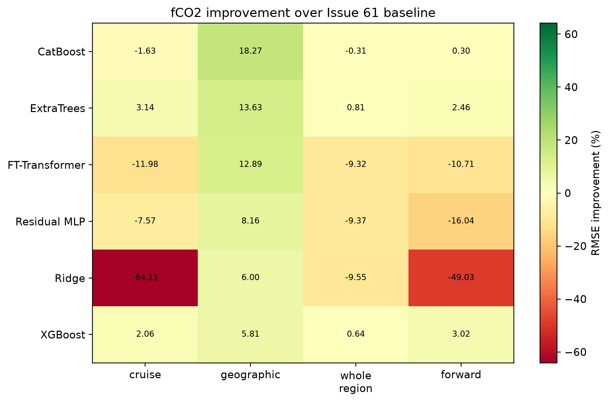

Figure 4. Percent fCO2 RMSE improvement relative to the Issue 61 modernized random forest; the comparison uses identical outer folds and nested upstream SSS, so differences isolate model family and its fixed small search allowance.
### Figure 5

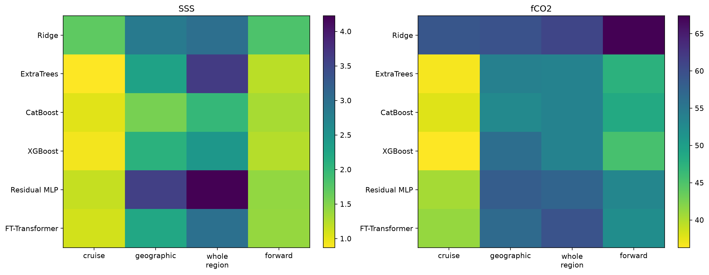

Figure 5. Group-equal RMSE assigns every held cruise or platform group equal influence and therefore checks whether dense observations dominate pooled RMSE; lower values and consistent color across columns indicate more stable transfer.
### Figure 6

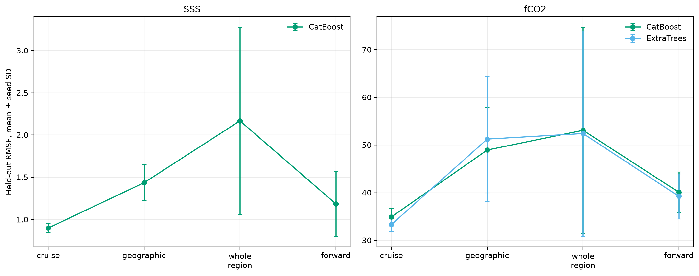

Figure 6. Three-seed RMSE mean and standard deviation for the preregistered Pareto or fallback finalists (SSS: CatBoost; fCO2: ExtraTrees, CatBoost); error bars quantify stochastic training sensitivity after configuration selection.
### Figure 7

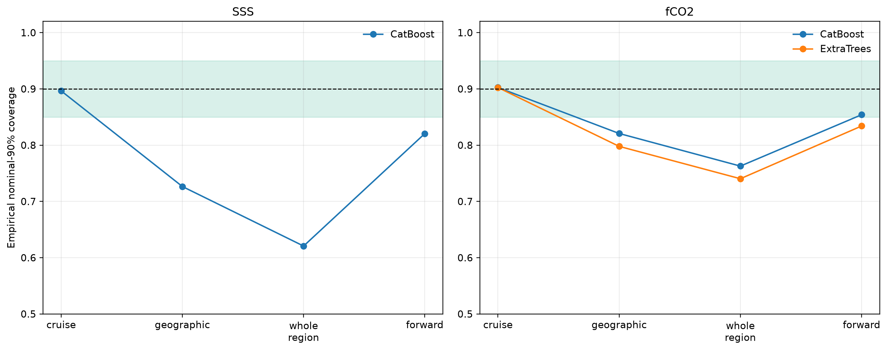

Figure 7. Empirical coverage of nominal 90% prediction intervals for the finalists; the green band marks the frozen 0.85-0.95 acceptance range and reveals where calibration fitted inside outer training fails under distribution shift.
### Figure 8

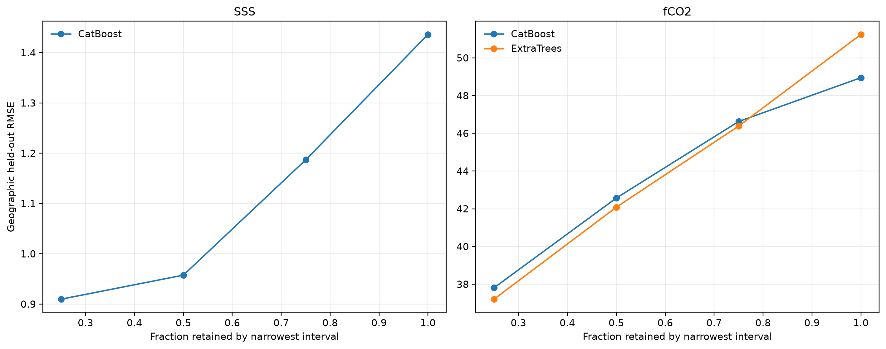

Figure 8. Geographic-holdout RMSE after retaining observations with the narrowest prediction intervals; a monotone curve supports interval width as a risk-ranking device but does not validate unobserved coastal grid cells.
### Figure 9

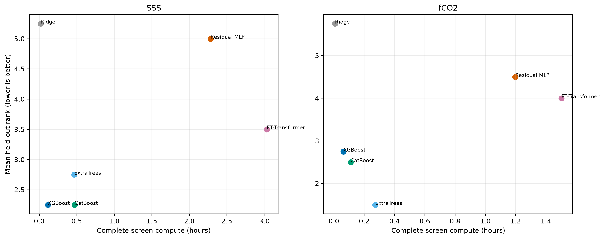

Figure 9. Complete screening compute time versus mean held-out rank, including all six inner configurations and final outer fits; the lower-left region identifies families that combine transfer skill with practical computational cost.
### Figure 10

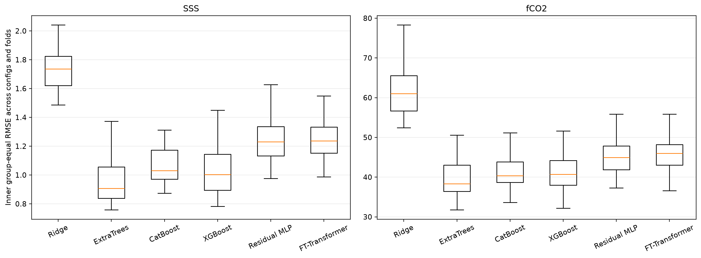

Figure 10. Distribution of inner group-equal RMSE across every family configuration and outer fold; broad or shifted boxes show whether the equal six-configuration allowance yielded a robust family or a configuration-sensitive result.
### Figure 11

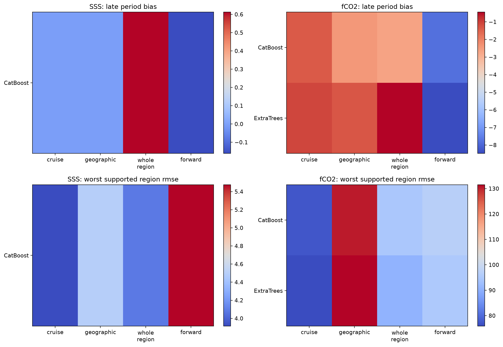

Figure 11. Finalist late-period bias for 2020-2025 and worst RMSE among LMEs with at least 200 held observations; these diagnostics prevent good global averages from hiding temporal drift or severe supported-region failures.
### Figure 12

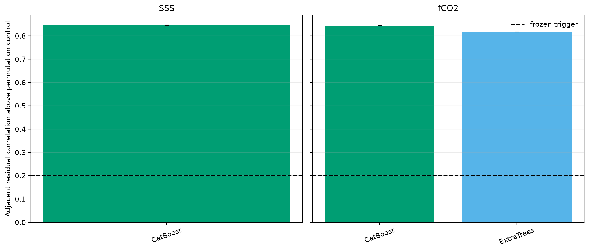

Figure 12. Same-month four-neighbour residual correlation after subtracting a within-month permutation control, averaged over finalist seeds; the frozen graph trigger is 0.20 and the resulting statuses are SSS=triggered, fCO2=triggered.
### Figure 13

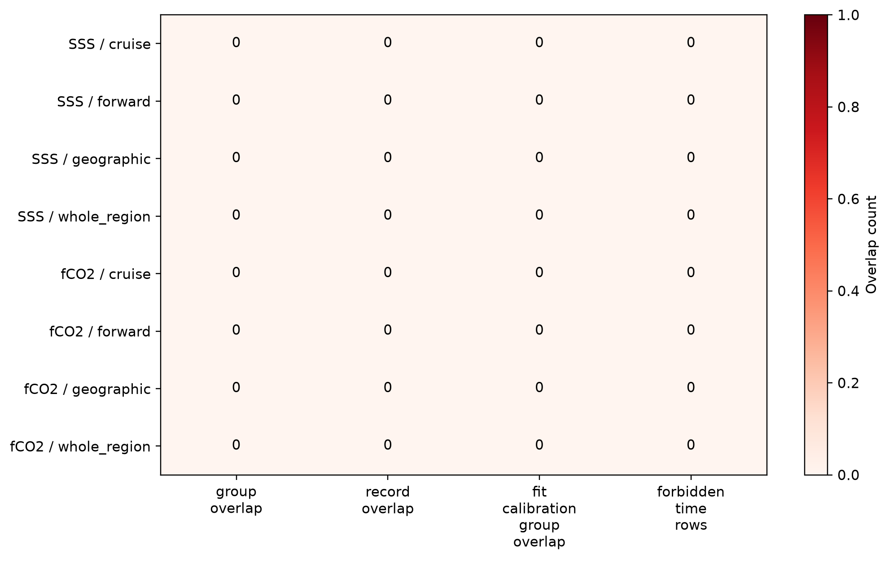

Figure 13. Summed group, record, calibration-group, and forbidden-future overlap counts inherited from the repaired Issue 61 folds; every displayed zero is required before model-family comparisons can be interpreted.

Exact source CSVs are under `tables/`. `archive_manifest.json` maps every figure to its source data and hashes all archived files. Row-level predictions, configuration records, nested SSS predictions, and model checkpoints remain outside Git under `C:\backup\phd\data\processed\recad_v2_4\p2_model_zoo_v2.4`.
