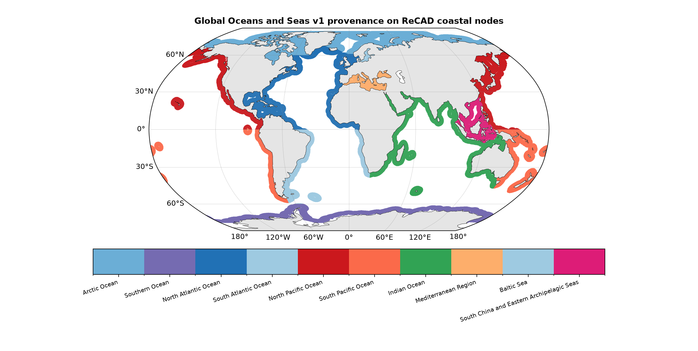
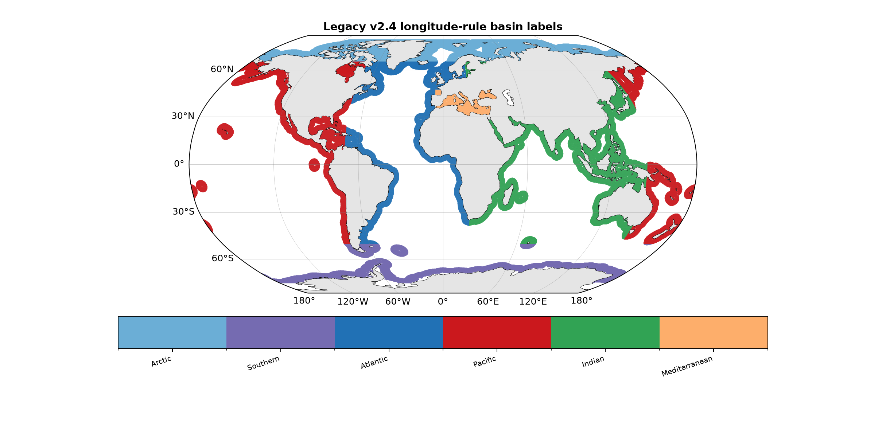
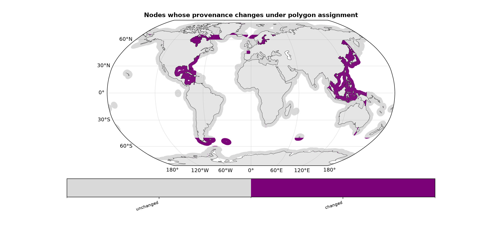
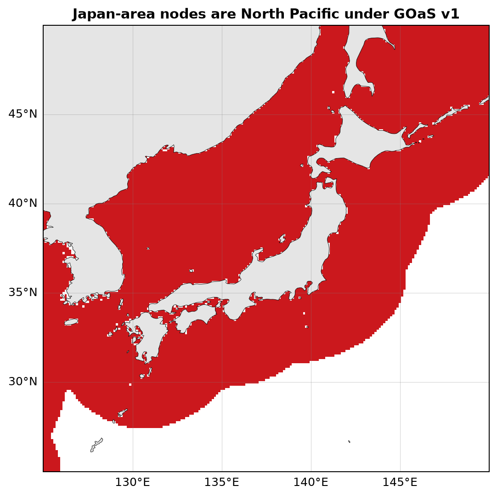
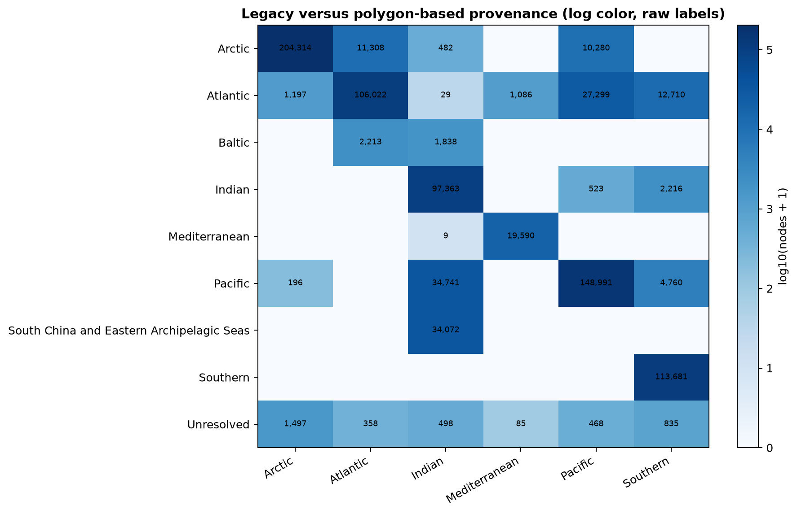
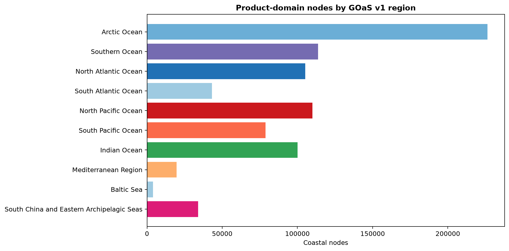
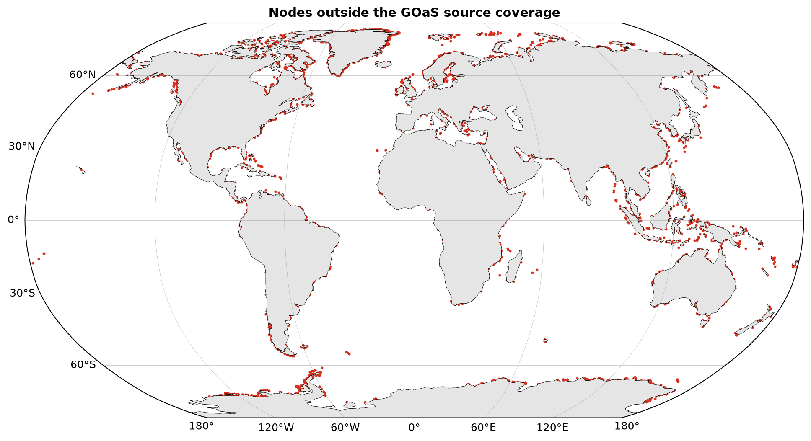
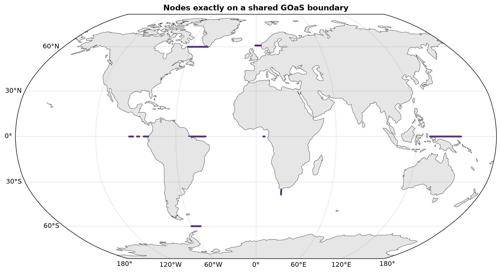

# Ocean-region provenance repair

## Scientific question and permitted claim

Can the coarse longitude-rule basin field be replaced by a versioned polygon source so reporting provenance is geographically auditable and cannot create a release-status bypass? The permitted claim is limited to geographic provenance. Region identity does not establish reconstruction accuracy.

## Data, splits, and leakage controls

The analysis uses the immutable spatial nodes from the ReCAD v2.4 fCO2 release and no target labels. Region polygons come from Global Oceans and Seas, version 1, DOI https://doi.org/10.14284/542. The raw WFS and topology-preserving 0.005-degree simplification are pinned by SHA256. This label-free operation cannot tune models, uncertainty thresholds, or the Issue 5 audit.

## Candidate models and training

No statistical model is trained. The legacy candidate is the v2.4 latitude/longitude threshold. The replacement uses polygon coverage, records exact shared-boundary hits, and leaves uncovered nodes unresolved. No nearest-region or basin-name release fallback is permitted.

## Main development results

The product contains 838,661 coastal nodes. Polygon assignment leaves 3,741 unresolved (0.446%) and marks 676 shared-boundary nodes (0.081%). The new macro provenance differs from the legacy label at 148,700 nodes (17.7%). Within 125-150 E and 25-50 N, 15,657 nodes assigned to the GOaS North Pacific region carried the legacy Indian basin label.

Figure 1. Polygon-based Global Oceans and Seas v1 provenance for every ReCAD v2.4 coastal node. The ten source regions are mutually auditable reporting strata and do not directly determine reconstruction quality or release status.

Figure 2. Legacy v2.4 basin labels produced by latitude and longitude thresholds. The 145 degree east boundary cuts through the western North Pacific and assigns part of Japan and adjacent seas to the Indian label.

Figure 3. Nodes whose reporting provenance changes when the coarse threshold rule is replaced by GOaS polygons. Purple denotes a changed macro label or a newly explicit Baltic or archipelagic region; gray denotes agreement.

Figure 4. Japan-area product nodes assigned from the GOaS North Pacific polygon. Both the Pacific-facing and Sea of Japan margins receive North Pacific provenance, removing the legacy Indian-label bypass.

Figure 5. Node-count cross-tabulation between legacy coarse basins and new reporting macro basins. Cell labels are raw counts and color is logarithmic, exposing substantial off-diagonal assignments hidden by the old longitude boundaries.

Figure 6. Number of ReCAD coastal nodes in each GOaS source region. These counts describe geographic product support only and are not weights, quality grades, or target-observation counts.

Figure 7. Product nodes not covered by the frozen GOaS polygon geometry. They remain explicitly unresolved rather than receiving a fallback basin from longitude, and must be investigated before provenance is written into a release product.

Figure 8. Product nodes covered by more than one GOaS polygon because they lie exactly on a shared boundary. The stable lower region ID is retained for serialization while the boundary flag preserves the ambiguity for audits.

## Decision and limitations

Decision: `adopt_goas_v1_for_provenance_only; prohibit_basin_release_switches`. The Japan bypass is repaired by the source polygon rather than a hand-written exception. Baltic and South China/Eastern Archipelagic Seas remain explicit regions instead of being forced into a neighboring ocean. Unresolved and shared-boundary nodes are preserved as auditable states. This phase does not replace the v2.4 release, estimate physical error, or assign A-D/U evidence.

The source is a static hydrographic partition, not a dynamic water-mass classification. It is suitable for provenance and stratified reporting but cannot define model applicability. The 3,741 uncovered nodes require a later source/coastline reconciliation; they cannot silently inherit a basin.

## Figure and table index

- Figures 1-8 correspond to source tables 1-8 in order.
- Table 1: node counts by GOaS region.
- Table 2: legacy/new confusion counts.
- Table 3: frozen geographic regression fixtures.
- Tables 4-5: unresolved and shared-boundary 5-degree blocks.
- Table 6: macro-basin counts.
- Table 7: changed fraction by source region.
- Table 8: source, hashes, and release policy.
