# P2.3d controlled SSS and fCO2 predictor ablations

Issue: #54

Decision: **retain background-SSS residual correction for SSS; retain no optional field for fCO2; reject ADT for both targets**

## Scientific question and permitted claim

This experiment tests which deployable predictor groups improve SSS and fCO2 under identical frozen observations, folds, geometry, preprocessing rules, and CatBoost budgets. It supports target-specific predictor selection for the later model-family bake-offs. It does not select the final production architecture, establish independent-test skill, or claim reliable performance outside observation-supported coastal regimes.

## Data, splits, and leakage controls

| target | rows | cruises | lmes | first_year | last_year | sss_background_available_fraction | adt_available_fraction |
| --- | --- | --- | --- | --- | --- | --- | --- |
| SSS | 750040 | 4615 | 54 | 1993 | 2025 | 0.989 | 0.990 |
| fCO2 | 887811 | 5143 | 54 | 1993 | 2025 | 0.973 | 0.974 |

The frozen 1993-2025 SOCAT cache was intersected once with the Issue #53 coastal-node cube. Every variant used the same target rows. Cruise folds, spatial blocks, whole-LME folds, and forward-time partitions were group-safe: any cruise touching a held partition was excluded from fitting. The 2026 provisional records, locked test, and external-independent labels remained unopened. Optional missing fields stayed as NaN plus explicit availability flags; no candidate gained rows by dropping missing cases.

The original Issue #54 matrix named chlorophyll-a, mixed-layer depth, river inputs, and circulation proxies. Issue #52 did not qualify global monthly deployable fields for those groups, so testing them here would have changed the frozen data contract. Their exclusion is archived in Table 14. The realized sequence was geotime, geometry, mandatory SST/wind/atmospheric-xCO2, background SSS, optional ADT, their combination, and training-only field dropout.

## Candidate models and training

All 224 fits used CatBoost with 300 trees, depth 8, learning rate 0.05, fixed seeds, GPU execution, and weights that first equalized LMEs and then cruises. For SSS variants containing the background field, the model predicted the observation-minus-background residual wherever background SSS existed and fell back to the same-fold A2 direct model where it did not. fCO2 never used observed SOCAT salinity as a predictor; it used only the frozen background SSS field. A6 applied deterministic training-only dropout (5% background SSS, 15% ADT).

The retention gate required at least 0.5% median RMSE improvement, positive cruise and spatial effects, no greater than 1% degradation in whole-LME or either forward period, positive strict-common-support effects, and a negative 95% upper confidence bound from 2,000 cruise-level paired bootstrap replicates.

## Main development results

| target | variant | scheme | n | rmse | mae | bias | r2 |
| --- | --- | --- | --- | --- | --- | --- | --- |
| SSS | A3_background_sss | cruise | 750040 | 0.907 | 0.488 | -0.062 | 0.987 |
| SSS | A3_background_sss | spatial | 750040 | 0.973 | 0.522 | -0.066 | 0.985 |
| SSS | A3_background_sss | whole_lme | 750040 | 2.470 | 1.408 | 0.367 | 0.907 |
| SSS | A3_background_sss | forward_2019_2021 | 111352 | 1.227 | 0.527 | 0.052 | 0.978 |
| SSS | A3_background_sss | forward_2022_2025 | 140154 | 1.580 | 0.696 | -0.080 | 0.965 |
| fCO2 | A2_environment | cruise | 887811 | 36.484 | 22.848 | 0.048 | 0.661 |
| fCO2 | A2_environment | spatial | 887811 | 39.001 | 24.376 | -0.885 | 0.613 |
| fCO2 | A2_environment | whole_lme | 887811 | 54.259 | 35.417 | 2.638 | 0.251 |
| fCO2 | A2_environment | forward_2019_2021 | 119205 | 44.236 | 26.590 | -10.451 | 0.542 |
| fCO2 | A2_environment | forward_2022_2025 | 140722 | 50.326 | 34.350 | -17.078 | 0.526 |

Background-SSS residual correction passed every gate for SSS. Relative to A2, cruise RMSE changed from 0.962 to 0.907 PSU, spatial RMSE from 1.058 to 0.973 PSU, whole-LME RMSE from 8.334 to 2.470 PSU, 2019-2021 forward RMSE from 1.760 to 1.227 PSU, and 2022-2025 forward RMSE from 1.956 to 1.580 PSU. These values remain development estimates; the large whole-LME tail shows that a global average cannot be treated as universal reliability.

For fCO2, background SSS gave small pooled gains (cruise 36.484 to 36.070 µatm; spatial 39.001 to 38.469 µatm), but the cruise-level bootstrap interval crossed zero, so it failed the reproducibility gate. ADT failed for both targets and sometimes degraded cruise or forward performance. Missing-input dropout did not pass consistently. The frozen optional-input decision is therefore SSS-background residual correction for SSS and no optional field for fCO2.

Against the Issue #37 minimum development ceilings, the retained SSS input passes cruise (0.907 < 1.0 PSU) and spatial (0.973 < 1.2 PSU) but fails late forward time (1.580 > 1.2 PSU). The retained fCO2 input fails cruise (36.484 > 30 µatm) and both forward periods (44.236 and 50.326 > 40 µatm), while spatial RMSE narrowly passes its 40 µatm ceiling. Predictor selection alone therefore does not meet the release contract; #40 and #41 must improve temporal transfer and tail-region behavior.

| target | group | retained | reasons |
| --- | --- | --- | --- |
| SSS | adt | False | median_improvement_below_0.5pct;cruise_not_improved;forward_2019_2021_degrades_over_1pct;forward_2022_2025_degrades_over_1pct;common_support_not_improved;paired_bootstrap_not_significant |
| SSS | background_sss | True | passed_all_gates |
| SSS | missing_robustness | False | median_improvement_below_0.5pct;spatial_not_improved;forward_2019_2021_degrades_over_1pct;common_support_not_improved;paired_bootstrap_not_significant |
| fCO2 | adt | False | median_improvement_below_0.5pct;cruise_not_improved;spatial_not_improved;common_support_not_improved;paired_bootstrap_not_significant |
| fCO2 | background_sss | False | paired_bootstrap_not_significant |
| fCO2 | missing_robustness | False | median_improvement_below_0.5pct;cruise_not_improved;spatial_not_improved;common_support_not_improved;paired_bootstrap_not_significant |

## Decision and limitations

Issue #54 passes as a controlled negative-and-positive ablation archive. The input contract for #40 SSS is A2 plus the masked background-SSS residual branch and same-fold fallback. The input contract for #41 fCO2 is A2 only: geotime, frozen coastal geometry, SST, wind speed, and atmospheric xCO2. ADT remains diagnostic and must not gate product coverage. Background SSS may be revisited for fCO2 only with new evidence or a preregistered interaction model; the present small pooled improvement is insufficient.

The decisive results are development OOF estimates rather than independent validation. Whole-LME errors are much larger than ordinary cruise/spatial scores, particularly for SSS without its background field. Observation density is highly uneven among LMEs, annual bias changes include sampling-composition changes, and the single-source-era cube provides no natural source-transition experiment. Reliability flags and fixed-coverage independent tests remain mandatory downstream.

## Figure and table index

### Figure 1

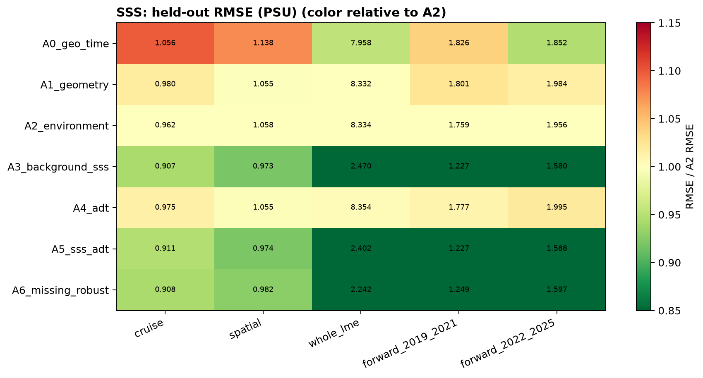

Figure 1. SSS held-out RMSE for every feature variant and validation scheme; cell colors are normalized to the mandatory-environment A2 baseline while annotations retain absolute PSU values.

### Figure 2

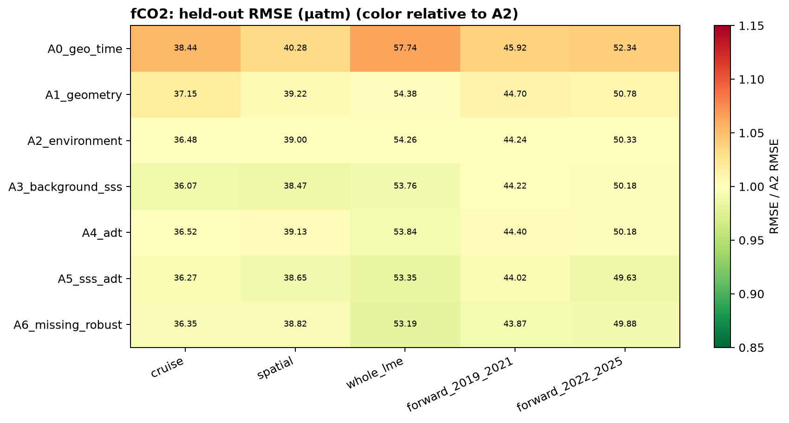

Figure 2. fCO2 held-out RMSE for every feature variant and validation scheme; pooled gains from background SSS are small compared with the variation among validation designs.

### Figure 3

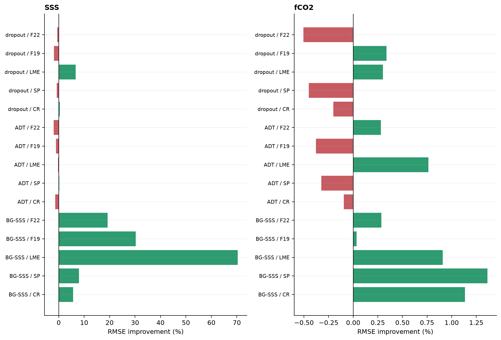

Figure 3. Relative RMSE effects of background SSS, ADT, and training-only missing-field dropout across all five decision schemes; positive bars denote lower candidate error.

### Figure 4

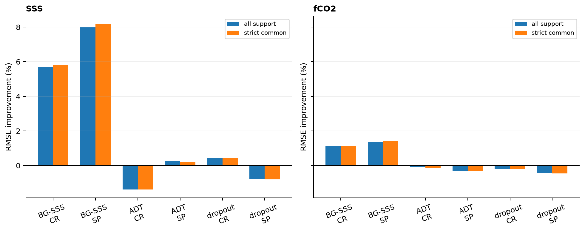

Figure 4. Optional-field effects on all observations and the identical strict common-support subset, preventing coverage reduction from masquerading as predictor skill.

### Figure 5

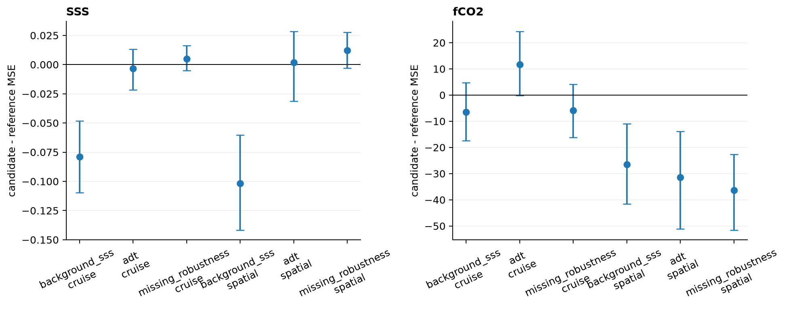

Figure 5. Cruise-level paired bootstrap mean squared-error contrasts with 95% intervals; an optional group passes this gate only when the complete interval is below zero in cruise and spatial validation.

### Figure 6

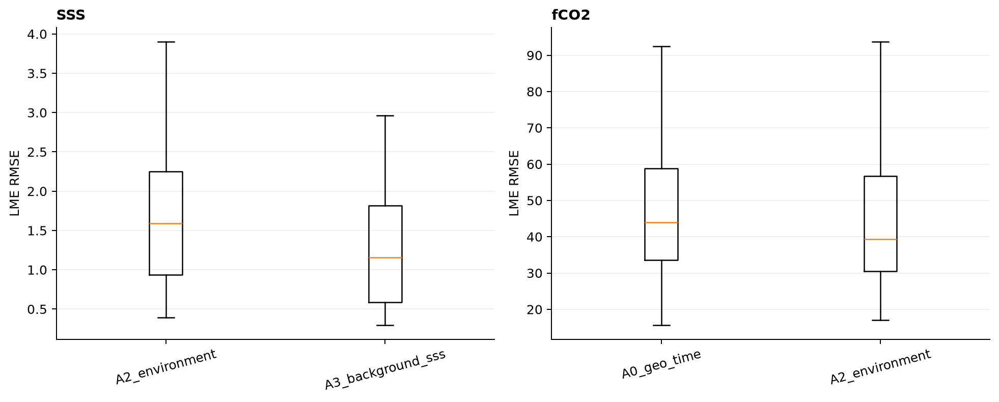

Figure 6. Distribution of per-LME errors under whole-LME validation; background-SSS residual correction sharply reduces SSS transfer error but substantial regional heterogeneity remains.

### Figure 7

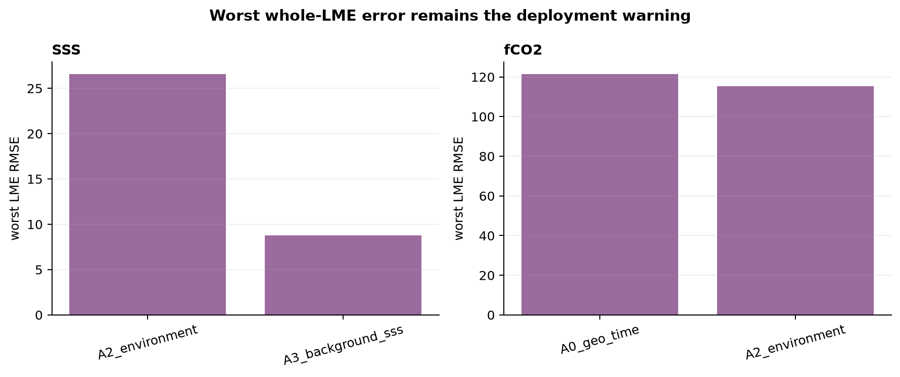

Figure 7. Worst per-LME RMSE under whole-LME validation for the principal baseline and retained variants, emphasizing the tail risk hidden by pooled global metrics.

### Figure 8

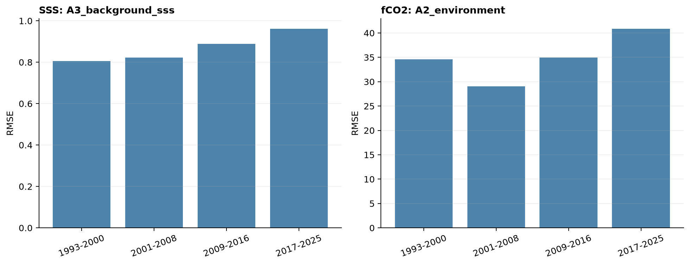

Figure 8. Cruise-OOF RMSE in four frozen time blocks for the retained SSS input and frozen fCO2 input, documenting temporal rather than only pooled behavior.

### Figure 9

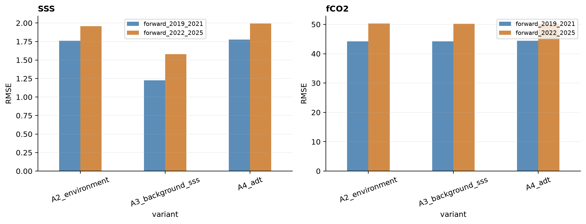

Figure 9. Strict forward-time RMSE in 2019-2021 and 2022-2025 for the mandatory baseline and principal optional candidates; later years are harder for both targets.

### Figure 10

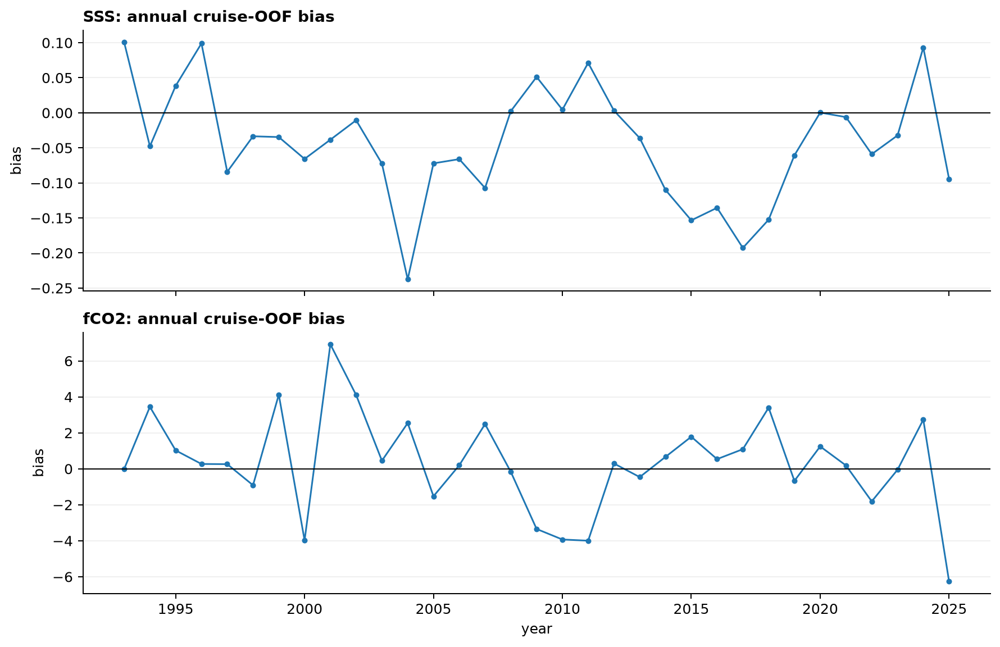

Figure 10. Annual cruise-OOF bias for the retained target-specific inputs; year-to-year changes mix model drift with changing observational composition and are not interpreted as source discontinuities.

### Figure 11

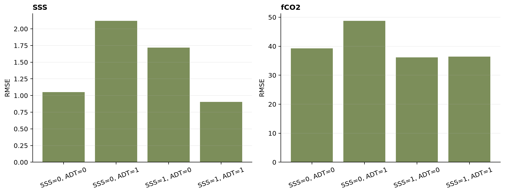

Figure 11. Cruise-OOF RMSE by background-SSS and ADT availability strata; unavailable SSS uses the frozen same-fold A2 fallback and ADT absence never removes a prediction.

### Figure 12

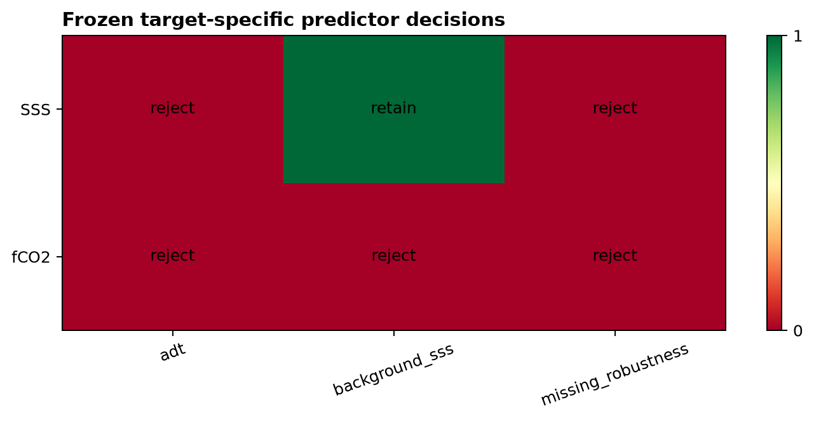

Figure 12. Frozen target-specific gate outcome: background-SSS residual correction is retained only for SSS, while ADT and missing-field dropout are rejected for both targets.

### Tables

- `table01_pooled_metrics.csv`: machine-readable source data used by this report.
- `table02_lme_metrics.csv`: machine-readable source data used by this report.
- `table03_time_block_metrics.csv`: machine-readable source data used by this report.
- `table04_missing_strata_metrics.csv`: machine-readable source data used by this report.
- `table05_paired_bootstrap.csv`: machine-readable source data used by this report.
- `table06_effects.csv`: machine-readable source data used by this report.
- `table07_retained_decision.csv`: machine-readable source data used by this report.
- `table08_variant_definitions.csv`: machine-readable source data used by this report.
- `table09_source_inventory.csv`: machine-readable source data used by this report.
- `table10_training_log.csv`: machine-readable source data used by this report.
- `table11_data_scope.csv`: machine-readable source data used by this report.
- `table12_lme_macro_worst.csv`: machine-readable source data used by this report.
- `table13_acceptance_gates.csv`: machine-readable source data used by this report.
- `table14_excluded_candidates.csv`: machine-readable source data used by this report.
- `table15_annual_transition_diagnostic.csv`: machine-readable source data used by this report.
