# P2.3b global coastal predictor-availability audit

Issue: #52

Core period: January 1993 through December 2025

Product geometry: Issue #50 frozen 400-km significant-land mask, with the GEBCO 0-200 m shelf subdivision

Decision: **pass availability audit; proceed to #53 with a three-field dense dynamic base, masked background SSS, and optional ADT**

## Scientific question and permitted claim

This audit asks whether every proposed model input can actually be constructed across the frozen global coastal product domain and core period. It may establish engineering availability, missingness structure, physically implausible cached values, and availability at SOCAT target rows. It does not measure predictive skill, prove generalization, or open any locked or external-independent target labels.

## Data, splits, and leakage controls

The audit uses the observation-independent mask frozen by Issue #50 and scans the standardized SST, GLORYS SSS, ADT, CCMP wind-speed, and atmospheric-xCO2 caches month by month. Validity combines finiteness with broad physical audit bounds recorded in Table 10. Spherical grid-cell area weights prevent high-latitude node counts from dominating global coverage.

SOCATv2026 rows from the Issue #38 cache are used only to ask whether a predictor exists at rows carrying an SSS or fCO2 observation. No target value is read, fitted, imputed, ranked, or used to define the product mask. The frozen cruise/spatial/forward split manifest is unchanged. Locked and external-independent labels remain sealed.

## Candidate models and training

No model was trained. This is a deterministic data audit. The five standardized dynamic fields are evaluated on 396 months and 838,661 product nodes. Static geometry and deterministic calendar/location features are inventoried separately. Optional fields without a global standardized artifact are not treated as silently available.

## Main development results

### Measured standardized fields

| predictor | mean_product_area_fraction | minimum_product_area_fraction | mean_shelf_area_fraction | minimum_shelf_area_fraction | classification |
|---|---|---|---|---|---|
| SST | 100.000% | 100.000% | 100.000% | 100.000% | deployable |
| GLORYS SSS | 98.126% | 98.126% | 96.390% | 96.390% | deployable_with_missingness |
| ADT | 92.666% | 87.711% | 90.492% | 80.446% | repair_required |
| wind speed | 100.000% | 100.000% | 100.000% | 100.000% | deployable |
| atmospheric xCO2 | 100.000% | 100.000% | 100.000% | 100.000% | deployable |

### Full candidate inventory

| predictor | classification | rationale |
|---|---|---|
| SST | deployable | direct standardized field |
| GLORYS SSS | deployable_with_missingness | background salinity; not the reconstructed target |
| ADT | repair_required | direct field |
| wind speed | deployable | direct field |
| atmospheric xCO2 | deployable | direct field |
| bathymetry / distance / shelf | deployable | static geometry replicated through time |
| calendar / trend / coordinates | deployable | deterministic features |
| chlorophyll-a | repair_required | global cache absent; source path unavailable; structural gaps |
| mixed-layer depth | unavailable | no source artifact found |
| river discharge / runoff | unavailable | GSHHG river geometry is not discharge |
| upwelling / circulation proxies | diagnostic_only | formula and edge handling must be frozen in #53 |

The mandatory dense production base for #53 is SST, wind speed, atmospheric xCO2, bathymetry/distance/shelf geometry, and deterministic coordinates/calendar/trend. GLORYS background SSS may enter with an explicit availability mask. ADT is useful but fails the frozen minimum-coverage threshold, especially on the shelf, so it must remain optional with a fallback and cannot determine whether a grid-month is publishable. Coverage holes in every measured field must remain explicit masks rather than being confused with observed values.

Across all five standardized dynamic fields, exact same-month joint availability averages **92.138%** of product area and falls to **87.301%** in the worst month. On the shelf core it averages **89.327%** and falls to **79.445%**. A cube that requires ADT everywhere would therefore discard a scientifically important fraction of shallow coastal waters.

Global chlorophyll-a is **not currently buildable from the frozen workspace state**: only regional caches exist, the recorded raw source path is unavailable, and MODIS Aqua supplies no observations for 1993-mid-2002 or 2021-2025. It remains a scientifically valuable optional channel after repair, accompanied by availability indicators and a non-Chl-a fallback. Mixed-layer depth and river discharge are unavailable; GSHHG river geometry is not a freshwater-flux product. Wind/ADT-derived circulation proxies remain diagnostic until #53 freezes formulas and boundary treatment.

## Decision and limitations

Issue #52 passes as an availability audit, not as a claim that every proposed predictor is ready. Issue #53 may build the 1993-2025 cube from the deployable base fields and fields explicitly classified as deployable with missingness. It must not make Chl-a, MLD, river discharge, or an unfrozen circulation proxy mandatory.

The standardized cache filenames do not by themselves fully identify upstream source releases. #53 must pin upstream product versions and transformations in its data manifest. The exact joint-coverage calculation requires all five standardized fields in the same grid-month. Plausible-range checks are deliberately broad and cannot detect scientifically biased but numerically plausible values. Predictor availability at SOCAT locations says nothing about prediction error in observation-sparse coastal waters.

## Figure and table index

### Figure 1

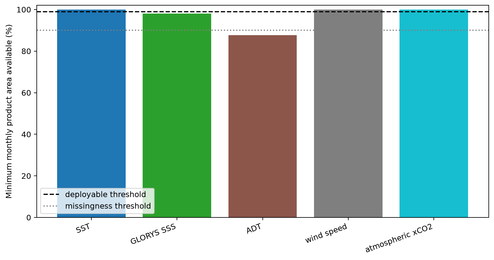

Figure 1. Minimum monthly area-weighted availability on the frozen 400-km global coastal mask during 1993-2025; dashed thresholds define the pre-registered deployment classes.

### Figure 2

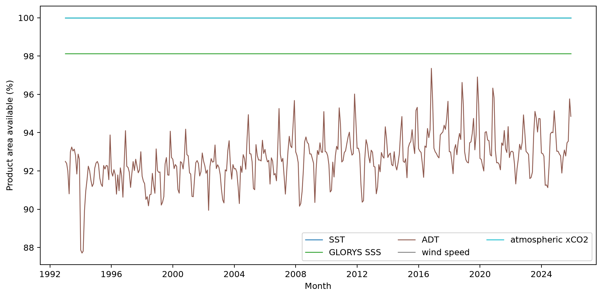

Figure 2. Monthly area-weighted availability for the five standardized dynamic predictors across the frozen product geometry from January 1993 through December 2025.

### Figure 3

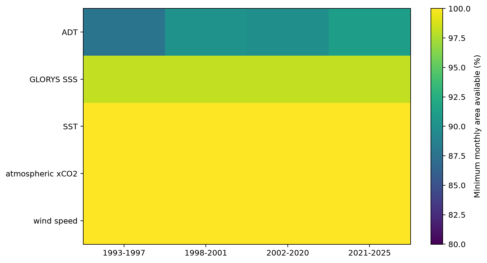

Figure 3. Worst monthly product-area availability within the four frozen temporal blocks, exposing source-era weaknesses that a whole-period mean would conceal.

### Figure 4

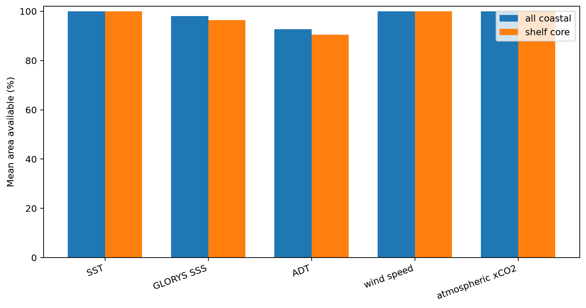

Figure 4. Mean availability over the complete coastal product and the GEBCO 0-200 m shelf core, quantifying whether missingness intensifies near the shallow coast.

### Figure 5

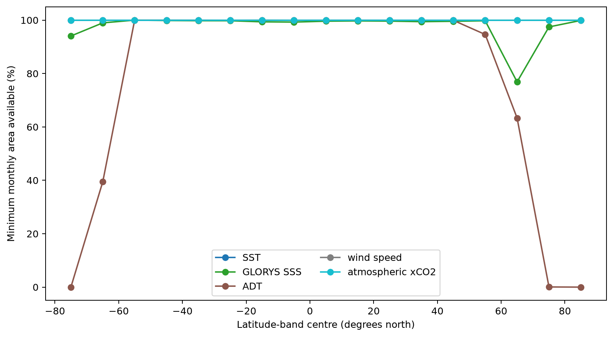

Figure 5. Minimum monthly area-weighted availability by ten-degree latitude band, identifying polar and regional holes inside the global product envelope.

### Figure 6

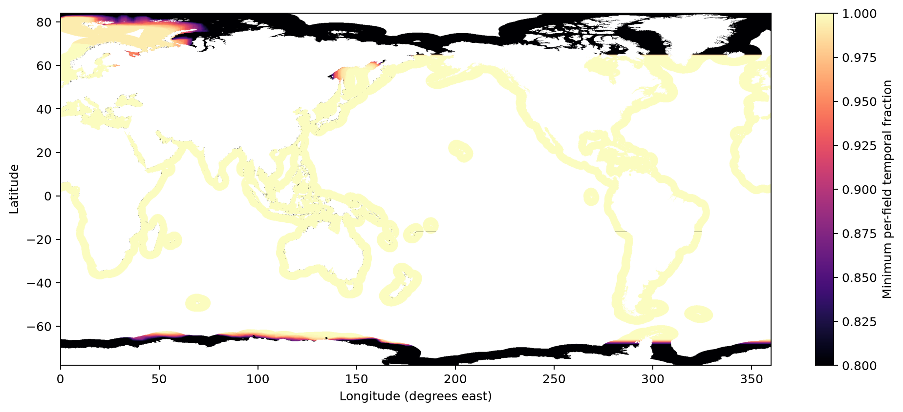

Figure 6. Exact fraction of 1993-2025 months in which all five standardized predictors are simultaneously valid at each coastal node.

### Figure 7

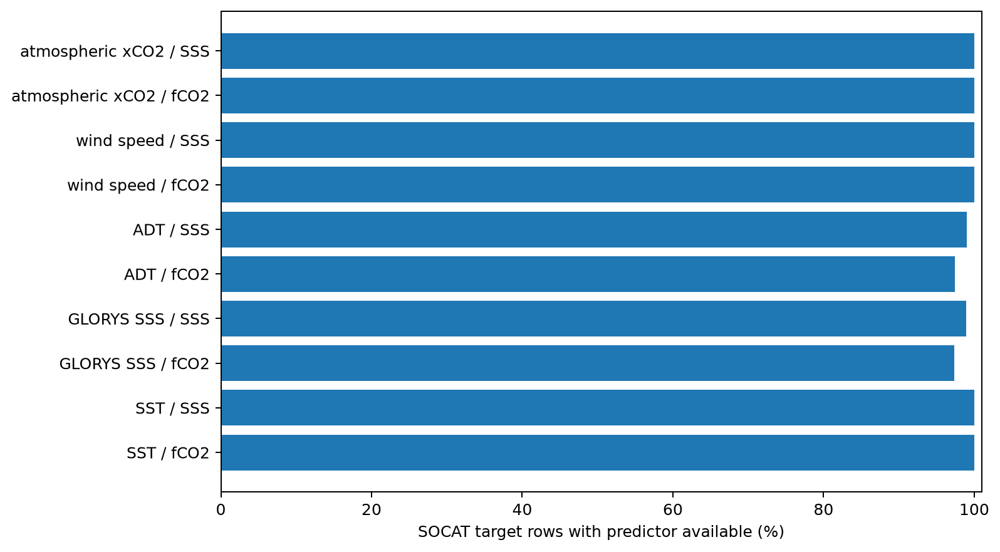

Figure 7. Predictor availability at frozen SOCAT SSS and fCO2 grid-month rows inside the new product mask; target values select audit rows but never enter predictor construction.

### Figure 8

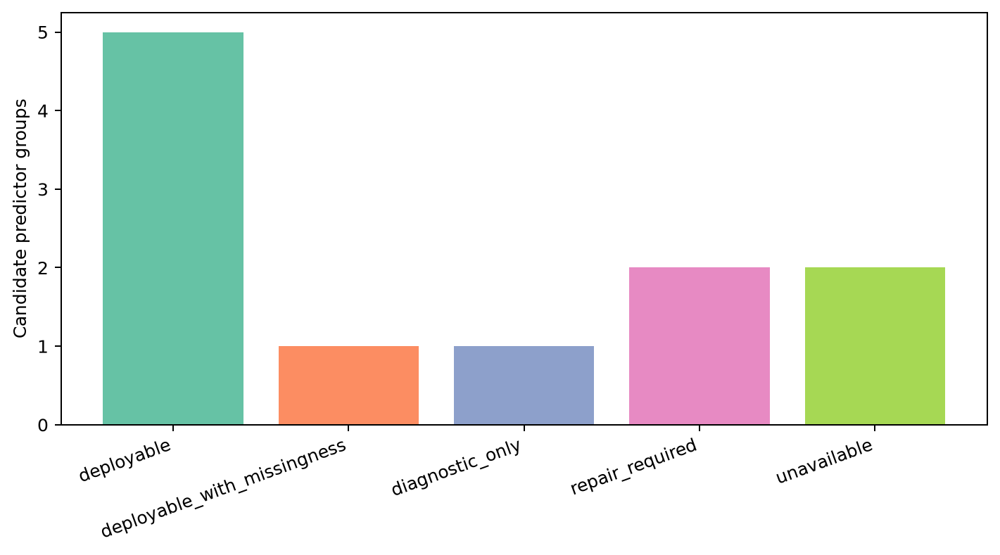

Figure 8. Final readiness classification across measured, static, deterministic, derived, and currently absent predictor groups under the frozen Issue 52 rules.

### Figure 9

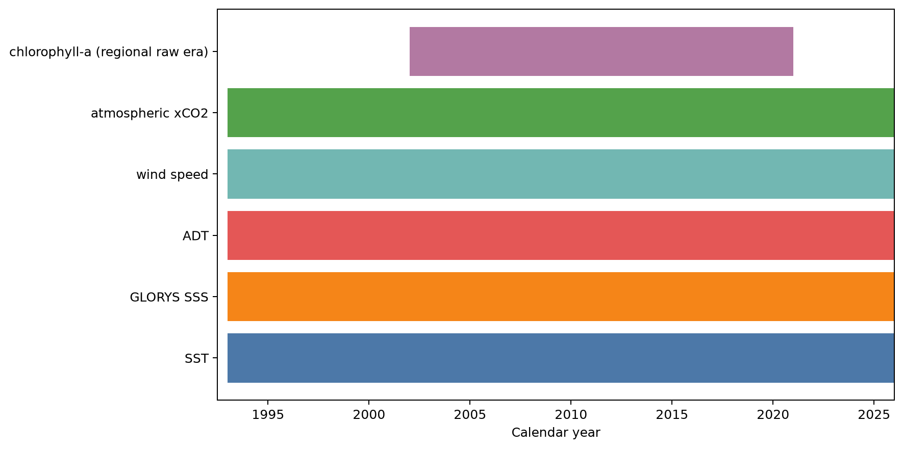

Figure 9. Nominal source coverage against the 1993-2025 core period; chlorophyll-a is structurally absent before mid-2002 and after 2020 even if its raw source is restored.

### Figure 10

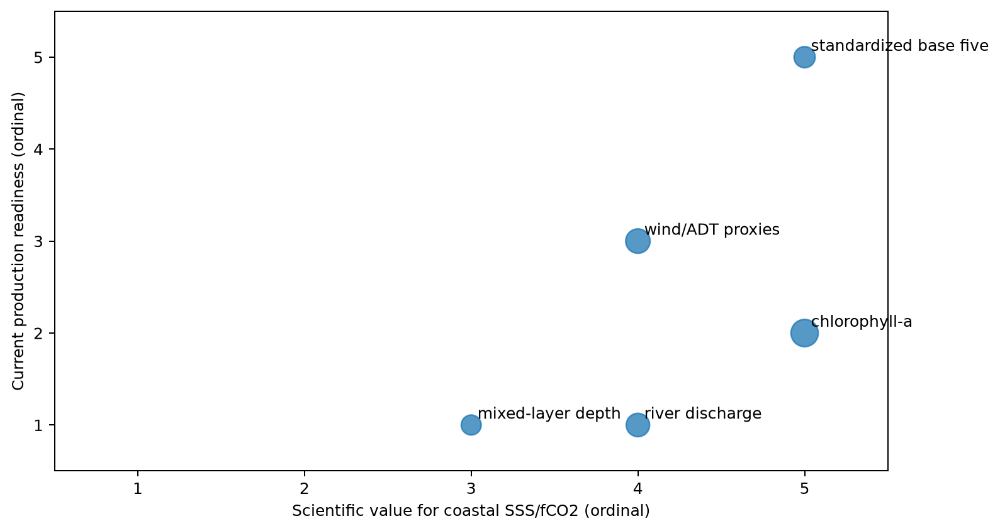

Figure 10. Engineering priority matrix combining expected scientific value and current readiness; point size encodes urgency for the next predictor-cube issue.

### Figure 11

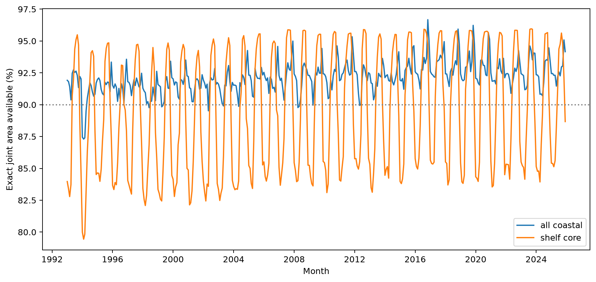

Figure 11. Exact monthly area where SST, GLORYS SSS, ADT, wind speed, and atmospheric xCO2 are all valid together, shown for the full coastal product and shelf core.

### Source tables

- `table01_field_summary.csv`: field summary
- `table02_monthly_coverage.csv`: monthly
- `table03_time_block_coverage.csv`: blocks
- `table04_latitude_coverage.csv`: latitude
- `table05_socat_monthly.csv`: socat monthly
- `table06_socat_summary.csv`: socat summary
- `table07_predictor_inventory.csv`: inventory
- `table08_source_timeline.csv`: timeline
- `table09_repair_priority.csv`: repair priority
- `table10_value_ranges.csv`: ranges
- `table11_source_transitions.csv`: transitions
- `table12_joint_monthly_coverage.csv`: joint
