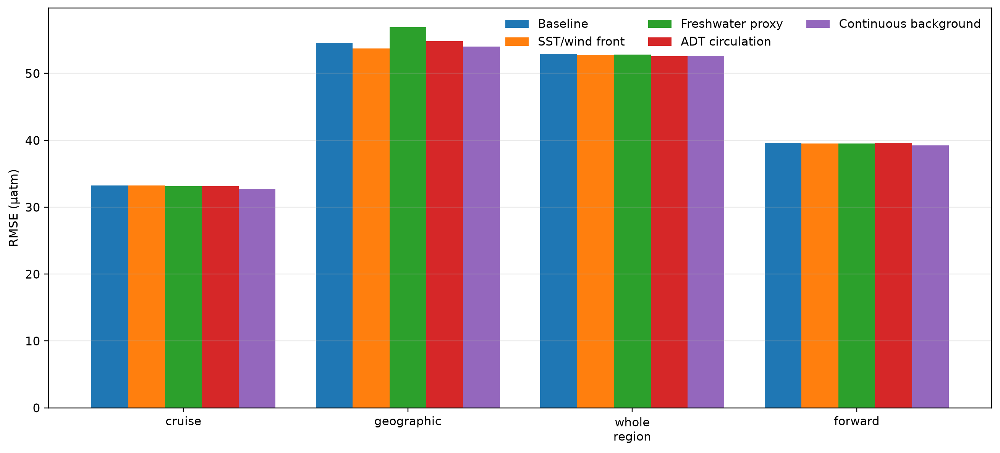
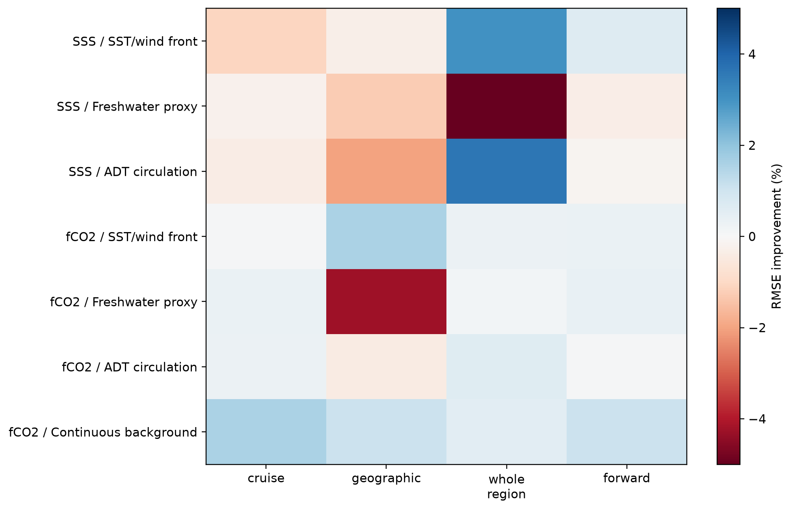
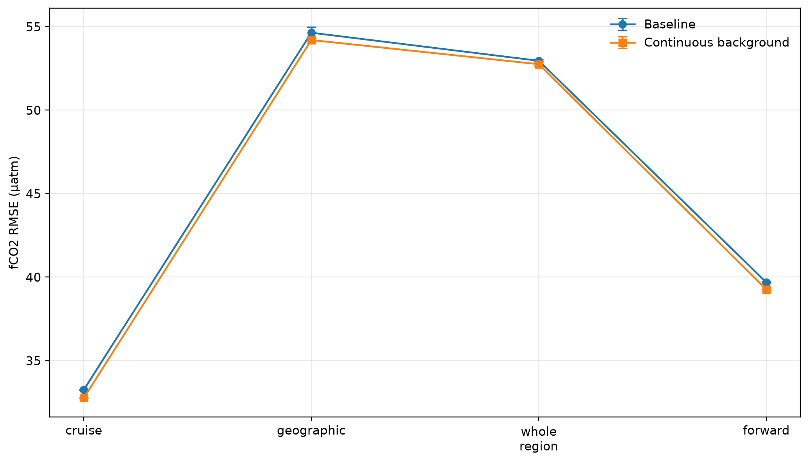
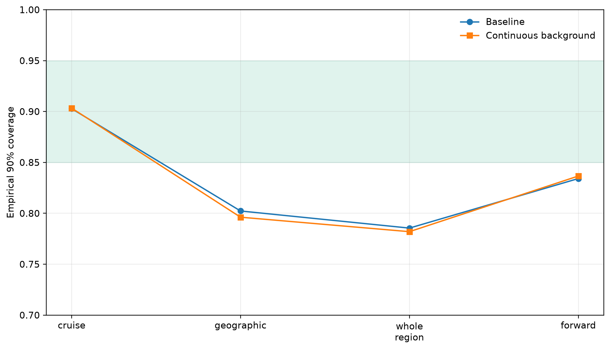
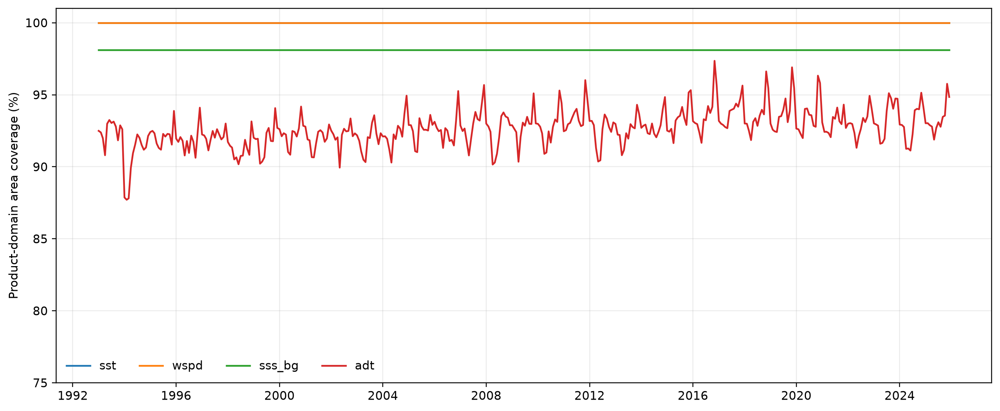
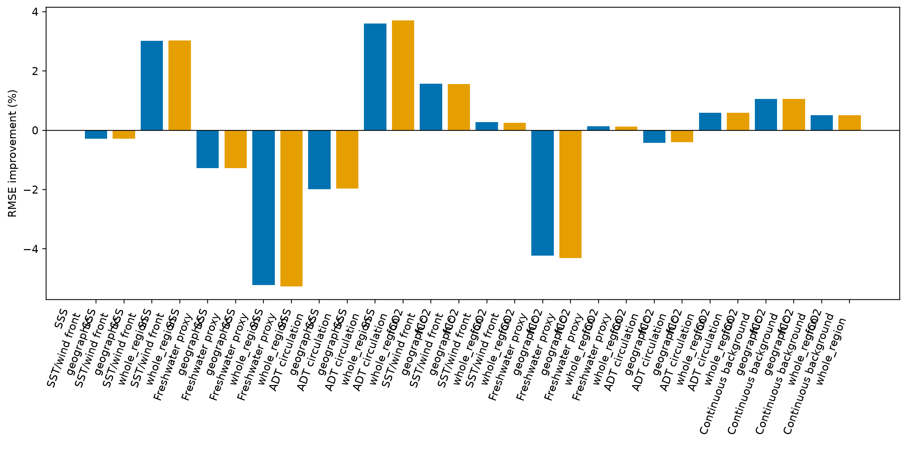
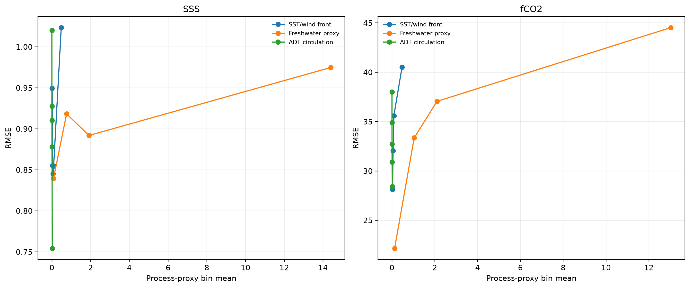
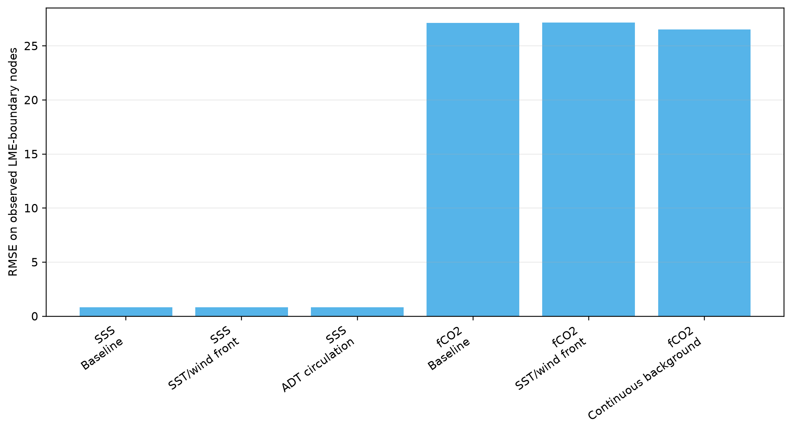

# P2 deployable process predictors and continuous background v2.4

## Scientific question and permitted claim

Issue #63 tests whether missing deployable process information or a discontinuous background explains the transfer failures that remained after the fair Issue 62 model-family screen. This is corrected-fold development evidence only. The experiment opened no new locked, external-independent, or 2026 labels and does not qualify a product.

## Data, splits, and leakage controls

Every branch uses the exact Issue 61 cruise, geographic plus 100 km buffer, whole-region, and past-only forward indices, the Issue 62 target-specific finalist family, the same six-configuration inner allowance, outer-training-only calibration, and outer-nested predicted SSS for fCO2. Each factor is added alone. Missing optional fields retain every row through a zero-valued contrast plus explicit availability or neighbour-count fallback. Both all-support and strict common-support results are archived.

## Candidate models and training

The deployable factors are same-month water-connected SST/wind contrasts, a background-SSS freshwater deficit and local contrast, and an optional ADT local contrast. The fCO2-only background is an outer-training-only Ridge surface over unit-sphere coordinates, annual harmonics, trend, and interactions, followed by an ExtraTrees residual. It contains no LME identity or held-label correction. Chl-a, mixed-layer depth, and river discharge were unavailable in the frozen workspace and are preserved as negative availability results; no synthetic substitute was renamed after them.

## Main development results

No SSS process factor passes the retention gate. The front and ADT proxies improve the one-seed whole-region RMSE by about 3.0% and 3.6%, respectively, but regress ordinary cruise or geographic transfer and fail the paired two-scheme rule. The background-SSS freshwater proxy regresses geographic and whole-region performance. These are retained negative results.

For fCO2, the continuous background residual is the sole retained development branch. Its three-seed cruise/geographic/whole-region/forward RMSE is **32.760/54.201/52.754/39.263 µatm**, compared with **33.251/54.640/52.958/39.682 µatm** for the matched ExtraTrees baseline. The improvement is small: roughly 1.5% on cruise, 0.8% on geographic after three seeds, 0.4% on whole-region, and 1.1% on forward. It passed the frozen screen because cruise and geographic exceeded 1% with paired grouped upper MSE differences below zero. The process proxies do not pass; the freshwater branch notably regresses geographic RMSE by 4.2%.

The retained branch remains a development component rather than a production promotion. Geographic and whole-region RMSE remain about 54.2 and 52.8 µatm. Empirical 90% coverage remains only 0.796 in geographic, 0.782 in whole-region, and 0.837 forward, so the uncertainty contract still fails under shift. Source-era arrays contain a single standardized era for every deployed cube field, and the continuous background has no hard LME offsets. Observation-supported boundary diagnostics show no newly introduced discontinuity, but they cannot prove behavior on coastlines with no observations.

## Decision and limitations

The machine decision is `retain_fco2_continuous_background_for_development_only`. SSS remains the Issue 62 CatBoost background-residual finalist without added Issue 63 process fields. fCO2 carries the continuous background residual forward as a controlled candidate, with the direct ExtraTrees path retained as the comparison and fallback. No tested single process factor earns combination rights. Therefore Issue 64 may test the already-triggered graph hypothesis only with a changed architecture or information path, and may test an uncertainty head specifically against the documented shifted under-coverage. It must not rerun Issue 42's failed four-neighbour ST96 implementation, and it has no evidence-based process-factor combination branch from Issue 63.

## Figure and table index

### Figure 1

Figure 1. SSS held-out RMSE for the CatBoost baseline and each deployable process factor on the exact corrected cruise, geographic plus 100 km buffer, whole-region, and past-only forward folds; none of the three factors passes the preregistered two-scheme retention gate.
### Figure 2

Figure 2. fCO2 held-out RMSE for the ExtraTrees baseline, three deployable process proxies, and the continuous spherical-seasonal-trend background residual; only the continuous background passes the frozen screen retention rule.
### Figure 3

Figure 3. Single-seed RMSE improvement relative to each target's identical-fold baseline; red cells are regressions and blue cells are improvements, exposing split-specific gains that cannot justify unrestricted feature combinations.
### Figure 4

Figure 4. Three-seed mean and standard deviation for the retained fCO2 continuous-background residual and its ExtraTrees baseline; the gain is small and stable, while geographic and whole-region error remain far above publication gates.
### Figure 5

Figure 5. Empirical coverage of nominal 90% intervals for the retained fCO2 branch and baseline; the green band is the 0.85-0.95 target and shows that continuous-background gains do not repair spatial-shift under-coverage.
### Figure 6

Figure 6. Monthly area-weighted availability over all 838,661 frozen coastal product nodes from 1993-2025; SST and wind are complete, background SSS has explicit sparse gaps, and optional ADT has the largest coverage loss.
### Figure 7

Figure 7. Geographic and whole-region RMSE improvement on all rows with deployable fallbacks and on factor-specific common support; reporting both views prevents apparent gains obtained by deleting difficult missing-field cases.
### Figure 8

Figure 8. Cruise-holdout RMSE across quintiles of the tested front, freshwater, and circulation proxies; errors vary strongly by regime, but the added proxy does not deliver the required transferable aggregate improvement.
### Figure 9

Figure 9. Cruise-holdout RMSE on observation-supported coastal nodes adjacent to a node assigned to another majority LME; the continuous fCO2 background introduces no discrete LME correction and does not create a new hard boundary artifact.
### Figure 10

Figure 10. Frozen-cube source-era and preregistered source-availability audit; all deployed cube fields use one standardized source era, while Chl-a, mixed-layer depth, and river discharge remain explicit unavailable negative results rather than fabricated proxies.

Exact source CSVs are under `tables/`. Row-level predictions, selections, feature cache, and 1,080 checkpoint files remain outside Git under `C:\backup\phd\data\processed\recad_v2_4\p2_process_predictors_v2.4`. `archive_manifest.json` maps every figure to its source tables and hashes the complete archive.
