# P2.4 global coastal SSS model-family bake-off

Issue: #40

Decision: **do not promote a new global SSS model; retain global CatBoost as the frozen baseline and carry GMM experts only as a support-aware challenger**

## Scientific question and permitted claim

This experiment asks whether regional correction, soft environmental experts, or a single-target ST96 transformer improves the frozen Issue #54 background-SSS residual baseline under the same observations, predictors, splits, and output coverage. It supports a development-stage architecture decision. It does not provide independent validation, authorize a global product, or establish accuracy in unobserved coastal regimes.

## Data, splits, and leakage controls

All candidates used the same 750,040 SOCAT SSS records from 4,615 cruises, 54 LMEs, and 1993-2025. Validation used five-fold held-cruise, spatial-block, strict whole-LME, and forward-time designs. Cruises touching a held spatial block or LME were removed from fitting. Background-field gaps used the same-fold direct A2 fallback. Empirical uncertainty widths were fitted from other folds; forward intervals used only cruise OOF records through 2018. The old Issue #25 locked set, 2026 provisional rows, and external-independent labels remained unopened.

Local front strength was computed from the monthly GLORYS SSS difference to four adjacent water nodes divided by grid distance. Distance-to-land bands diagnose cross-shore position; no target value enters either diagnostic predictor.

## Candidate models and training

The bake-off compared raw GLORYS, fold-fitted robust regional correction, frozen global CatBoost residual correction, eight probabilistic environmental/GMM experts shrunk 50% toward global CatBoost, eight top-two soft-gated experts, and a grouped-token ST96 transformer. All learned models used the same 16 retained Issue #54 inputs and identical outer folds. Training produced 96 prediction partitions and 32 learned checkpoints.

## Main development results

| model | cruise | spatial | whole_lme | forward |
| --- | ---: | ---: | ---: | ---: |
| raw_glorys | 1.717 | 1.718 | 1.740 | 2.111 |
| robust_regional | 1.298 | 1.327 | 1.859 | 1.739 |
| catboost_global | 0.907 | 0.973 | 2.470 | 1.446 |
| gmm_experts | 0.864 | 0.918 | 2.620 | 1.422 |
| top2_experts | 1.062 | 1.130 | 7.222 | 1.553 |
| st96 | 0.954 | 1.007 | 4.239 | 1.470 |

GMM experts achieved pooled RMSE 0.864 PSU in cruise validation and 0.918 PSU in spatial validation, compared with 0.907 and 0.973 PSU for global CatBoost. The pooled changes are 4.76% and 5.63%; 2,000 cruise-level paired bootstrap replicates placed both MSE contrasts below zero. Under the frozen primary cruise-equal metric, cruise RMSE changed from 1.049 to 1.000 PSU, a 4.61% gain that remains below the 5% gate. Strict forward RMSE improved from 1.446 to 1.422 PSU, but the 2022-2025 value remained 1.560 PSU, above the 1.2 PSU minimum target.

The decisive failure is geographic transfer. Whole-LME RMSE rose from 2.470 PSU for CatBoost to 2.620 PSU for GMM, while uncorrected GLORYS was 1.740 PSU. In LME 17, GMM RMSE was 5.584 spatially, 6.136 for whole-LME, and 7.104 PSU forward; each is slightly worse than CatBoost. The 20-30 PSU cruise stratum also remained difficult at 3.360 PSU. These failures show that denser-region gains cannot justify unconditional global correction.

Intervals are calibrated in ordinary OOF settings, but forward 90% coverage was only 0.873 for GMM and 0.876 for CatBoost. Width-based risk ranking is informative, yet it does not prove calibration on unsampled grids.

## Decision and limitations

GMM fails two frozen promotion gates: cruise improvement is below 5%, and whole-LME performance degrades. It also fails the specific no-degradation requirement in LME 17. ST96 and top-two experts are worse than global CatBoost in ordinary tests and collapse more severely in whole-LME transfer. Model size is therefore not the present bottleneck.

Issue #40 closes with no unconditional global SSS production model selected. Global CatBoost remains the reproducible baseline for the next reliability stage; GMM experts may be evaluated as a support-aware challenger only where observation support is explicit. Outside qualified support, the system must retain the background or suppress the correction. A new blind global audit and external-independent observations remain required before release.

Gate result: 7/11 checks passed. Locked test opened: **no**. External independent validation opened: **no**.

## Figure and table index

### Figure 1

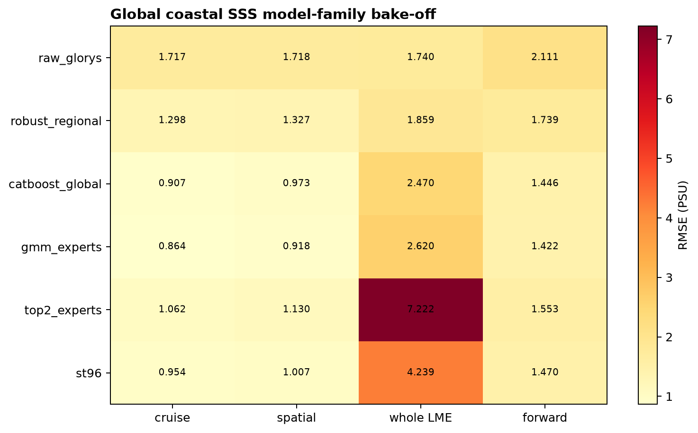

Figure 1. Held-out SSS RMSE for all six model families and four validation designs; GMM experts lead ordinary cruise, spatial, and forward tests, while raw GLORYS is best under unseen whole-LME transfer.

### Figure 2

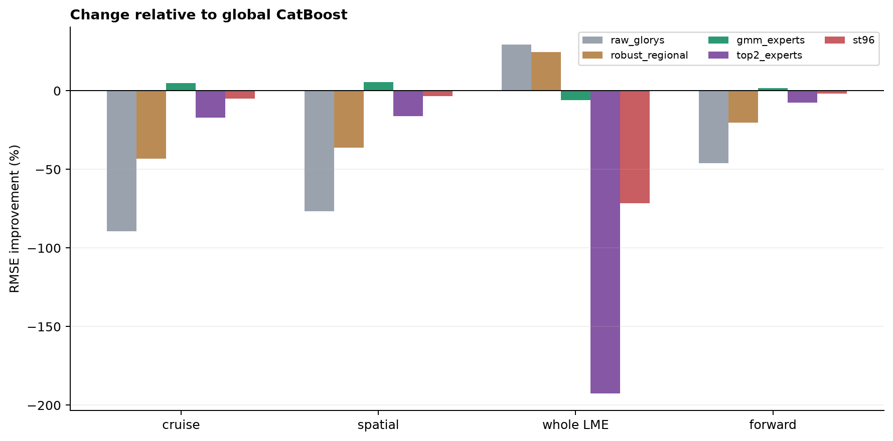

Figure 2. Relative RMSE change from the frozen global CatBoost baseline; positive values mean improvement and expose the GMM model's small supported-domain gain alongside its whole-LME penalty.

### Figure 3

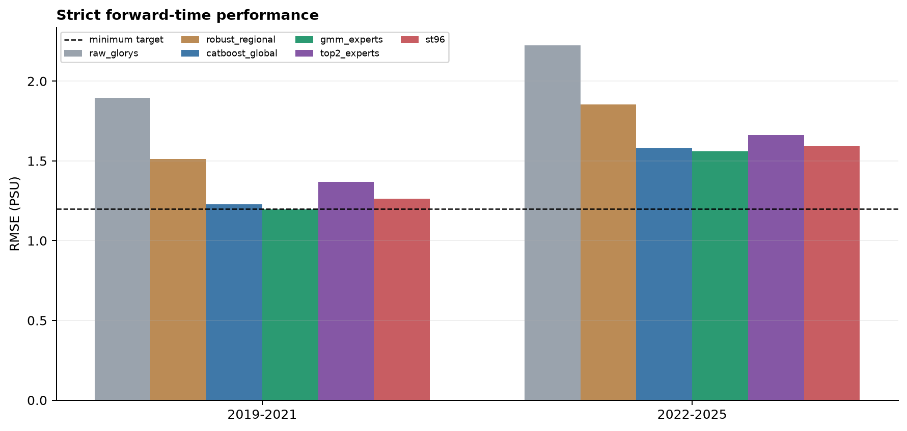

Figure 3. Strict forward-time RMSE separated into 2019-2021 and 2022-2025; every learned model remains above the 1.2 PSU late-forward minimum target.

### Figure 4

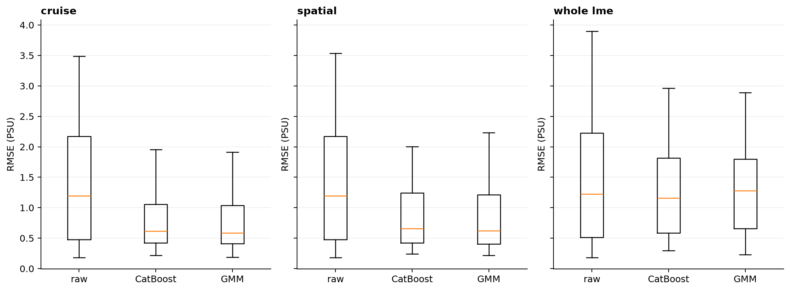

Figure 4. Per-LME RMSE distributions for cruise, spatial, and whole-LME validation; pooled gains do not remove the long regional error tail.

### Figure 5

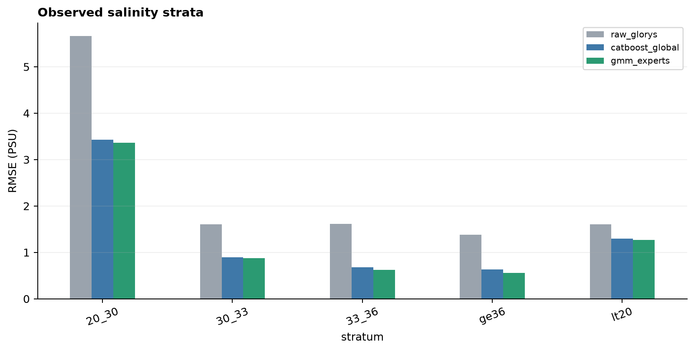

Figure 5. Cruise-held-out RMSE by observed salinity band; the largest errors occur at 20-30 PSU and the GMM improvement there is modest.

### Figure 6

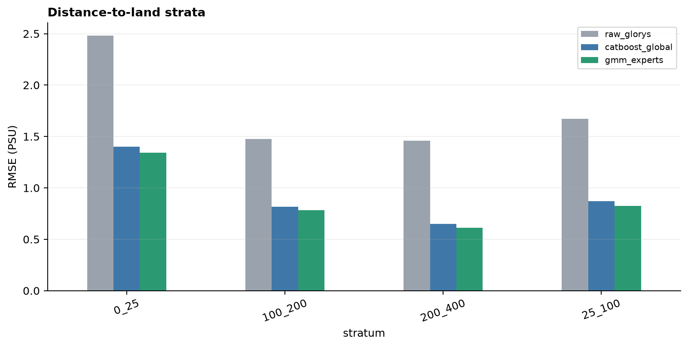

Figure 6. Cruise-held-out RMSE across distance-to-land bands, showing how performance changes from nearshore cells to the 200-400 km product margin.

### Figure 7

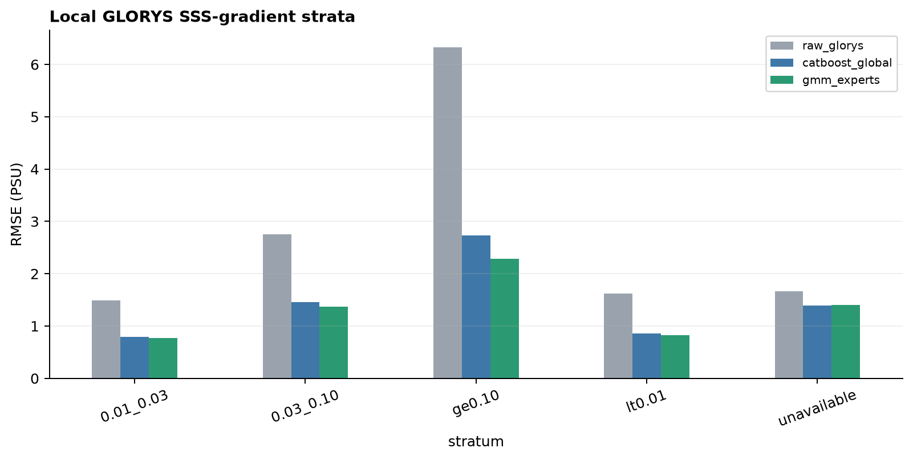

Figure 7. Cruise-held-out RMSE across local monthly GLORYS SSS-gradient bands; sharper background fronts remain harder and are diagnosed without using target labels as predictors.

### Figure 8

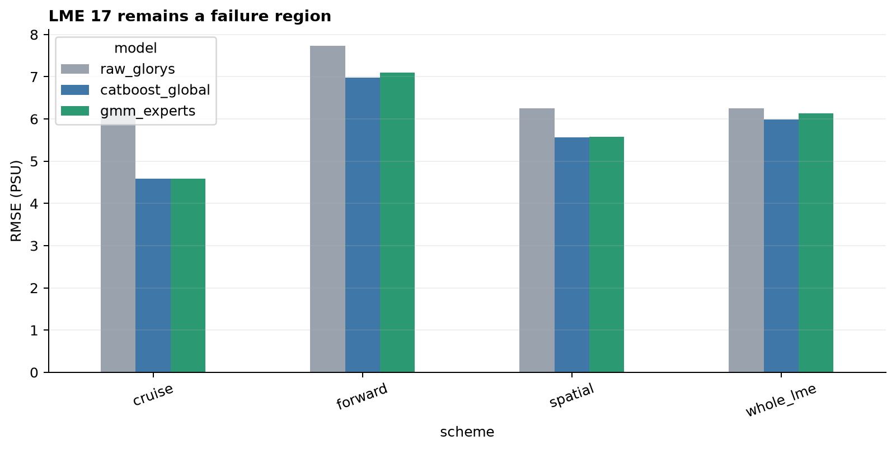

Figure 8. LME 17 RMSE under all validation designs; GMM experts do not improve spatial, whole-LME, or forward transfer in this previously identified low-salinity failure region.

### Figure 9

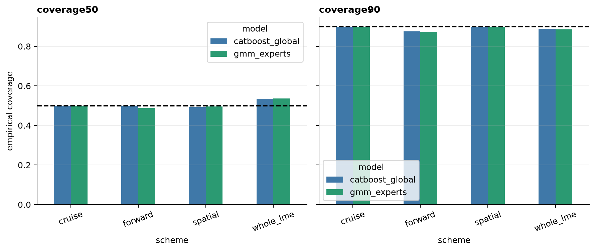

Figure 9. Leakage-safe empirical 50% and 90% interval coverage; forward 90% coverage falls below nominal for both CatBoost and GMM, so uncertainty is not release-ready.

### Figure 10

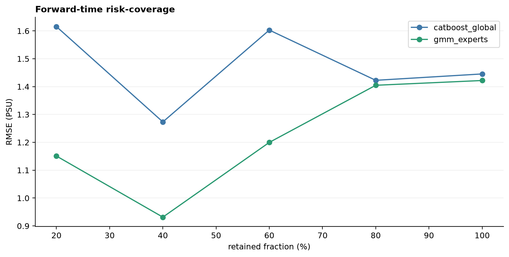

Figure 10. RMSE after retaining observations with the narrowest predicted 90% intervals; uncertainty ranking separates easier from harder cases but does not establish unsampled-grid reliability.

### Figure 11

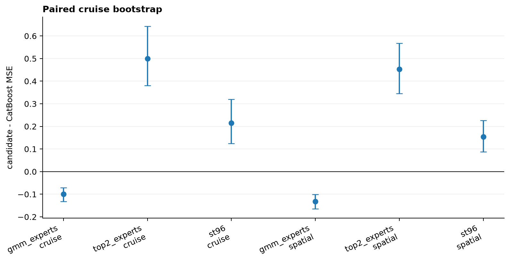

Figure 11. Cruise-level paired bootstrap MSE contrasts against global CatBoost; GMM gains are statistically consistent in cruise and spatial tests, whereas ST96 and top-two experts degrade.

### Figure 12

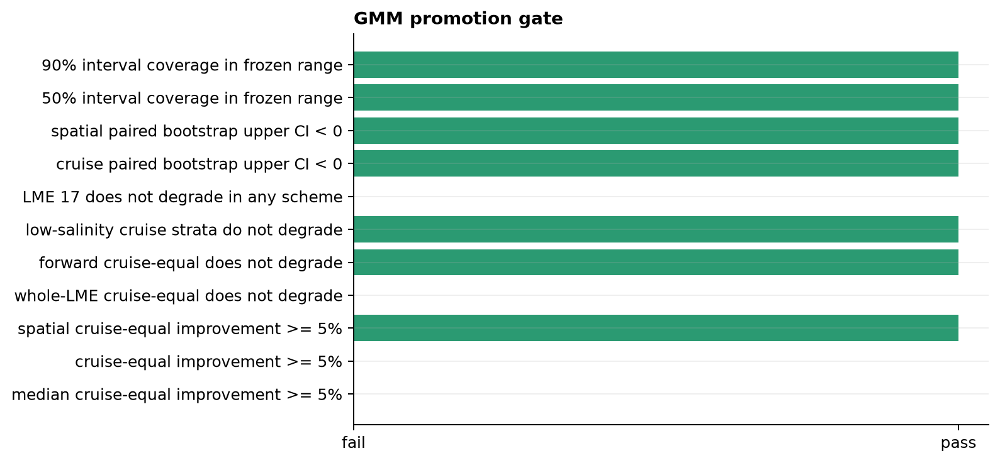

Figure 12. Frozen GMM selection gate outcome; failure of the 5% cruise threshold and whole-LME non-degradation rule prevents model promotion despite several positive diagnostics.

### Tables

- `table01_pooled_metrics.csv`: machine-readable source data used by this report.
- `table02_cruise_equal_metrics.csv`: machine-readable source data used by this report.
- `table03_lme_metrics.csv`: machine-readable source data used by this report.
- `table04_lme_macro_worst.csv`: machine-readable source data used by this report.
- `table05_stratified_metrics.csv`: machine-readable source data used by this report.
- `table06_time_block_metrics.csv`: machine-readable source data used by this report.
- `table07_interval_metrics.csv`: machine-readable source data used by this report.
- `table08_risk_coverage.csv`: machine-readable source data used by this report.
- `table09_paired_bootstrap.csv`: machine-readable source data used by this report.
- `table10_forward_period_metrics.csv`: machine-readable source data used by this report.
- `table11_model_definitions.csv`: machine-readable source data used by this report.
- `table12_training_log.csv`: machine-readable source data used by this report.
- `table13_effects_vs_catboost.csv`: machine-readable source data used by this report.
- `table14_selection_gate.csv`: machine-readable source data used by this report.
- `table15_source_inventory.csv`: machine-readable source data used by this report.
