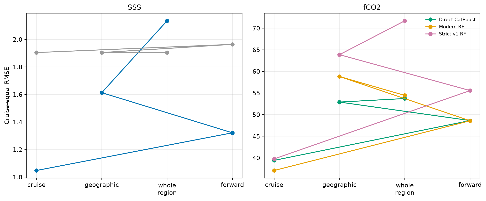
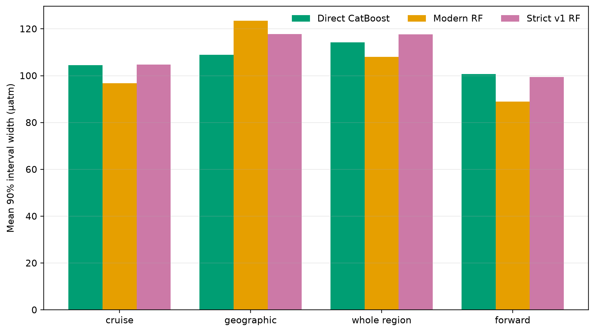
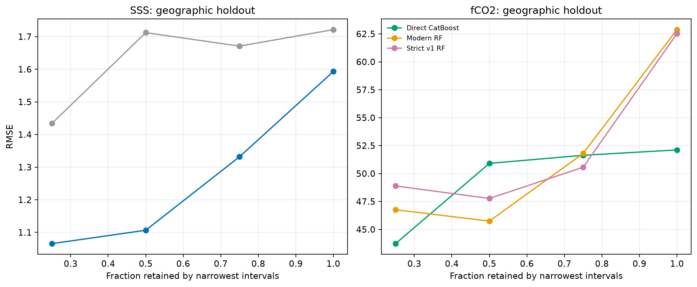
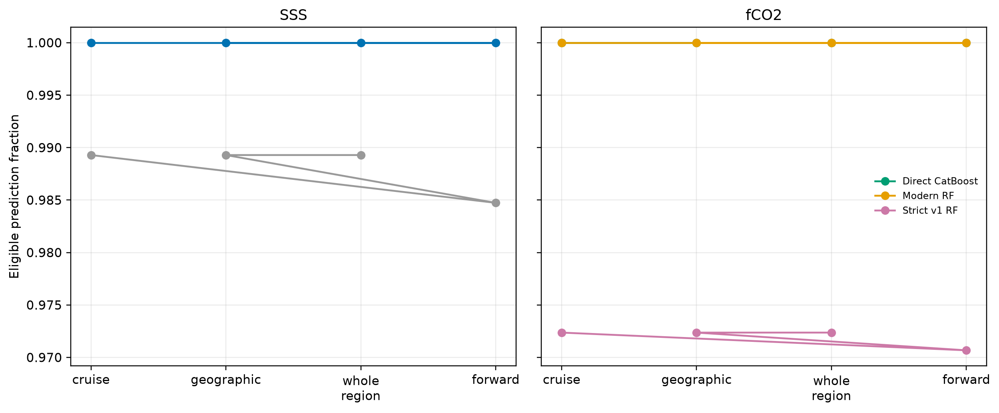
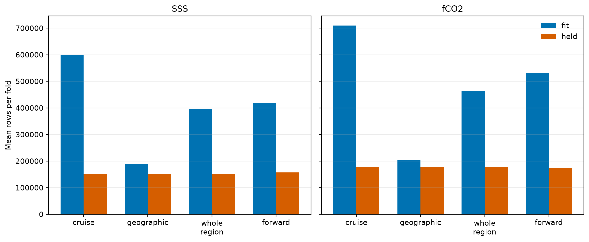
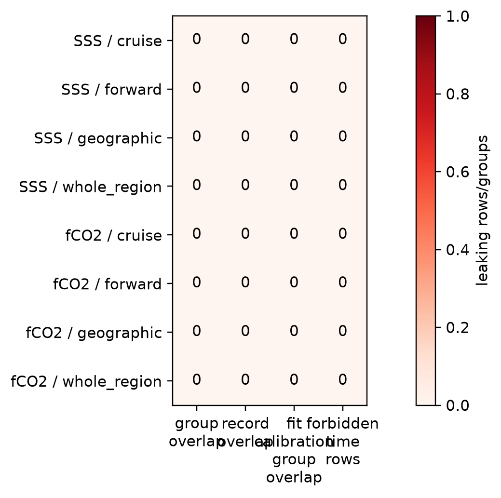

# P2 validation repair v2.4

## Scientific question and permitted claim

Issue #61 asks whether the existing SSS and fCO2 baselines survive validation that excludes complete cruises, actual geographic blocks plus a 100 km buffer, complete biogeographic regions, and future periods. The permitted claim is limited to corrected development evidence. No new locked-test or external-independent labels were opened, and no global production model is promoted here.

## Data, splits, and leakage controls

The frozen 1993-2025 matchup contains 750,040 SSS labels and 887,811 fCO2 labels. Five cruise folds, five 5-degree geographic folds, five whole-region folds, and three rolling-forward windows were evaluated. Geographic fitting removes complete held groups and every candidate grid cell within 100 km of held coordinates. Every outer fit is divided by complete group into 80% model fitting and 20% interval calibration. The fitted model is never refit after seeing calibration residuals. Cross-target SSS used by fCO2 is generated entirely inside the permitted outer-fit lineage. All audited group, record, calibration-group, and future-time overlap counts are zero.

The calibration plan was clarified before formal training: a single deterministic grouped 80/20 split replaced an early two-fold cross-conformal sketch so that no target could enter another target through an indirectly reused calibration group. This amendment is recorded in the experiment record and protocol.

## Candidate models and training

SSS compares raw GLORYS with a 300-iteration CatBoost residual correction that falls back safely when background SSS is absent. fCO2 compares (1) an exact v1-style 300-tree complete-case RF using its original seven predictors and background SSS, (2) a modernized 96-tree RF using nested cross-fitted SSS and expanded coastal predictors, and (3) direct CatBoost with the same leakage-safe lineage. These are corrected baselines; broader Transformer, expert, and neural-family screening remains assigned to Issue #62.

## Main development results

SSS CatBoost reaches RMSE 0.921 psu and R² 0.987 under cruise holdout, but weakens to 1.593 psu under geographic holdout and 2.571 psu under whole-region holdout. Raw GLORYS is 1.721 psu overall and becomes preferable to CatBoost for complete-region transfer. The repaired result therefore supports SSS correction where observational support is represented, but rejects a claim of uniformly accurate unsampled-region extrapolation.

For fCO2, modern RF is best under cruise holdout at RMSE 34.38 µatm and R² 0.699, missing the 30 µatm gate. Direct CatBoost is best under geographic holdout at RMSE 52.12 µatm and R² 0.309; both RF variants exceed 62 µatm there. The corrected evidence does not support immediate global-model promotion.

Nested intervals are close to nominal under cruise holdout but frequently under-cover during geographic, whole-region, and forward transfer. Interval width can still be studied as a risk-ranking feature, but cannot yet be published as a calibrated grid-cell uncertainty product.

## Decision and limitations

Issue #61 succeeds as a validation repair and fails as a promotion gate. It unblocks Issue #62 because exposure lineage, strict spatial splitting, forward splitting, nested calibration, exact-v1 identity, and common-grid comparisons now have reusable implementations. The next experiment must compare model families on these exact folds and must optimize for strict geographic and forward performance rather than ordinary cruise performance alone.

These numbers are development estimates from observed locations. They are not an independent product validation and do not measure error at never-observed grid cells. Whole-region folds combine LMEs with fixed neutral regions where LME assignment is absent. No TA or DIC conclusion is changed by this experiment.

The prior `p2_sss_global_bakeoff_v2.3`, `p2_fco2_global_bakeoff_v2.3`, and `p2_context_connectivity_v2.3` archives remain useful development records, but their sealed-label, strict-spatial, family-wide rejection, and deployable-uncertainty interpretations are superseded by this repair. Correction notes in those archive folders point here.

## Figure and table index

### Figure 1

Figure 1. Pooled held-out SSS RMSE across four leakage-repaired validation designs. CatBoost correction improves on raw GLORYS for cruise, geographic, and forward validation, but degrades under complete-region transfer and misses the 1.2 psu geographic and forward gate.

### Figure 2

Figure 2. Pooled held-out fCO2 RMSE across the strict v1 RF replica, modernized RF, and direct CatBoost. Modern RF leads cruise and forward validation, while direct CatBoost is least poor for geographic and whole-region extrapolation; every preregistered RMSE gate fails.

### Figure 3

Figure 3. Held-out R-squared for SSS and fCO2 under the four repaired validation designs. Ordinary cruise validation remains optimistic relative to geographic and whole-region transfer, especially for fCO2 where geographic R-squared falls to about 0.31 for the best model.

### Figure 4

Figure 4. Cruise-equal RMSE gives every held group equal weight instead of allowing dense cruises to dominate. The ranking broadly confirms the pooled metrics while exposing the larger error experienced by sparsely sampled groups.

### Figure 5

Figure 5. Empirical coverage of nominal 50% prediction intervals calibrated only inside each outer training partition. Cruise coverage is near nominal, but geographic, whole-region, and forward transfer frequently under-cover, so these intervals are not yet deployable uncertainty estimates.

### Figure 6

Figure 6. Empirical coverage of nominal 90% prediction intervals calibrated without held-out labels. Several strict-transfer settings fall outside the preregistered 0.85-0.95 acceptance range, demonstrating distribution shift that internal calibration cannot repair by itself.

### Figure 7

Figure 7. Mean width of the nested 90% fCO2 intervals for each model and validation design. Width must be read together with Figure 6: a narrower interval is useful only when its held-out coverage remains calibrated.

### Figure 8

Figure 8. Geographic-holdout RMSE after retaining observations with the narrowest predicted 90% intervals. The curves test whether interval width ranks error risk; they do not establish accuracy at coastal grid cells with no observations.

### Figure 9

Figure 9. Fraction of held-out observations receiving an eligible prediction. The strict v1 RF loses roughly 2.8-2.9% of fCO2 rows through its complete-case feature contract, whereas the modern models and residual SSS path retain all rows.

### Figure 10

Figure 10. Mean fit and held-out row counts per fold after complete-group exclusion and, for geographic folds, the 100 km spatial buffer. Smaller geographic training sets are a deliberate consequence of leakage control rather than failed data loading.

### Figure 11

Figure 11. Summed leakage diagnostics across every target and validation design. All recorded group overlap, record overlap, fit-calibration group overlap, and forbidden future-time counts are exactly zero.

### Figure 12

Figure 12. Count of passed applicable preregistered gates for each target, validation design, and model; whole-region has two applicable coverage gates because no absolute RMSE ceiling was frozen for that scheme. Passing a subset does not promote a model; Issue 61 unblocks fair model-family screening while retaining all baselines as development evidence only.

Exact source CSVs are in `tables/`. `archive_manifest.json` maps every figure to its source table and hashes all tracked files. Large row-level predictions, nested SSS predictions, split indices, and checkpoints remain outside Git under `C:\backup\phd\data\processed\recad_v2_4\p2_validation_repair_v2.4` and are referenced by hash.
