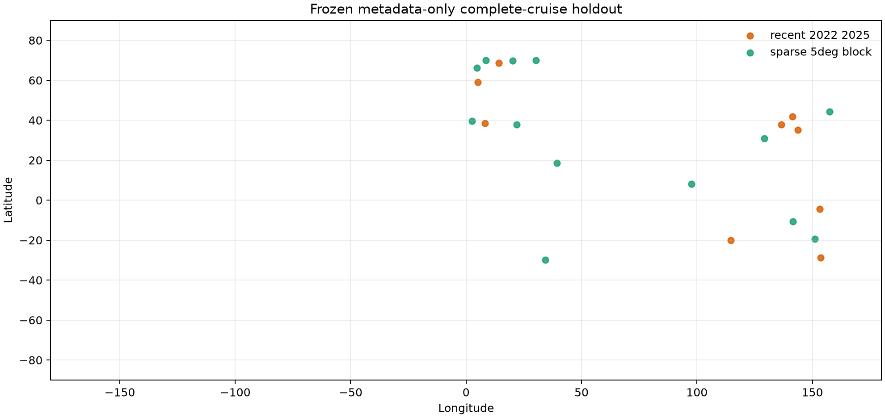
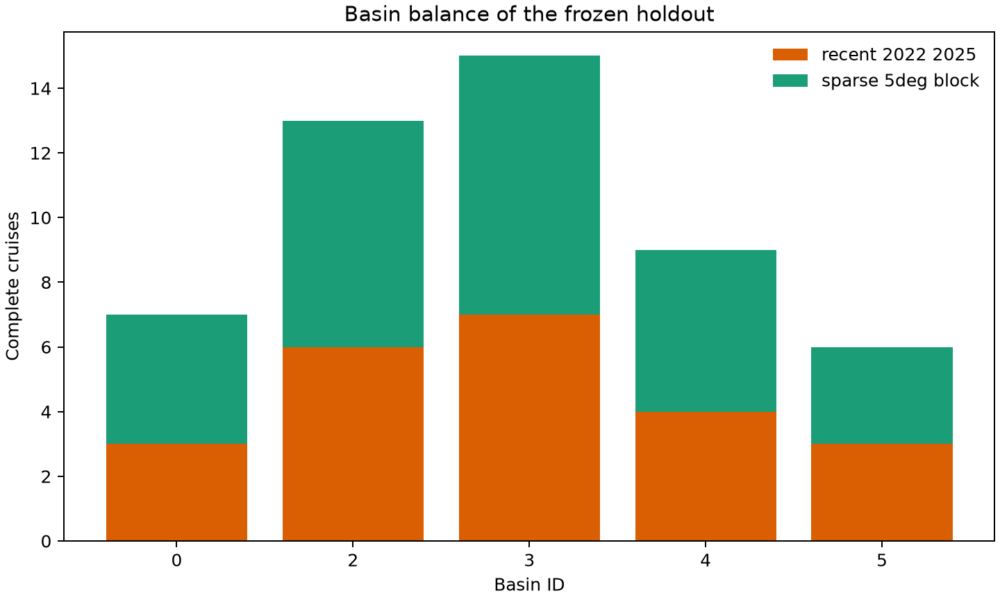
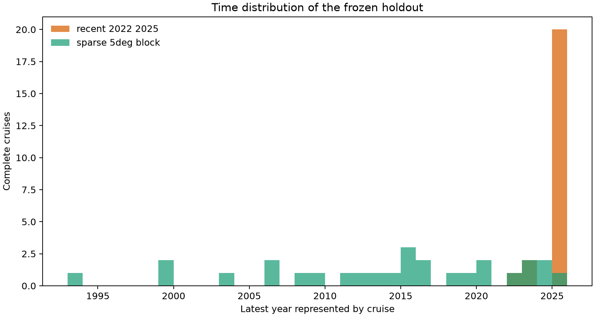

# P3 complete-cruise holdout freeze

## Scientific question and permitted claim

This preregistration asks whether the frozen SSS and fCO2 methods transfer to complete SOCAT v2026 cruises that are absent from every fitting and calibration stage. It is a same-source cruise, sparse-place, and recent-time transfer test. It does not test transfer to another observation product and cannot support a cross-dataset claim.

This design supersedes the earlier requirement for a post-v2026 or external source for Issue #5. SOCAT v2026 is the current complete source, and a separate dataset does not directly answer the stated reliability question. The earlier prospective external-source plan remains in the audit trail.

## Data, splits, and leakage controls

Selection read only `group_key`, year/month, median position, basin identity, and per-target availability counts. It did not read `salinity`, `fco2`, predictions, residuals, grades, or uncertainty. Eligible cruises require at least 10 SSS rows and 10 fCO2 rows. A salted deterministic rule selected 50 complete cruises: a minimum of six per represented basin, approximately half chosen from 2022–2025 and the remainder from the least cruise-populated 5° blocks.

Every selected `group_key` will be removed before fitting SSS, fCO2, continuous backgrounds, risk models, conformal residual distributions, applicability thresholds, and deployment support indices. It will also be absent from cross-fitted upstream SSS used by fCO2. Observed SSS from a held cruise is forbidden as an fCO2 input.

The remaining observations are not artificially deleted around a held cruise. Geographic difficulty is measured by held-row distance and environmental dissimilarity to the remaining training cruises and by the preregistered sparse-5° stratum. This preserves the estimand: performance on a new cruise under the available historical network.

## Candidate models and training

SSS uses the Issue-62 CatBoost background-residual three-seed finalist. fCO2 uses the Issue-64 CatBoost/F4 convex ensemble with CatBoost weight 0.30. Candidate families, hyperparameters, predictors, metrics, and the Issue-44 applicability contract were frozen before this manifest was constructed.

The evaluation runner may open held target rows only after this preregistration is merged. Any change to the manifest, candidate, feature path, calibration rule, thresholds, or metrics after access is a deviation and cannot silently replace the result.

## Main development results

This is a metadata-only preregistration, so it contains no holdout performance result. The frozen set contains 50 cruises, 8,469 SSS rows, and 8,470 fCO2 rows. Basin quotas are 7/13/15/9/6 for basin IDs 0/2/3/4/5. Twenty-three cruises form the 2022–2025 recent-time stratum and 27 form the sparse-geography stratum. The exact manifest SHA256 is `50ffcd07c051781a44855ffc2ad3dee3dcb804d6dba745d4b3cb4b5aa632fe2e`.

Figure 1. Frozen median cruise positions by metadata-only selection stratum. Several cruises have the same or nearly the same median position, so overlapping markers can make the visible marker count smaller than 50.

Figure 2. Complete-cruise counts by basin and metadata-only selection stratum. Every represented basin contributes at least six cruises so that the densest basin cannot determine the aggregate result alone.

Figure 3. Latest year represented by each frozen complete cruise. The recent stratum stresses 2022–2025 transfer, while the sparse-block stratum spans 1993–2025 and stresses geographic support.

## Decision and limitations

Decision: **`metadata_holdout_frozen_pending_label_access`**. Merge this exact manifest before evaluation. Then run the frozen candidates once after complete group exclusion.

The final report will include RMSE, MAE, bias, R², cruise-equal RMSE, 50/90% interval coverage and median width, and WIS for all held cruises, every cruise, basin, recent/sparse strata, support-distance bins, region, and A/B/C/D grade. Issue-44 thresholds will be applied without fitting on held labels. A target or stratum below 0.85 coverage at nominal 90% remains diagnostic or suppressed.

Because all observations come from SOCAT v2026, the result measures within-source transfer after complete cruise exclusion. It does not establish performance under a different observation system, variable definition, or quality-control pipeline.

## Figure and table index

- Figure 1: spatial distribution of selected complete cruises; source `tables/table01_selected_cruises.csv`.
- Figure 2: basin and selection-stratum balance; sources `tables/table01_selected_cruises.csv` and `tables/table02_selection_summary.csv`.
- Figure 3: time distribution of selected cruises; source `tables/table01_selected_cruises.csv`.
- Table 1: exact metadata-only selected cruise manifest.
- Table 2: basin/stratum counts and target-availability row totals.

Machine-readable inputs are `configs/frozen/p3_cruise_holdout_manifest_v2.4.csv`, `configs/frozen/p3_cruise_holdout_manifest_v2.4.json`, `configs/frozen/p3_cruise_holdout_protocol_v2.4.json`, and `configs/frozen/p3_cruise_holdout_lock_v2.4.json`. The reproducible selector is `scripts/select_p3_cruise_holdout_v2_4.py`.
