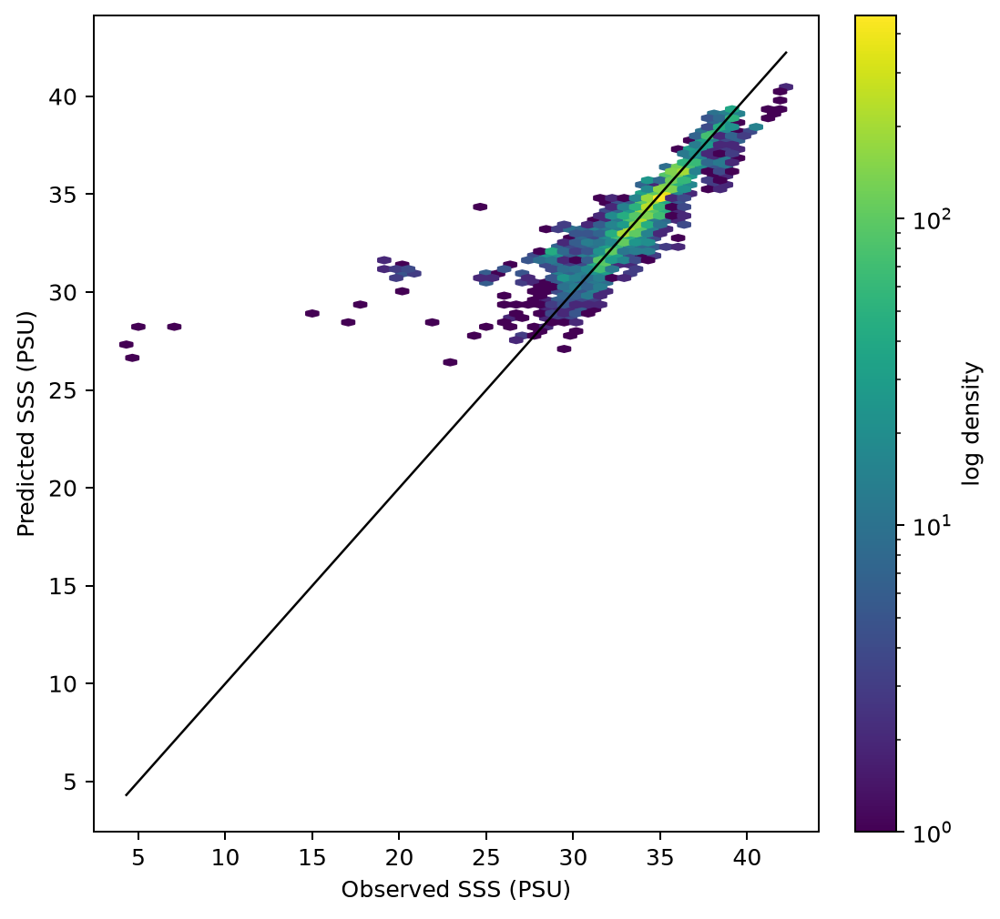
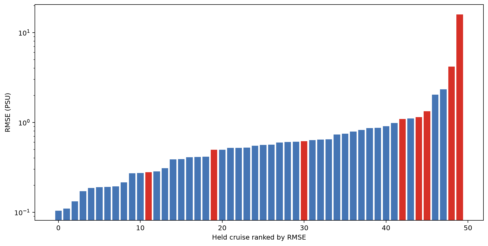
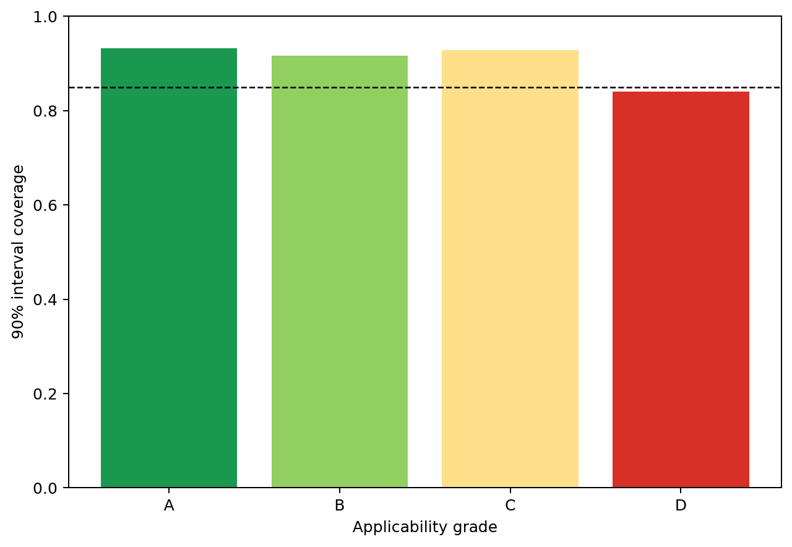
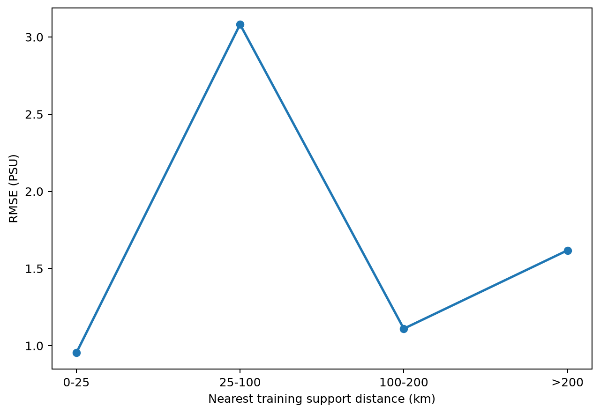
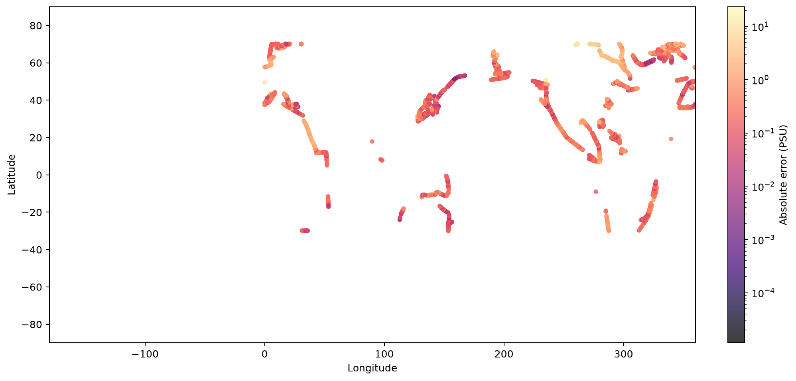
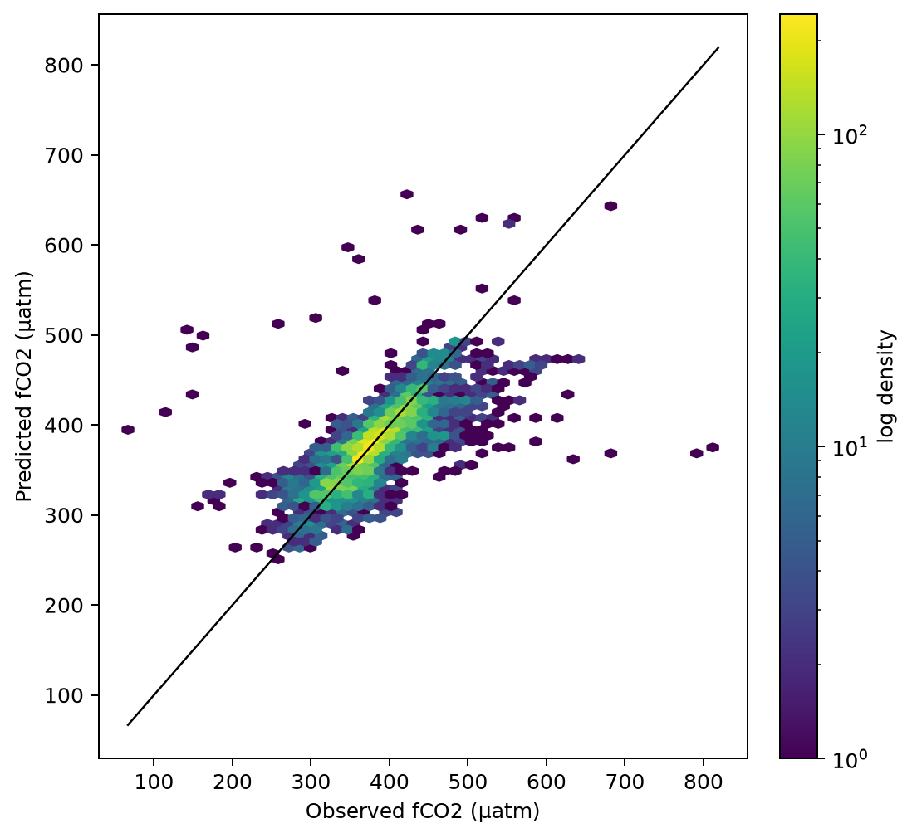
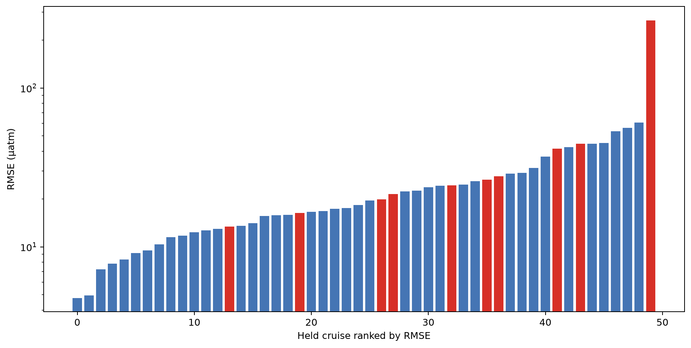
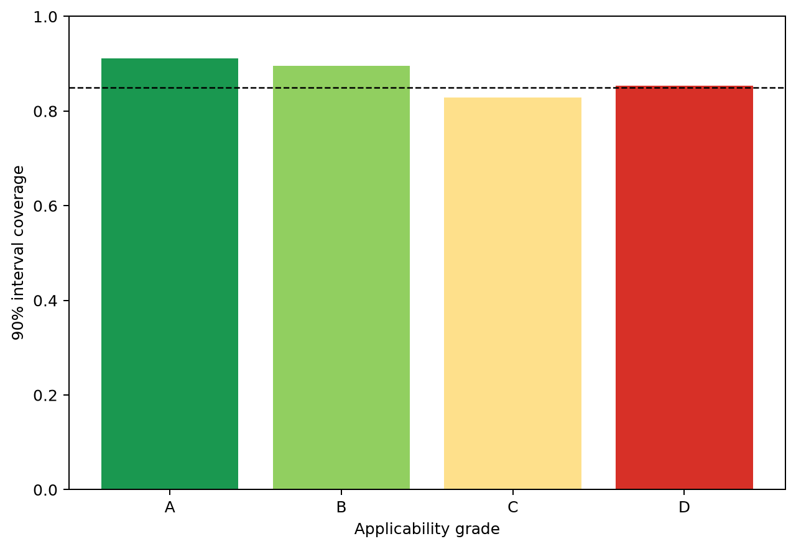
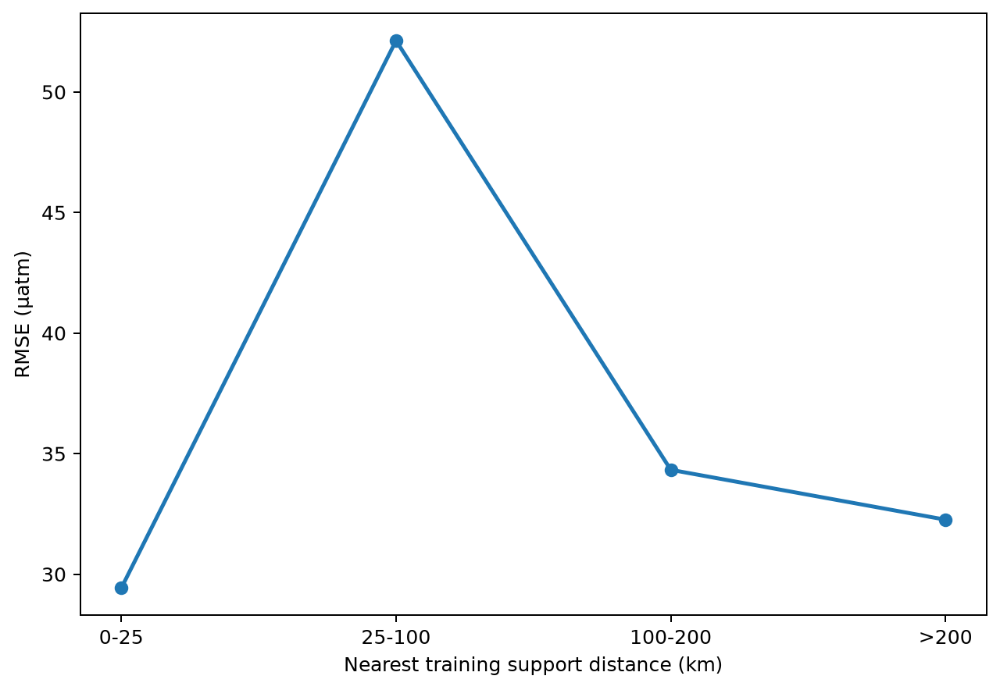

# P3 complete-cruise validation

## Scientific question and permitted claim

This one-time evaluation tests frozen SSS and fCO2 candidates on 50 complete SOCAT v2026 cruises selected from metadata before their target values were read. Every held group was excluded from point-model fitting, calibration, continuous backgrounds, upstream SSS, thresholds, and support indices. The permitted claim is same-source transfer to unseen cruises, sparse places, and recent time. No cross-dataset generalization is claimed.

## Data, splits, and leakage controls

The frozen manifest contains 8,469 SSS and 8,470 fCO2 rows. Twenty-three cruises stress 2022-2025 transfer and 27 stress sparse 5° blocks. Remaining cruises were split by complete group into model fit and calibration. fCO2 never receives observed SSS: its training SSS is two-fold complete-cruise cross-fitted, while calibration and held SSS are predicted from non-held SSS observations. The label access ledger records exactly one access after PR #75 merged.

## Candidate models and training

SSS is the Issue-62 three-seed CatBoost background-residual ensemble. fCO2 is the Issue-64 continuous-background ExtraTrees plus CatBoost convex ensemble with frozen CatBoost weight 0.30. Risk models and interval calibration use only non-held complete groups. The 2.57 GB fCO2 ExtraTrees checkpoint and all other large artifacts remain outside Git with SHA256 hashes in Table 6.

## Main development results

This section reports final held-cruise evidence rather than additional development selection. SSS has RMSE 1.185 PSU, R² 0.773, 90% coverage 0.910, and background skill 0.700. fCO2 has RMSE 30.780 µatm, R² 0.592, 90% coverage 0.883, and background skill 0.622. Cruise-equal RMSE is materially worse at 2.445 PSU and 45.942 µatm because a small number of complete cruises fail strongly.

The frozen A/B layer is much more reliable: SSS RMSE 0.598 PSU with 0.927 coverage and fCO2 RMSE 26.619 µatm with 0.904 coverage. Sparse-block RMSE is 1.487 PSU and 35.005 µatm, worse than recent-cruise RMSE of 0.738 PSU and 25.498 µatm. Pacific fCO2 A/B coverage is 0.845, just below the frozen 0.85 gate, so it cannot enter the trusted layer.

Figure 1. Held-cruise SSS observations against frozen-candidate predictions. The one-to-one line exposes both the dominant agreement and a small set of strong freshwater failures.

Figure 2. SSS RMSE for every held cruise, ranked on a logarithmic axis. Red bars have modal grade D; the extreme tail explains the gap between pooled and cruise-equal RMSE.

Figure 3. SSS 90% interval coverage by frozen applicability grade. The dashed line is the preregistered 0.85 minimum; grade D falls below it and remains suppressed.

Figure 4. SSS RMSE by distance to the remaining training cruises. Errors increase sharply away from dense support, so distance remains a required product flag.

Figure 5. Absolute SSS error at held-cruise grid months. The logarithmic color scale preserves ordinary errors while exposing geographically concentrated freshwater failures.

Figure 6. Held-cruise fCO2 observations against frozen-candidate predictions. Most rows follow the one-to-one line, while a small extreme-estuary tail remains unresolved.

Figure 7. fCO2 RMSE for every held cruise, ranked on a logarithmic axis. A few complete cruises dominate cruise-equal risk despite acceptable pooled performance.

Figure 8. fCO2 90% interval coverage by frozen applicability grade. A/B meet the pooled gate, while C under-covers and D remains unsuitable for trusted publication.

Figure 9. fCO2 RMSE by distance to the remaining training cruises. The 25-100 km bin is especially difficult, and all distant bins retain weak interval coverage.

Figure 10. Absolute fCO2 error at held-cruise grid months. The logarithmic color scale shows that the largest errors are localized rather than uniformly global.

## Decision and limitations

Decision: **`pass_flagged_same_source_release_with_regional_suppression`**. SSS A/B may proceed as same-source qualified across represented basins; SSS C remains diagnostic and D suppressed. fCO2 A/B may proceed outside the Pacific; Pacific A/B and all C remain diagnostic, while D is suppressed. Complete geographic coverage must never be described as complete reliability.

The clearest failure is cruise `187F20250215`, a strong freshwater system with SSS RMSE 15.947 PSU and fCO2 RMSE 266.792 µatm. It is grade D, showing that the flag catches the setting, but its intervals still fail badly. The experiment is within SOCAT v2026 and does not test a different sensor, QC system, or observation product. Fifty cruises provide a much stronger transfer audit than random rows, but basin-level samples remain modest and some cruises cross row-level basin boundaries.

## Figure and table index

Figures 1-5 report SSS agreement, cruise risk, grade calibration, support distance, and geography. Figures 6-10 provide the same views for fCO2. Table 1 contains overall metrics; Table 2 all frozen strata; Table 3 trusted A/B regional evidence; Table 4 every cruise; Table 5 the release decision; Table 6 hashes every external output; Tables 7-8 store calibration and the one-time label-access ledger.
