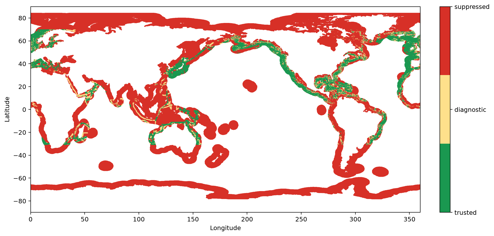
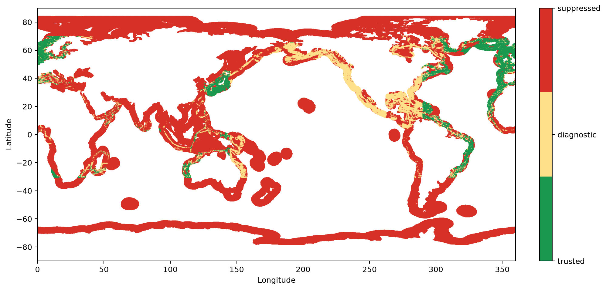
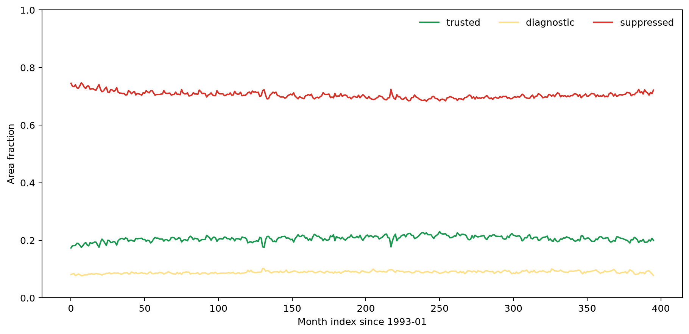
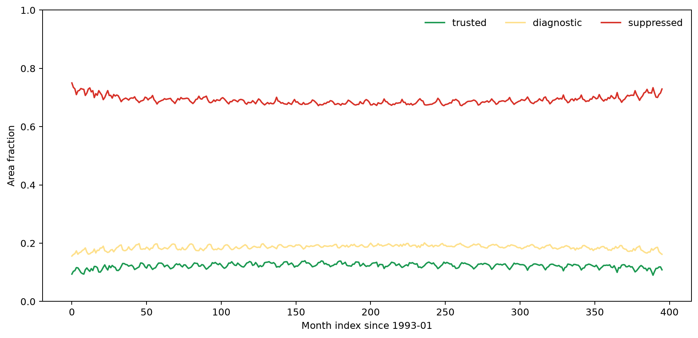
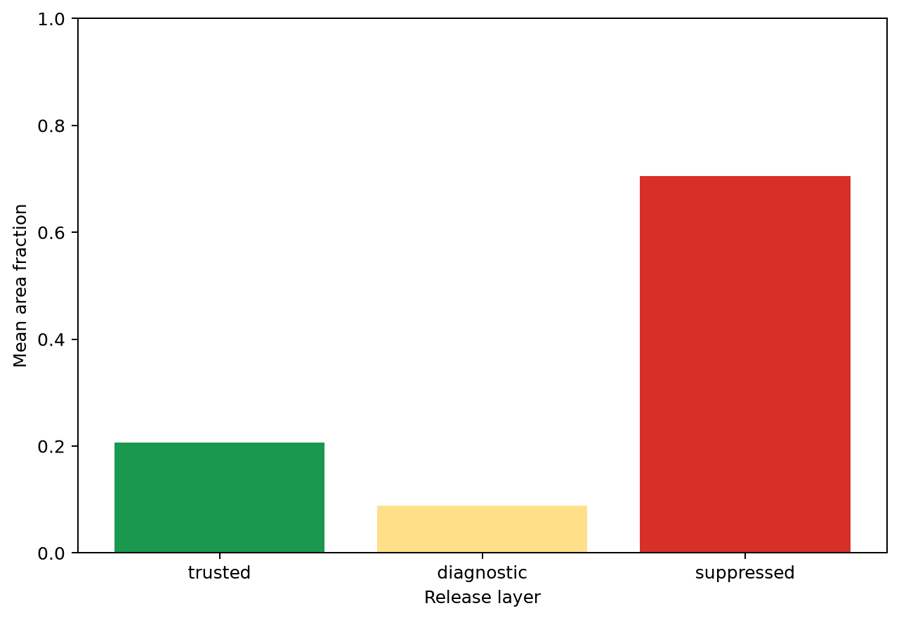
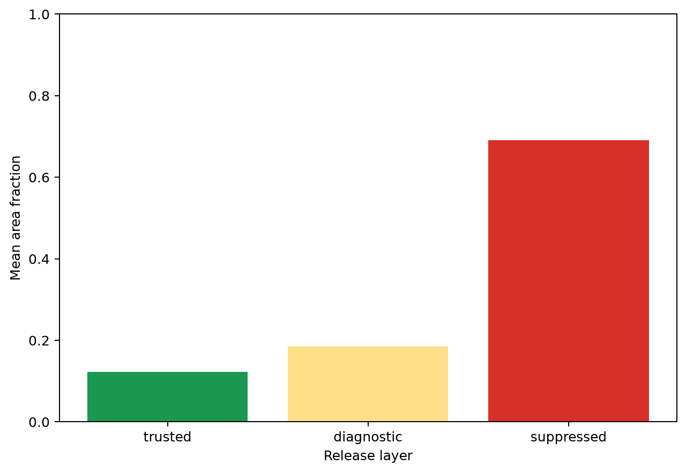
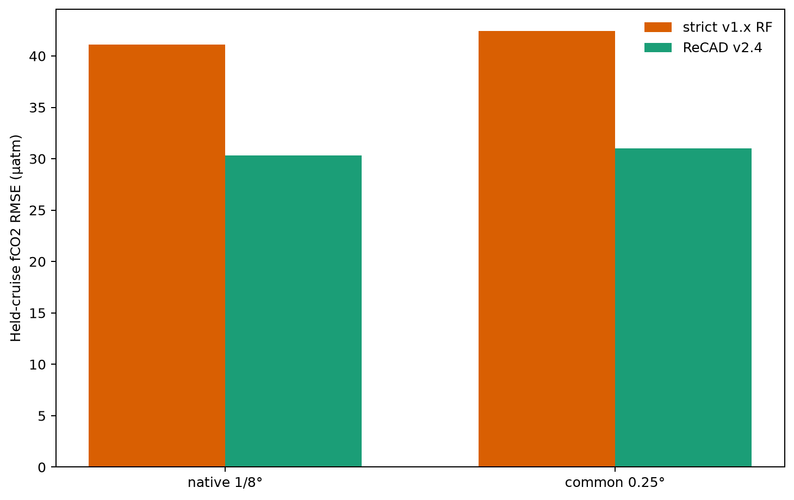
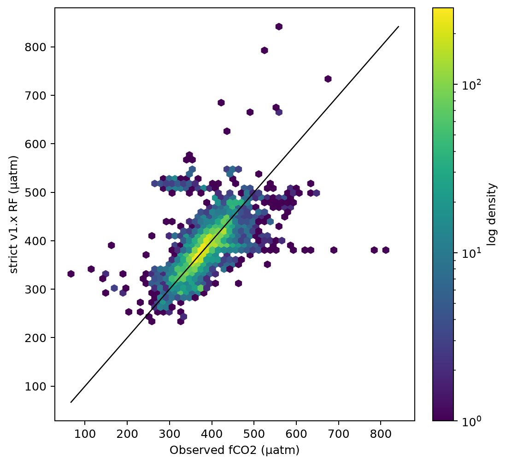
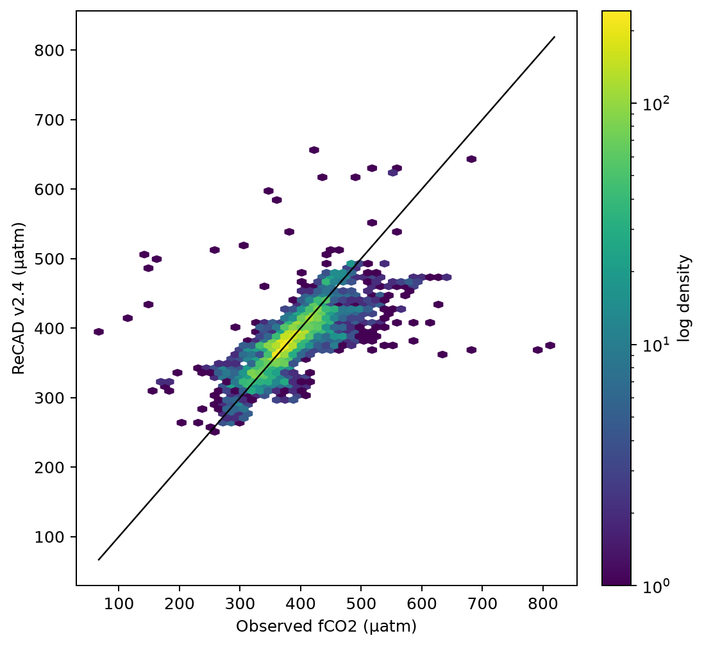
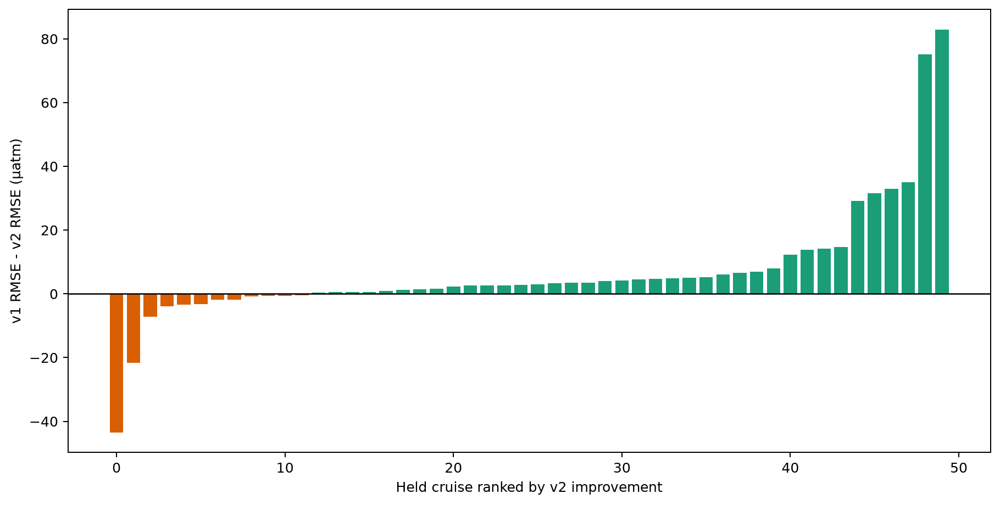

# ReCAD v2.4 conditional release

## Scientific question and permitted claim

Issue #46 converts the P3-qualified target/region/grade pairs into a versioned 1993-2025 release and tests whether fCO2 improves on a strict v1.x Random Forest under identical complete-cruise exclusion and common rows. The permitted claim is a flagged global-coastal product with same-source transfer evidence. It is not an unconditional global-accuracy or cross-dataset claim.

## Data, splits, and leakage controls

The release copies the immutable Issue-44 full-domain predictions and applies the Issue-5 decision without retraining or changing estimates. SSS A/B is trusted across represented basins; fCO2 A/B is trusted outside the coarse Pacific basin. C is diagnostic and D suppressed. TA/DIC and provisional 2026 are absent. The strict v1.x comparison trains after removing the same 50 cruises and is evaluated on 7,907 identical eligible rows; its 0.25° panel preserves cruise identity.

## Candidate models and training

The released estimates are the frozen Issue-62 SSS CatBoost background-residual ensemble and Issue-64 fCO2 continuous-background ExtraTrees/CatBoost convex ensemble. Product arrays contain the estimate, 50/90 widths, grade, status, reason bits, support diagnostics, basin ID, and separate trusted/diagnostic prediction variables. No post-P3 target tuning occurs.

## Main development results

SSS trusted area averages 20.61% and fCO2 trusted area 12.28%; diagnostic fractions are 8.91% and 18.61%, while 70.47% and 69.11% remain suppressed. Every product has 396 months and 838,661 coastal nodes, with zero release-layer consistency mismatch.

On common native rows, strict v1.x fCO2 RMSE is 41.100 µatm and v2 is 30.325 µatm, a 26.2% improvement. At cruise-preserving common 0.25°, RMSE is 42.424 versus 31.014 µatm, a 26.9% improvement. These pass the frozen 5% gate. Published v1.1 random-test and 2004-2005 values and the Northeast Pacific literature value remain context only because their labels, calibration, target basis, and domains differ.

Figure 1. December 2025 SSS release status on the native coastal nodes. Trusted, diagnostic, and suppressed layers remain geographically explicit instead of hiding difficult cells.

Figure 2. December 2025 fCO2 release status on the native coastal nodes. Pacific A/B cells are diagnostic under the P3 regional gate, while grade D remains suppressed globally.

Figure 3. Monthly area fractions of the three SSS release layers from 1993 through 2025. The trusted layer remains bounded near one fifth of coastal area rather than expanding after validation.

Figure 4. Monthly area fractions of the three fCO2 release layers from 1993 through 2025. Pacific regional restriction reduces trusted area and increases diagnostic coverage.

Figure 5. Mean 1993-2025 SSS area fraction by release layer. Most complete-domain cells remain suppressed because geographic availability is not equivalent to validated reliability.

Figure 6. Mean 1993-2025 fCO2 area fraction by release layer after the Pacific A/B downgrade. Trusted area is deliberately smaller than the Issue-44 development mask.

Figure 7. Strict v1.x Random Forest and ReCAD v2.4 fCO2 RMSE on identical complete-cruise rows at native 1/8° and cruise-preserving 0.25° aggregation. v2 improves both comparisons by more than 25%.

Figure 8. Strict v1.x Random Forest predictions against observations on the 7,907 common held-cruise rows. This control omits the published full-period local calibration that would leak future context.

Figure 9. ReCAD v2.4 predictions against observations on the same 7,907 held-cruise rows used by the strict v1.x control. The shared support makes the model comparison directly auditable.

Figure 10. Per-cruise fCO2 RMSE improvement of v2 over strict v1.x on common rows. Positive bars favor v2; remaining negative cruises are preserved rather than removed from the release evidence.

## Decision and limitations

Decision: **`release_complete_flagged_scope`**. Publish SSS/fCO2 estimates only together with grade, status, interval width, reason bits, support, and provenance. Use `trusted_prediction` for qualified analysis, `diagnostic_prediction` for hypothesis generation, and never silently fill suppressed values. Pacific fCO2 A/B remains diagnostic. TA/DIC and 2026 remain outside this release.

The products contain globally complete model estimates but only 20.6%/12.3% mean trusted area. P3 evidence is from SOCAT v2026 complete-cruise withholding and does not prove transfer to another observing system. Strict v1.x is a fair method-family control, not an exact reconstruction of its published full-period locally calibrated product. Literature scores are therefore not ranked against the new release.

## Figure and table index

Figures 1-6 show release geography and area coverage. Figures 7-10 show common-support v1.x comparisons. Tables 1-3 store release coverage and checks; Tables 4-5 store common comparison metrics and predictions; Table 6 stores literature context; Tables 7-10 store scope, variables, map provenance, and per-cruise comparison; Table 11 hashes every external artifact.
